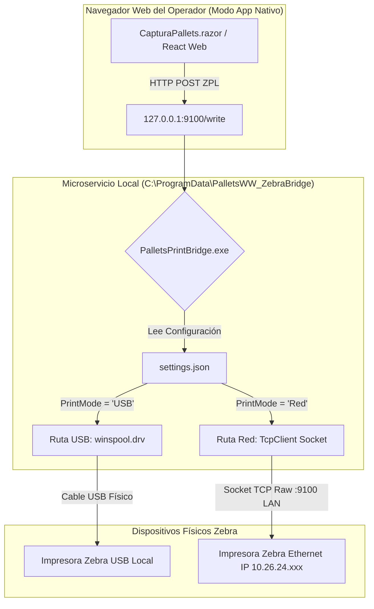

# 005 Arquitectura Dual de Impresión (USB / Red LAN), Instalador Unificado y Directivas de Despliegue IIS

**Propósito:** Especificación de ingeniería y manual operativo del sistema de impresión híbrido (USB Local y Red Ethernet LAN), instalador cliente y directivas de producción.  
**Planta:** Planta Tlaxcala - Depto 3 (Wet Wipes) y Depto Pañal (Kimberly-Clark de México)  
**Fecha:** 28/09/2026  
**Autor:** Antigravity AI Agent & Equipo de Sistemas  

---

## 1. Contexto Operativo y Caso de Uso Real (Líneas 4 y 6)

### Antecedente en Planta
En las máquinas de producción **Línea 4 (TXWW54)** y **Línea 6 (TXWW67)** se presentó una contingencia donde se descompuso una de las impresoras Zebra, quedando únicamente una impresora física operativa para ambas líneas:
- Como solución inmediata temporal, la **Máquina 6** conservó la conexión por cable **USB**, mientras que a la **Máquina 4** se le conectó mediante un cable serial (RS-232).
- Ambas máquinas cuentan con bajada de **Red Ethernet LAN** disponible en piso, lo que habilitó la oportunidad de migrar la impresión hacia conexión por **IP de Red fija** (puerto raw 9100).
- Se requería una solución robusta donde **una máquina pueda imprimir por USB y la otra por Red IP fija a la misma impresora**, o donde a futuro cualquier línea pueda migrar entre USB y Red sin necesidad de recompilar la aplicación web, sin cambiar el código frontend y sin requerir instaladores separados.

### Decisión de Arquitectura: "Camino A (El Microservicio Local PalletsPrintBridge)"
Se evaluaron dos alternativas:
- **Camino B (El Navegador imprime directo por IP):** Descartado categóricamente. Los navegadores web (Edge/Chrome) operan bajo un estricto sandbox de seguridad donde no pueden abrir sockets TCP raw hacia el puerto 9100 de una IP en la red local. Si se intenta un `fetch()` HTTP tradicional contra el puerto 9100 de una Zebra, la impresora recibe las cabeceras HTTP (`POST / HTTP/1.1...`) e imprime físicamente renglones de texto basura antes de la etiqueta.
- **Camino A (El Microservicio Local con Modo Dual):** La solución adoptada. El microservicio `PalletsPrintBridge.exe` corre en cada PC cliente escuchando en loopback local (`127.0.0.1:9100`). La aplicación web siempre envía el código ZPL al bridge local vía `POST http://127.0.0.1:9100/write`. Es el microservicio local el que inspecciona su archivo de configuración `settings.json` y decide el mecanismo de despacho:
  1. Si `PrintMode == "USB"`: Escribe directamente al driver de Windows Spooler (`winspool.drv`) con **Pause Guard** y purga de colas.
  2. Si `PrintMode == "Red"`: Abre un socket TCP (`TcpClient(PrinterIp, PrinterPort)`) en streaming crudo hacia el puerto 9100 de la impresora en la red LAN con timeout de protección de 3 segundos.

---

## 2. Diagrama de Arquitectura del Sistema de Impresión Híbrido



---

## 3. Estructura de Persistencia: `settings.json`

El archivo de configuración maestro reside en una ruta universal accesible por todos los usuarios de la terminal:
`C:\ProgramData\PalletsWW_ZebraBridge\settings.json` (para Wet Wipes)  
`C:\ProgramData\PalletsPanal_ZebraBridge\settings.json` (para Pañal)

### Ejemplo de Configuración en Modo USB (Predeterminado)
```json
{
  "machineId": 70,
  "machineName": "TXWW70",
  "serverIp": "10.26.24.31",
  "printerName": "",
  "printMode": "USB",
  "printerIp": "",
  "printerPort": 9100
}
```

### Ejemplo de Configuración en Modo Red Ethernet LAN
```json
{
  "machineId": 54,
  "machineName": "TXWW54",
  "serverIp": "10.26.24.31",
  "printerName": "",
  "printMode": "Red",
  "printerIp": "10.26.24.106",
  "printerPort": 9100
}
```

---

## 4. Instalador Unificado de Cliente: `Setup_PalletsWW_Cliente.exe`

El instalador cliente ha sido unificado en un solo binario autosuficiente (`SingleFile`) que no requiere dependencias externas ni conexión a internet durante su instalación.

### Tarjetas y Controles del Instalador

| No. | Sección / Tarjeta | Función y Componentes |
|---|---|---|
| **1** | **Línea de Producción Asignada** | ComboBox con detección automática previa del número de máquina (ej. `Línea 4 (TXWW54)`). |
| **2** | **Servidor Central IIS** | Input de dirección IP del servidor central (`10.26.24.31`) en puerto 5106. |
| **3** | **Conexión de Impresora Zebra** | **Selector Dual:**<br>• `RadioButton rbUsb`: "Zebra USB (Local por cable USB)" (Default).<br>• `RadioButton rbNetwork`: "Zebra RED (Ethernet LAN - IP Fija)".<br>• `txtPrinterIp`: Entrada de IP fija (ej. `10.26.24.106`).<br>• `txtPrinterPort`: Puerto raw (predeterminado `9100`).<br>• `btnTestPrinterIp`: Botón **"Probar Conexión"** que realiza un handshake TCP instantáneo (2.5s) y notifica visualmente si la impresora está en línea. |
| **4** | **Cuentas de Usuario en la PC** | `CheckedListBox` que enumera todos los perfiles en `C:\Users` (`Operador`, `Administrador`, etc.) para configurar accesos directos sin importar quién inicie sesión. |
| **5** | **Acciones Automatizadas** | Instalación del microservicio en `ProgramData`, alta en `Common Startup` (arranque con Windows), optimización de directivas de Edge y anclaje a Barra de Tareas. |

---

## 5. Corrección de la Barra de Tareas (Eliminación de Iconos Duplicados)

### Diagnóstico de la Causa Raíz
1. **El Bug de Windows Taskband:** Cuando un instalador simplemente copia un archivo `.lnk` a la carpeta `C:\Users\<Usuario>\AppData\Roaming\Microsoft\Internet Explorer\Quick Launch\User Pinned\TaskBar`, Windows Explorer **no registra** la clave en el registro de Windows (`HKCU\Software\Microsoft\Windows\CurrentVersion\Explorer\Taskband`).
2. **Resultado:** Al hacer clic en dicho acceso directo huérfano, Windows lanzaba una nueva instancia de Microsoft Edge (`--app="http://..."`), y como no existía vinculación en `Taskband`, el sistema operativo creaba un **segundo icono activo** a la derecha, dejando el icono anclado como un elemento "muerto" o duplicado.
3. **Pérdida de Configuración de Servidor:** Cuando el operador cambiaba la IP en la web, el bucle de actualización de accesos directos intentaba acceder a carpetas de otros usuarios (`C:\Users\Administrador`) y, al no contar con permisos elevados, lanzaba una excepción no capturada que abortaba la actualización de los accesos directos del usuario `Operador`.

### Solución Técnica Implementada
1. **Shell Verb Oficial de Windows:** En lugar de copiar archivos huérfanos a `User Pinned\TaskBar`, el instalador invoca el verbo nativo de Windows Shell (`"Anclar a la barra de tareas"` / `"Pin to taskbar"`) sobre el acceso directo del escritorio del usuario activo. Esto escribe el identificador nativo en el registro de Windows `Taskband`.
2. **Plantilla `LayoutModification.xml`:** Se despliega en `AppData\Local\Microsoft\Windows\Shell` asegurando que Windows 10 y 11 lean la asignación de barra de tareas al arrancar la sesión.
3. **Aislamiento por Perfil en `PalletsPrintBridge`:** El bucle que recorre `C:\Users` envuelve cada usuario individual en bloques `try { ... } catch { }`, garantizando que si una carpeta de usuario administrativa deniega el acceso a un operador restringido, los accesos del propio operador se sincronicen al 100% en:
   - Escritorio del usuario (`Desktop`)
   - Barra de tareas activa (`User Pinned\TaskBar`)
   - Accesos implícitos de Edge (`User Pinned\ImplicitAppShortcuts`)
   - Menú Inicio (`Start Menu\Programs`)

---

## 6. Guía Rápida para Soporte Técnico / TI (Configurar Máquina en 30 Segundos)

### Escenario A: Configurar Máquina con Impresora de Red (ej. Máquina 4)
1. Conectar el cable de red Ethernet a la impresora Zebra y verificar que obtenga su IP fija (ej. `10.26.24.106`).
2. Ejecutar `Setup_PalletsWW_Cliente.exe` con clic derecho -> **Ejecutar como administrador**.
3. El instalador detectará la línea automáticamente.
4. En la Tarjeta **3. Conexión de Impresora Zebra**, seleccionar **"Zebra RED"**.
5. Escribir la IP de la impresora: `10.26.24.106` (Puerto: `9100`).
6. Hacer clic en **"Probar Conexión"**. Aparecerá una confirmación verde: `✓ OK (9100)`.
7. Hacer clic en **"⚡ INSTALAR Y CONFIGURAR AHORA"**.
8. Listo. La máquina imprimirá a través de la red local sin requerir ningún cambio en el servidor web.

### Escenario B: Revertir o Configurar Máquina con Impresora USB (ej. Máquina 6)
1. Conectar la impresora Zebra por cable USB a la computadora.
2. Ejecutar `Setup_PalletsWW_Cliente.exe` como administrador.
3. En la Tarjeta **3. Conexión de Impresora Zebra**, seleccionar **"Zebra USB"**.
4. Hacer clic en **"⚡ INSTALAR Y CONFIGURAR AHORA"**.
5. El instalador actualizará `settings.json` a modo USB y enrutará la impresión hacia el driver Spooler de Windows.

---

## 7. Políticas Mandatorias de Despliegue en IIS (AGENTS.md)

Para garantizar la continuidad operativa en las líneas de producción, se establecen las siguientes reglas estrictas:

1. **PROHIBIDO el Despliegue Automático:**
   El Agente de IA tiene **estrictamente prohibido** publicar código a IIS de manera automática tras realizar modificaciones locales.
2. **Publicación Exclusiva por Comando Explícito:**
   El Agente únicamente compilará y copiará archivos a las carpetas de publicación de IIS (`C:\PublishIIS\PalletsWW_PC.Blazor.Publish\` o `C:\PublishIIS\PalletsWW_PC.Api.Publish\`) cuando el usuario escriba de forma textual y explícita en el chat:
   > *"publica los cambios"* o *"despliega a producción"*
3. **Despliegue Atómico Zero-Downtime:**
   - **Queda prohibido** detener el sitio web o el Application Pool de IIS manualmente.
   - **Queda prohibido** eliminar carpetas completas en caliente (lo que provoca el error `503 Service Unavailable` y desconecta los terminales de producción).
   - Se debe utilizar sincronización diferencial atómica (`robocopy /MIR` o Shadow Copy de .NET Core) para que los navegadores mantengan la sesión activa sin interrupción.