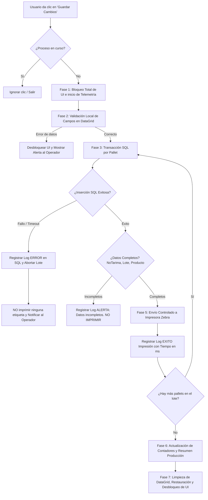

# 005 - Plan de Implementación Pallets Wipes V3: Bloqueo Integral de Aplicación, Transaccionalidad de Lote (DataGrid) y Telemetría de Operaciones

**Proyecto:** clsA_P035_PallestWipes  
**Base de Datos:** TLX022MXDB  
**Servidor:** MXTLAS02 (Desarrollo: DESKTOP-GNLGUOC)  
**Fecha:** 16 de Septiembre de 2026  
**Documento Previo:** `002 Modificaciones de App Wipes.md`  

---

## 1. Diagnóstico Certero del Problema en Producción

### Síntomas Reportados por Operación
1. **Envío de múltiples etiquetas:** Al presentarse lentitud en la red de planta, la aplicación envía múltiples etiquetas por una misma operación o por un mismo lote de captura.
2. **Etiquetas con información incompleta:** Las etiquetas salen de la impresora Zebra con campos críticos totalmente en blanco (sin Número de Tarima, sin Lote, sin Clave de Producto o sin Cajas).
3. **Descoordinación operativa:** El bloqueo transaccional actual solo opera dentro del Stored Procedure en SQL Server (`pa_P009_01006_tblPalletsInsertcmdV02`), pero la aplicación cliente (.NET) carece de un bloqueo transaccional de extremo a extremo que proteja desde que el operador da clic en "Guardar" hasta que se confirma la impresión y la actualización de los contadores.

---

### Análisis de Causas Raíz (Root Cause Analysis)

#### Causa Raíz 1: Ausencia de Bloqueo a Nivel UI / Capa de Aplicación (Reentrancia y Doble Clic)
- En `frm_001_Pallets.vb`, el evento `lnkGuardardgvDatos1_LinkClicked`:
  - **No deshabilita el enlace ni los controles:** `lnkGuardardgvDatos1.Enabled = False` no se ejecuta.
  - **No cambia el cursor ni muestra indicador de espera:** El operador no recibe confirmación visual de que la red está procesando la solicitud.
  - **Reentrancia por clics repetidos:** Ante una latencia de red de 10 a 30 segundos, el operador asume que el sistema "no respondió" y vuelve a dar clic varias veces sobre "GUARDAR/MODIFICAR CAMBIOS".
  - Cada clic invoca nuevamente `slnkGuardardgvDatos1_LinkClicked`, disparando inserciones concurrentes o reintentos sobre el mismo DataSet.
  - Además, los timers de fondo como `tmrRegistros` siguen ejecutando consultas periódicas (`pa_P007_002_LlenardgvComidas` en `TLX012MXDB`), saturando aún más el ancho de banda degradado.

#### Causa Raíz 2: Impresión Prematura y a Ciegas en el Evento `OnRowUpdated`
- En `clsU_00901_dgv.vb`, la impresión de la etiqueta está colocada dentro del evento de bajo nivel `daLlenarDataGridView.RowUpdated`:
  ```vb
  Private Sub OnRowUpdated(ByVal sender As Object, ByVal e As SqlRowUpdatedEventArgs)
      If e.StatementType = StatementType.Insert Then
          ccm = New SqlCommand("SELECT @@IDENTITY", e.Command.Connection)
          intFolio = ccm.ExecuteScalar
          With clU_SQL.fcmSQLEjecutaMXTLAS02("TLX022MXDB", intEnumType, strSQL)
              .Parameters.AddWithValue("@IdtblPallets", intFolio)
              rdr = .ExecuteReader
              With rdr
                  While .Read
                      Fecha = .GetValue(0)
                      ...
  ```
- **Falta de validación de `e.Status`:** Si la inserción en SQL falló o tuvo un timeout de red, `OnRowUpdated` se dispara de todos modos sin validar si la fila se insertó correctamente.
- **Segunda conexión innecesaria y propensa a fallos de red:** Tras insertar la fila, la app abre una **segunda conexión independiente** (`fcmSQLEjecutaMXTLAS02`) para consultar `pa_P009_01010_btnImprimirEtiqueta_click`. Si la red sufre intermitencia en ese instante, la segunda consulta falla o no devuelve registros.

#### Causa Raíz 3: Variables ZPL en Blanco se Envían Directamente a la Impresora
- Si la consulta de datos del pallet no devuelve registros (`rdr.Read() = False`) o se produce una excepción:
  - Las variables locales (`strNoTarima`, `strLote`, `strClaveProducto`, `strDescProducto`, `strNoCajas`) conservan su inicialización por defecto: **cadenas vacías `""`**.
  - El código no cuenta con ninguna validación defensiva previa a la impresión. Procede inmediatamente a concatenar el comando ZPL:
    `^FD" & strNoTarima & "^FS` $\rightarrow$ genera `^FD^FS`
  - Y ejecuta `clU_Utilszebra.ImprimePaquete(_Text)`.
  - **Consecuencia directa:** La impresora Zebra imprime etiquetas vacías o mutiladas.

#### Causa Raíz 4: Inconsistencia en Lotes Multi-Pallet del DataGrid
- El DataGrid `dgvDatos1` permite capturar 1 o varios pallets antes de guardar.
- El método `daLlenarDataGridView.Update(dsChanges, "Table1")` itera fila por fila sin una transacción de aplicación que abarque todo el lote.
- Si en un lote de 3 pallets la fila 1 se guarda y se imprime, pero la fila 2 sufre un error de red:
  - La fila 1 ya se guardó e imprimió.
  - La fila 2 falló.
  - El `AcceptChanges()` del DataSet nunca se ejecuta (porque `Update` arrojó excepción).
  - Al reintentar el guardado, la fila 1 **se vuelve a procesar**, duplicando la etiqueta ya impresa.

---

## 2. Arquitectura de la Solución V3 (Pipeline Atómico de 7 Fases)

Para resolver definitivamente el problema, la operación debe orquestarse como un **Pipeline Atómico Unificado** que controle la UI, la persistencia en base de datos, la validación estricta de datos y la emisión física de etiquetas.



---

## 3. Sistema de Telemetría y Logging en SQL Server (`TLX022MXDB`)

Se diseñó e implementó vía MCP una tabla especializada de auditoría y telemetría operativa para monitorear en tiempo real los milisegundos que toma cada paso de la operación y diagnosticar fallas de red.

### Tabla: `dbo.tblLog_PalletsWipes`
```sql
CREATE TABLE [dbo].[tblLog_PalletsWipes] (
    [IdLog] BIGINT IDENTITY(1,1) NOT NULL PRIMARY KEY,
    [FechaHora] DATETIME NOT NULL CONSTRAINT DF_tblLog_PalletsWipes_FechaHora DEFAULT GETDATE(),
    [IdTransaccion] UNIQUEIDENTIFIER NOT NULL,
    [NoMaquina] INT NULL,
    [IdtblProductos] INT NULL,
    [FolioVale] INT NULL,
    [IdtblPallets] INT NULL,
    [NoTarima] NVARCHAR(50) NULL,
    [Lote] NVARCHAR(50) NULL,
    [TotalCajas] INT NULL,
    [Accion] VARCHAR(50) NOT NULL,
    [Estatus] VARCHAR(30) NOT NULL,
    [TiempoMs] INT NOT NULL CONSTRAINT DF_tblLog_PalletsWipes_TiempoMs DEFAULT 0,
    [Mensaje] NVARCHAR(1000) NULL,
    [DetalleError] NVARCHAR(MAX) NULL,
    [NoEmpleado] INT NULL,
    [NombreEquipo] NVARCHAR(100) NULL,
    [UsuarioWindows] NVARCHAR(100) NULL
);

CREATE NONCLUSTERED INDEX IX_tblLog_PalletsWipes_FechaHora ON [dbo].[tblLog_PalletsWipes] ([FechaHora] DESC);
CREATE NONCLUSTERED INDEX IX_tblLog_PalletsWipes_IdTransaccion ON [dbo].[tblLog_PalletsWipes] ([IdTransaccion]);
CREATE NONCLUSTERED INDEX IX_tblLog_PalletsWipes_NoTarima ON [dbo].[tblLog_PalletsWipes] ([NoTarima]);
```

### Stored Procedure de Registro: `dbo.pa_P009_01006_tblLogPalletsWipesInsert`
Diseñado con protección interna `TRY...CATCH` para garantizar que la recolección de telemetría sea ultraligera y nunca interrumpa la operación productiva.

```sql
CREATE OR ALTER PROCEDURE [dbo].[pa_P009_01006_tblLogPalletsWipesInsert]
    @IdTransaccion UNIQUEIDENTIFIER,
    @NoMaquina INT = NULL,
    @IdtblProductos INT = NULL,
    @FolioVale INT = NULL,
    @IdtblPallets INT = NULL,
    @NoTarima NVARCHAR(50) = NULL,
    @Lote NVARCHAR(50) = NULL,
    @TotalCajas INT = NULL,
    @Accion VARCHAR(50),
    @Estatus VARCHAR(30),
    @TiempoMs INT = 0,
    @Mensaje NVARCHAR(1000) = NULL,
    @DetalleError NVARCHAR(MAX) = NULL,
    @NoEmpleado INT = NULL,
    @NombreEquipo NVARCHAR(100) = NULL,
    @UsuarioWindows NVARCHAR(100) = NULL
AS
BEGIN
    SET NOCOUNT ON;
    BEGIN TRY
        INSERT INTO [dbo].[tblLog_PalletsWipes] (
            [IdTransaccion], [NoMaquina], [IdtblProductos], [FolioVale],
            [IdtblPallets], [NoTarima], [Lote], [TotalCajas],
            [Accion], [Estatus], [TiempoMs], [Mensaje],
            [DetalleError], [NoEmpleado], [NombreEquipo], [UsuarioWindows]
        )
        VALUES (
            @IdTransaccion, @NoMaquina, @IdtblProductos, @FolioVale,
            @IdtblPallets, @NoTarima, @Lote, @TotalCajas,
            @Accion, @Estatus, @TiempoMs, @Mensaje,
            @DetalleError, @NoEmpleado, @NombreEquipo, @UsuarioWindows
        );
    END TRY
    BEGIN CATCH
        -- Silenciar error del log para no afectar la transacción principal
    END CATCH
END;
```

### Eventos Registrados por el Sistema de Telemetría:
| Acción | Estatus Posibles | Qué Mide |
| :--- | :--- | :--- |
| `TRANSACCION_GLOBAL` | `INICIADO`, `EXITO`, `ERROR` | Tiempo total de todo el lote desde clic hasta fin. |
| `VALIDACION_PREVIA` | `EXITO`, `ERROR_DATOS` | Validación en memoria de campos obligatorios. |
| `GUARDAR_SQL` | `EXITO`, `ERROR`, `TIMEOUT` | Milisegundos exactos que tarda la ejecución en SQL Server. |
| `CONSULTA_ETIQUETA` | `EXITO`, `DATOS_INCOMPLETOS`, `ERROR` | Tiempo en recuperar datos para armar el ZPL. |
| `IMPRIMIR_ETIQUETA` | `EXITO`, `BLOQUEADO_POR_DATOS`, `ERROR` | Tiempo de envío al spooler / impresora Zebra. |
| `ACTUALIZAR_CONTADORES` | `EXITO`, `ERROR` | Tiempo en refrescar resúmenes de producción en pantalla. |

---

## 4. Cambios Técnicos Detallados en la Aplicación (.NET / Visual Basic)

### 1. `clsA\frm_001_Pallets.vb` (Bloqueo de Interfaz de Usuario)
- **Bandera de Protección:**
  ```vb
  Private _isSaving As Boolean = False
  ```
- **En `lnkGuardardgvDatos1_LinkClicked`:**
  ```vb
  If _isSaving Then Exit Sub
  _isSaving = True
  
  ' Bloqueo visual y funcional
  lnkGuardardgvDatos1.Enabled = False
  dgvDatos1.Enabled = False
  Me.Cursor = Cursors.WaitCursor
  tmrRegistros.Stop() ' Pausar timer de fondo para liberar ancho de banda
  
  Try
      ' Llamar a la lógica de guardado pasando control de transacción
      ...
  Finally
      ' Restauración garantizada en cualquier escenario (éxito o error)
      _isSaving = False
      lnkGuardardgvDatos1.Enabled = True
      dgvDatos1.Enabled = True
      Me.Cursor = Cursors.Default
      tmrRegistros.Start()
  End Try
  ```

### 2. `clsU\clsU_00901_dgv.vb` y `clsD\clsD_0001_tblPallets.vb` (Separación de Guardado e Impresión)
- **Desacoplar la impresión de `OnRowUpdated`:**
  - Actualmente `OnRowUpdated` imprime inmediatamente durante el evento interno de `DataAdapter`.
  - Se debe modificar para que `sGuardarCambiosdgvTable1` recopile los IDs y filas guardadas exitosamente.
  - La impresión de etiquetas se ejecuta en una fase posterior, **únicamente si el guardado en SQL fue 100% confirmado y los datos están completos**.

### 3. Validación Inviolable Previa al Envío ZPL (`clsU_00901_dgv.vb` / `clsF_001_frm_001_Pallets.vb`)
- **Filtro Estricto Anti-Etiquetas Incompletas:**
  ```vb
  If intFolio <= 0 OrElse String.IsNullOrWhiteSpace(strNoTarima) OrElse _
     String.IsNullOrWhiteSpace(strLote) OrElse String.IsNullOrWhiteSpace(strClaveProducto) Then
      
      ' Registrar anomalía en la telemetría de SQL
      clsU_TelemetryLog.RegistrarLog(idTransaccion, intNoMaquina, intIdProducto, intFolioVale, _
          intFolio, strNoTarima, strLote, intTotalCajas, "IMPRIMIR_ETIQUETA", "BLOQUEADO_POR_DATOS", _
          0, "Impresión bloqueada: Datos incompletos detectados", Nothing, intNoEmpleado)
      
      MsgBox("Atención: No se pudo imprimir la etiqueta porque los datos del pallet están incompletos. " & _
             "El pallet quedó guardado con Folio " & intFolio & ". Puede reimprimirlo desde la pestaña Reimpresión.", _
             MsgBoxStyle.Exclamation, strNombreApp)
      Exit Sub
  End If
  ```

### 4. Nueva Clase de Telemetría: `clsU\clsU_TelemetryLog.vb`
- Creación de un componente desacoplado que utiliza `Stopwatch` para medir tiempos precisos y llama a `pa_P009_01006_tblLogPalletsWipesInsert` sin comprometer el rendimiento del hilo principal.

---

## 5. Consultas de Monitoreo y Diagnóstico de Red para Operaciones

Una vez desplegada la versión V3, los supervisores y el equipo de sistemas podrán consultar en cualquier momento la salud de la red y los tiempos de respuesta mediante las siguientes consultas SQL sobre `TLX022MXDB`:

### Consulta 1: Tiempos de Respuesta de SQL y de Impresión en las Últimas 24 Horas
```sql
USE [TLX022MXDB];
GO

SELECT 
    Accion,
    Estatus,
    COUNT(*) AS TotalEventos,
    AVG(TiempoMs) AS PromedioMs,
    MIN(TiempoMs) AS MinimoMs,
    MAX(TiempoMs) AS MaximoMs
FROM dbo.tblLog_PalletsWipes
WHERE FechaHora >= DATEADD(HOUR, -24, GETDATE())
GROUP BY Accion, Estatus
ORDER BY Accion, Estatus;
```

### Consulta 2: Detección de Operaciones Lentas (> 3 Segundos) o con Error por Máquina
```sql
USE [TLX022MXDB];
GO

SELECT 
    FechaHora,
    NombreEquipo,
    NoMaquina,
    Accion,
    Estatus,
    TiempoMs,
    Mensaje,
    DetalleError
FROM dbo.tblLog_PalletsWipes
WHERE (TiempoMs > 3000 OR Estatus IN ('ERROR', 'TIMEOUT', 'BLOQUEADO_POR_DATOS'))
  AND FechaHora >= DATEADD(DAY, -7, GETDATE())
ORDER BY FechaHora DESC;
```

---

## 6. Resumen de Seguridad e Integridad Operativa

> [!IMPORTANT]
> **Cero Pérdida de Información y Cero Afectación:**
> 1. **Base de Datos:** La tabla de logs `tblLog_PalletsWipes` y su SP son complementarios y no interfieren con ninguna tabla transaccional productiva.
> 2. **Impresión:** Se garantiza matemáticamente que ninguna etiqueta se enviará a Zebra si la base de datos no confirmó su folio o si algún campo clave está vacío.
> 3. **Concurrencia:** El operador ya no podrá enviar múltiples peticiones por impaciencia ante retardos de la red gracias al bloqueo de UI y protección anti-reentrancia.
