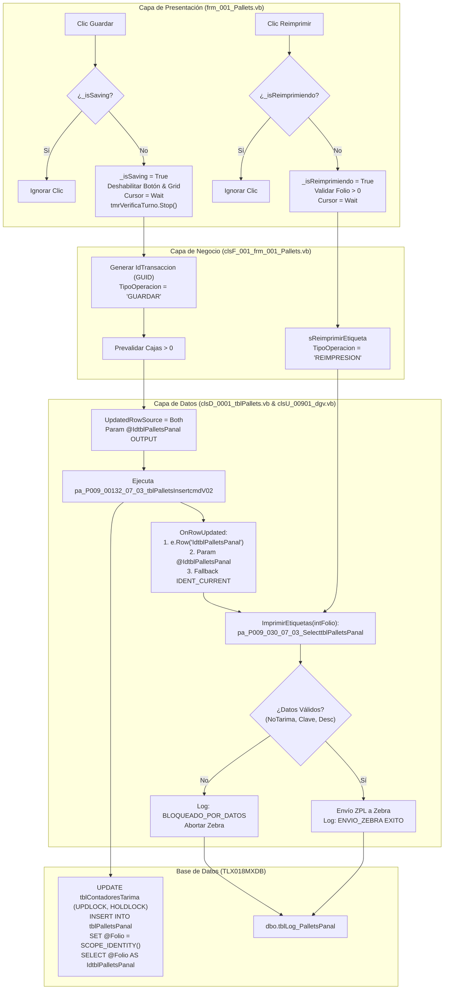

# 007 - Plan de Implementación: Pallets Pañal V3 (Estabilización Integral, Telemetría y Eliminación de Duplicidad)

**Proyecto:** PROY052_PalletsPanal  
**Base de Datos:** TLX018MXDB  
**Servidor:** MXTLAS02 (Desarrollo: DESKTOP-GNLGUOC)  
**Fecha:** 16 de Septiembre de 2026  
**Documentos de Referencia:**  
- `001 Modificaciones de App.md` (Modificaciones iniciales de Pañal)  
- `002 Modificaciones de App Wipes.md` (Incidencias iniciales en Toallitas)  
- `005 Plan de Implementacion Pallets WW V3.md` (Arquitectura V3 de Toallitas)  
- `006 Cambios en Pallets WW V3.md` (Resolución definitiva y lecciones aprendidas en Wipes)  
- `007_Despliegue_Produccion_Pallets_WW_V3.sql` (Script probado en producción)

---

## 1. Diagnóstico Forense y Causa Raíz en Pallets Pañal

Tras la estabilización exitosa de la aplicación hermana **Pallets WW** (`clsA_P035_PallestWipes`), se identificó que **Pallets Pañal** (`PROY052_PalletsPanal`) continuó experimentando problemas intermitentes de **etiquetas repetidas, saltadas o impresiones con datos inconsistentes**. 

El análisis exhaustivo del código fuente y la base de datos `TLX018MXDB` reveló las causas exactas:

### Falla Crítica 1: El Query Inseguro en `OnRowUpdated` (`SELECT TOP 1 ... ORDER BY DESC`)
En `clsU_00901_dgv.vb` (líneas 572-575):
```vb
ccm = New SqlCommand("SELECT TOP (1) IdtblPalletsPanal FROM tblPalletsPanal a@1 INNER JOIN tblRT_Produccion a@2 " &
"ON a@1.IdAutotblProduccion = a@2.IdAutotblProduccion " &
"WHERE a@1.NoMaquina = " & fNoMaquina & " AND a@2.LineaEmpaque = " & fNoLineaa & " ORDER BY a@1.IdtblPalletsPanal DESC", e.Command.Connection)
intFolio = ccm.ExecuteScalar
```
- **Por qué falla:** Este query se implementó porque el SP no devolvía el `SCOPE_IDENTITY()`. Sin embargo, bajo condiciones de red lenta, concurrencia de líneas (14 líneas concurrentes entre 7 máquinas) o cuando se guardan lotes de 2 o más pallets, este `SELECT TOP 1` **NO** recupera el pallet que se acaba de insertar en la fila actual, sino el último que encuentra registrado.
- **Consecuencia:** Si hay un retardo, reintento o inserción simultánea, `intFolio` toma el folio de un pallet anterior o de otra línea, **reimprimiendo la etiqueta del pallet previo y repitiendo la tarima**.

### Falla Crítica 2: Falta de `SCOPE_IDENTITY()` y Parámetro OUTPUT en `pa_P009_00132_07_03_tblPalletsInsertcmdV02`
- En el procedimiento actual `pa_P009_00132_07_03_tblPalletsInsertcmdV02`, se realiza el `INSERT INTO tblPalletsPanal`, pero **no** se captura `SCOPE_IDENTITY()`, **no** tiene parámetro `@IdtblPalletsPanal OUTPUT`, y **no** retorna el `SELECT @FolioPallet AS IdtblPalletsPanal;`.
- En la capa de datos (`clsD_0001_tblPallets.vb`), no se ha configurado `cmInsertCmd.UpdatedRowSource = UpdateRowSource.Both`.
- Por ende, el `DataAdapter` de ADO.NET no puede mapear el ID autogenerado de vuelta a `e.Row("IdtblPalletsPanal")`.

### Falla Crítica 3: Falta de Filtro Anti-Etiquetas en Blanco / Repetidas en `ImprimirEtiquetas`
En `clsU_00901_dgv.vb` (línea 613):
- Las variables `strNoTarima`, `strClaveProducto`, `strDescProducto` son globales a nivel de módulo o clase.
- Si el lector de datos (`rdr.Read()`) no encuentra registros (porque `ParamintFolio` vino en 0, no existe o hubo microcorte), el bucle `While .Read` no se ejecuta, pero la rutina **continúa y envía a la impresora Zebra el ZPL con los datos que quedaron en memoria del pallet anterior**, duplicando físicamente la etiqueta.

### Falla Crítica 4: Ausencia Total de Bloqueo UI y Anti-Doble Clic
- En `frm_001_Pallets.vb`, los eventos `lnkGuardardgvDatos1_LinkClicked` y `lnkReimprimir_LinkClicked` no tienen banderas de protección (`_isSaving`, `_isReimprimiendo`).
- El operador puede presionar "Guardar" múltiples veces mientras la red está lenta, provocando ejecuciones paralelas de guardado.
- El grid `dgvDatos1` permanece editable durante el guardado.
- El temporizador de fondo `tmrVerificaTurno` sigue activo durante la transacción, pudiendo refrescar estructuras de datos en pleno guardado.

### Falla Crítica 5: Procedimiento de Reimpresión Desalineado
- En `clsF_001_frm_001_Pallets.vb`, la rutina `sReimprimirEtiqueta` intenta ejecutar `pa_P009_01010_btnImprimirEtiqueta_click`, el cual **no existe** en `TLX018MXDB` (pertenece a la base de Wipes).
- Mientras tanto, el botón `cbtnImprimir` del grid ejecuta `ImprimirEtiquetas` sin confirmación de usuario ni logging. Ambos flujos deben unificarse.

### Falla Crítica 6: Cero Observabilidad y Telemetría
- En `TLX018MXDB` no existe ninguna tabla de logs. Ante una queja de lentitud o etiquetas saltadas, es imposible determinar si el retraso ocurrió en SQL Server, en la red de planta, en el socket de la impresora Zebra, o si fue un error de interfaz.

---

## 2. Objetivos del Plan de Implementación V3

1. **Garantizar Identidad Absoluta e Inmune a Triggers:** Capturar inmediatamente `SCOPE_IDENTITY()` dentro del SP y retornarlo vía parámetro `OUTPUT` y `ResultSet` a ADO.NET (`UpdatedRowSource.Both`), erradicando para siempre el `SELECT TOP 1`.
2. **Bloqueo Inviolable de Interfaz de Usuario:** Implementar banderas de reentrancia (`_isSaving`, `_isReimprimiendo`), deshabilitar controles durante el procesamiento, pausar temporizadores de fondo y colocar cursor en espera (`WaitCursor`).
3. **Filtro Defensivo Anti-Etiquetas en Blanco / Repetidas:** Abortar inmediatamente cualquier envío a Zebra si la consulta no devuelve datos completos (`NoTarima`, `ClaveProducto`, `DescProducto`), evitando desperdicio y duplicidades.
4. **Infraestructura de Telemetría Completa:** Crear la tabla `dbo.tblLog_PalletsPanal` y el SP `dbo.pa_P009_00132_tblLogPalletsPanalInsert` en `TLX018MXDB`, registrando tiempos exactos (en milisegundos) y diferenciando entre `GUARDAR` y `REIMPRESION`.
5. **Unificación y Validación de Reimpresión:** Validar entrada numérica estricta, conectar al SP correcto de Pañal (`pa_P009_030_07_03_SelecttblPalletsPanal`) y unificar el comportamiento de la reimpresión manual y la del grid.

---

## 3. Arquitectura y Módulos a Modificar



---

## 4. Detalle de Componentes y Cambios Técnicos

### Módulo 1: Base de Datos (`TLX018MXDB`)

#### 1.1 Nueva Tabla de Telemetría: `dbo.tblLog_PalletsPanal`
Estructura idéntica y compatible con la probada en Wipes:
```sql
CREATE TABLE [dbo].[tblLog_PalletsPanal] (
    [IdLog]           BIGINT IDENTITY(1,1) NOT NULL PRIMARY KEY CLUSTERED,
    [FechaHora]       DATETIME NOT NULL CONSTRAINT DF_tblLog_PalletsPanal_FechaHora DEFAULT GETDATE(),
    [IdTransaccion]   UNIQUEIDENTIFIER NOT NULL,
    [TipoOperacion]   VARCHAR(20) NOT NULL CONSTRAINT DF_tblLog_PalletsPanal_TipoOperacion DEFAULT 'GUARDAR', -- 'GUARDAR', 'REIMPRESION'
    [NoMaquina]       INT NULL,
    [IdtblProductos]  INT NULL,
    [FolioVale]       INT NULL,
    [IdtblPallets]    INT NULL, -- IdtblPalletsPanal
    [NoTarima]        NVARCHAR(50) NULL,
    [Lote]            NVARCHAR(50) NULL,
    [TotalCajas]      INT NULL,
    [Accion]          VARCHAR(50) NOT NULL,
    [Estatus]         VARCHAR(30) NOT NULL,
    [TiempoMs]        INT NOT NULL CONSTRAINT DF_tblLog_PalletsPanal_TiempoMs DEFAULT 0,
    [Mensaje]         NVARCHAR(1000) NULL,
    [DetalleError]    NVARCHAR(MAX) NULL,
    [NoEmpleado]      INT NULL,
    [NombreEquipo]    NVARCHAR(100) NULL,
    [UsuarioWindows]  NVARCHAR(100) NULL
);
```

#### 1.2 Índices de Rendimiento para Telemetría:
- `IX_tblLog_PalletsPanal_FechaHora` sobre `([FechaHora] DESC)`
- `IX_tblLog_PalletsPanal_IdTransaccion` sobre `([IdTransaccion])`
- `IX_tblLog_PalletsPanal_NoTarima` sobre `([NoTarima])`
- `IX_tblLog_PalletsPanal_TipoOperacion` sobre `([TipoOperacion])`

#### 1.3 Procedimiento Almacenado de Telemetría: `dbo.pa_P009_00132_tblLogPalletsPanalInsert`
- Ultraligero, con bloque `BEGIN TRY...END TRY / BEGIN CATCH...END CATCH` para que **bajo ninguna circunstancia** un fallo en el log afecte el guardado del pallet.
- Recibe `@TipoOperacion VARCHAR(20) = 'GUARDAR'`.

#### 1.4 Actualización de `dbo.pa_P009_00132_07_03_tblPalletsInsertcmdV02`:
- Agregar parámetro: `@IdtblPalletsPanal INT = NULL OUTPUT`.
- Inmediatamente después del `INSERT INTO tblPalletsPanal`:
  ```sql
  SET @FolioPallet = SCOPE_IDENTITY();
  ```
- Antes de confirmar:
  ```sql
  SET @IdtblPalletsPanal = @FolioPallet;
  COMMIT TRANSACTION;
  SELECT @FolioPallet AS IdtblPalletsPanal;
  ```

---

### Módulo 2: Capa de Presentación (.NET / `clsA\frm_001_Pallets.vb`)

1. **Declaración de Banderas de Concurrencia:**
   ```vb
   Private _isSaving As Boolean = False
   Private _isReimprimiendo As Boolean = False
   ```
2. **Protección Integral en `lnkGuardardgvDatos1_LinkClicked`:**
   - Si `_isSaving = True`, ignorar evento de inmediato (`Exit Sub`).
   - Bloqueo de entrada: `_isSaving = True`, `lnkGuardardgvDatos1.Enabled = False`, `dgvDatos1.Enabled = False`, `Cursor = Cursors.WaitCursor`.
   - Pausa preventiva de temporizador: `tmrVerificaTurno.Stop()`.
   - En el bloque `Finally`: restaurar `_isSaving = False`, `lnkGuardardgvDatos1.Enabled = True`, `dgvDatos1.Enabled = True`, `Cursor = Cursors.Default`, y reactivar `tmrVerificaTurno.Start()`.
3. **Protección Integral en `lnkReimprimir_LinkClicked`:**
   - Si `_isReimprimiendo = True`, ignorar evento de inmediato (`Exit Sub`).
   - Validación de folio: comprobar que `txtIdFolioPallet.Text` contenga un valor numérico entero mayor a 0 antes de procesar.
   - Bloqueo de entrada: `_isReimprimiendo = True`, `lnkReimprimir.Enabled = False`, `Cursor = Cursors.WaitCursor`, pausar temporizador.
   - En bloque `Finally`: restaurar estado y habilitar controles.

---

### Módulo 3: Capa de Negocio (.NET / `clsF\clsF_001_frm_001_Pallets.vb`)

1. **Orquestación de Lote en `slnkGuardardgvDatos1_LinkClicked`:**
   - Generación de `IdTransaccion = Guid.NewGuid()`.
   - Establecer `TipoOperacion = "GUARDAR"`.
   - Registro de telemetría para el ciclo de guardado.
2. **Corrección y Unificación de `sReimprimirEtiqueta`:**
   - Corregir el Stored Procedure: invocar `pa_P009_030_07_03_SelecttblPalletsPanal` en lugar del inexistente SP de Wipes.
   - Establecer `TipoOperacion = "REIMPRESION"`.
   - Incorporar validación defensiva anti-etiquetas en blanco.
   - Registrar telemetría de la reimpresión (`CONSULTA_ETIQUETA` y `ENVIO_ZEBRA`).
3. **Delegación en `sdgvDatos1_CellClick` (`cbtnImprimir`):**
   - Delegar limpiamente en `sReimprimirEtiqueta(intFolio, NoMaquina)` para garantizar que tanto la reimpresión manual como la del grid utilicen la misma lógica blindada.

---

### Módulo 4: Capa de Datos (.NET / `clsD\clsD_0001_tblPallets.vb`)

1. **Configuración de Mapeo de Identidad en `sdgvDatos1Params`:**
   ```vb
   cmInsertCmd.UpdatedRowSource = UpdateRowSource.Both
   ```
2. **Parámetro OUTPUT en `sIPrmsdgv1datos1`:**
   ```vb
   Dim pIdPallet As SqlParameter = .Parameters.Add("@IdtblPalletsPanal", SqlDbType.Int)
   pIdPallet.Direction = ParameterDirection.Output
   pIdPallet.SourceColumn = "IdtblPalletsPanal"
   ```
3. **Prevalidación Estricta de Celdas:**
   - Validar que `TotalCajas` sea un número válido > 0 antes de enviar el lote a SQL.

---

### Módulo 5: DataGridView, OnRowUpdated e Impresión (.NET / `clsU\clsU_00901_dgv.vb`)

1. **Eliminación Definitiva del Query Inseguro en `OnRowUpdated`:**
   - Erradicar la consulta `SELECT TOP 1 ... ORDER BY IdtblPalletsPanal DESC`.
   - Implementar la jerarquía de 3 niveles para captura de Folio:
     1. `e.Row("IdtblPalletsPanal")` (obtenido automáticamente de `SCOPE_IDENTITY()`).
     2. Parámetro de salida `e.Command.Parameters("@IdtblPalletsPanal").Value`.
     3. Fallback a `SELECT IDENT_CURRENT('dbo.tblPalletsPanal')`.
2. **Filtro Defensivo Anti-Etiquetas en Blanco / Repetidas en `ImprimirEtiquetas`:**
   - Inicializar variables locales en blanco para evitar retención de datos de llamadas previas.
   - Ejecutar `pa_P009_030_07_03_SelecttblPalletsPanal`.
   - Comprobar rigurosamente:
     ```vb
     If Not rdr.Read() OrElse String.IsNullOrWhiteSpace(strNoTarima) OrElse String.IsNullOrWhiteSpace(strClaveProducto) Then
         ' Registrar en telemetría: BLOQUEADO_POR_DATOS
         ' NO enviar a Zebra
         ' Notificar al operador
         Exit Sub
     End If
     ```
   - Solo si los datos son 100% válidos y completos, se envía el código ZPL a la impresora Zebra.
3. **Instrumentación de Telemetría en `clsU_00201ConexionSQL.vb`:**
   - Crear el método `RegistrarLog(...)` adaptado para `dbo.pa_P009_00132_tblLogPalletsPanalInsert` en `TLX018MXDB`.

---

## 5. Matriz de Componentes Afectados

| Archivo / Componente | Tipo | Cambios Principales |
| :--- | :--- | :--- |
| `dbo.tblLog_PalletsPanal` | SQL (Tabla) | Creación de tabla de telemetría con columna `TipoOperacion`. |
| `dbo.pa_P009_00132_tblLogPalletsPanalInsert` | SQL (SP) | Nuevo SP de inserción de logs protegido con `TRY...CATCH`. |
| `dbo.pa_P009_00132_07_03_tblPalletsInsertcmdV02` | SQL (SP) | Captura inmediata de `SCOPE_IDENTITY()`, parámetro OUTPUT y retorno de `ResultSet`. |
| `clsA\frm_001_Pallets.vb` | .NET (UI) | Banderas `_isSaving` / `_isReimprimiendo`, cursor Wait, bloqueo de controles, pausa de timers. |
| `clsF\clsF_001_frm_001_Pallets.vb` | .NET (Negocio) | GUID por lote, corrección de SP de reimpresión, unificación de botón de grid. |
| `clsD\clsD_0001_tblPallets.vb` | .NET (Datos) | `UpdatedRowSource.Both`, parámetro OUTPUT `@IdtblPalletsPanal`, prevalidación de celdas. |
| `clsU\clsU_00901_dgv.vb` | .NET (Grid/Print) | Eliminación de `SELECT TOP 1`, jerarquía `SCOPE_IDENTITY()`, filtro inviolable anti-etiquetas en blanco. |
| `clsU\clsU_00201ConexionSQL.vb` | .NET (SQL Util) | Función `RegistrarLog` para telemetría hacia `TLX018MXDB`. |

---

## 6. Plan de Pruebas y Validación

1. **Validación en Base de Datos de Desarrollo (`DESKTOP-GNLGUOC.TLX018MXDB`):**
   - Ejecución del script DDL para crear `tblLog_PalletsPanal` e índices.
   - Ejecución del script DDL para crear `pa_P009_00132_tblLogPalletsPanalInsert`.
   - Ejecución del script DDL para actualizar `pa_P009_00132_07_03_tblPalletsInsertcmdV02` con `SCOPE_IDENTITY()`.
   - Prueba unitaria de ejecución del SP verificando que retorna el ID correcto y registra en log.
2. **Validación de Compilación:**
   - Compilación con MSBuild en Visual Studio (`Release` y `Debug`).
   - Verificación de 0 Errores.
3. **Generación del Script Maestro para Producción:**
   - Creación del archivo `Gemini/008_Despliegue_Produccion_Pallets_Panal_V3.sql` listo para copiar y pegar en SSMS en `MXTLAS02`.
4. **Validación Funcional Simulada:**
   - Prueba de inserción unitaria y en lote.
   - Verificación de que no se repiten números de tarima ni folios.
   - Prueba de reimpresión con folio válido e inválido.
   - Inspección de la tabla `tblLog_PalletsPanal`.
