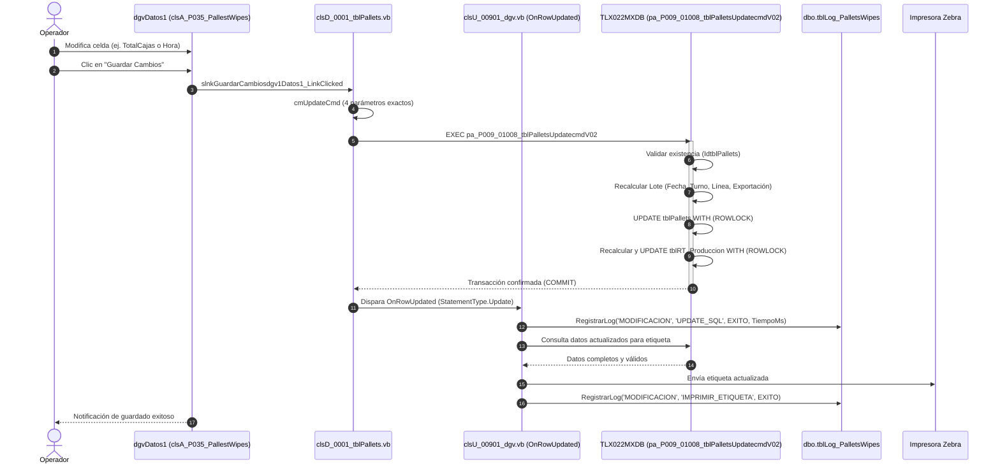

# 008 - Plan de Implementación: Pallets WW - Procedimiento Almacenado de Actualización (pa_P009_01008_tblPalletsUpdatecmdV02)

**Proyecto:** clsA_P035_PallestWipes (Pallets Toallitas Húmedas / WW)  
**Base de Datos:** TLX022MXDB  
**Servidor:** MXTLAS02 (Desarrollo/Pruebas: DESKTOP-GNLGUOC)  
**Fecha:** 16 de Septiembre de 2026  
**Documentos Relacionados:**  
- `001 Modificaciones de App Wipes.md`  
- `005 Plan de Implementacion Pallets WW V3.md`  
- `006 Cambios en Pallets WW V3.md`  
- `007_Despliegue_Produccion_Pallets_WW_V3.sql`  

---

## 1. Diagnóstico Forense y Causa Raíz del Error en Producción

### Mensaje de Error Capturado en Pantalla
> **"Ocurrió un error al guardar en la base de datos debido a problemas de red:  
> Procedure or function pa_P009_01008_tblPalletsUpdatecmd has too many arguments specified."**

### Análisis de Causa Raíz

Al revisar la interacción entre la capa de datos de la aplicación `.NET` (`clsD_0001_tblPallets.vb`) y el procedimiento almacenado en SQL Server `TLX022MXDB`, se identificaron **dos causas directas**:

#### Causa 1: Parámetro Duplicado en la Configuración de ADO.NET (`sUPrmsdgv1datos1`)
En el archivo `clsD_0001_tblPallets.vb` de `clsA_P035_PallestWipes` (líneas 335 a 355):

```vb
Private Sub sUPrmsdgv1datos1(ByRef cmUpdateCmd As SqlCommand)
    With cmUpdateCmd
        .Parameters.Add("@TotalCajas", SqlDbType.Int)
        .Parameters("@TotalCajas").SourceVersion = DataRowVersion.Current
        .Parameters("@TotalCajas").SourceColumn = "TotalCajas"

        .Parameters.Add("@Hora", SqlDbType.Time)
        .Parameters("@Hora").SourceVersion = DataRowVersion.Current
        .Parameters("@Hora").SourceColumn = "Hora"

        .Parameters.Add("@IdtblPallets", SqlDbType.Int)
        .Parameters("@IdtblPallets").SourceVersion = DataRowVersion.Current
        .Parameters("@IdtblPallets").SourceColumn = "IdtblPallets"

        .Parameters.Add("@Linea", SqlDbType.NVarChar, 50)
        .Parameters("@Linea").SourceVersion = DataRowVersion.Current
        .Parameters("@Linea").SourceColumn = "LineaEmpaque"

        ' ERROR CRÍTICO: Parámetro duplicado agregado inadvertidamente
        Dim pIdPallet As SqlParameter = .Parameters.Add("@IdtblPallets", SqlDbType.Int)
        pIdPallet.Direction = ParameterDirection.Output
        pIdPallet.SourceColumn = "IdtblPallets"
    End With
End Sub
```

- **El Problema:** Al preparar `cmUpdateCmd`, se agregaron **5 parámetros** a la colección del comando, declarando `@IdtblPallets` dos veces (una como entrada para la cláusula `WHERE` y otra como salida).
- **La Incompatibilidad en SQL:** El procedimiento almacenado `pa_P009_01008_tblPalletsUpdatecmd` solo define **4 parámetros**:
  `@TotalCajas int, @Hora time, @IdtblPallets int, @Linea nvarchar(05)`
- **La Consecuencia:** En cuanto un operador edita cualquier celda de un pallet existente en el `dgvDatos1` (por ejemplo, corrigiendo el número de cajas o la hora) y presiona "Guardar", el `DataAdapter` ejecuta `cmUpdateCmd` enviando 5 argumentos. SQL Server aborta inmediatamente la ejecución con el error:  
  `"Procedure or function pa_P009_01008_tblPalletsUpdatecmd has too many arguments specified."`

#### Causa 2: Procedimiento Almacenado de Update Legado sin Transaccionalidad ni Protección contra Concurrencia
El procedimiento actual `pa_P009_01008_tblPalletsUpdatecmd`:
1. **No tiene manejo transaccional:** No implementa `BEGIN TRANSACTION`, `SET XACT_ABORT ON`, ni `TRY...CATCH`. Si se actualiza `tblPallets` y ocurre un microcorte antes de actualizar `tblRT_Produccion`, las cajas quedan desincronizadas.
2. **No tiene `SET NOCOUNT ON;`:** Genera múltiples conteos de filas afectadas que interfieren con la detección de concurrencia optimista de ADO.NET (`DBConcurrencyException`).
3. **No tiene bloqueos de fila (`ROWLOCK`):** Puede provocar bloqueos mutuos (*deadlocks*) con la inserción masiva simultánea de pallets (`pa_P009_01006_tblPalletsInsertcmdV02`).
4. **No es una versión V02:** Para cumplir con la directriz del proyecto de **no alterar los procedimientos legados de producción**, se debe crear la versión mejorada `pa_P009_01008_tblPalletsUpdatecmdV02`.

---

## 2. Objetivos del Plan

1. **Eliminar el Parámetro Duplicado:** Corregir `sUPrmsdgv1datos1` en `clsD_0001_tblPallets.vb` para que `cmUpdateCmd` pase exactamente los 4 parámetros que requiere el SP.
2. **Crear `pa_P009_01008_tblPalletsUpdatecmdV02`:**
   - Incorporar `SET NOCOUNT ON;` y `SET XACT_ABORT ON;`.
   - Implementar transacción atómica protegida con `BEGIN TRY...BEGIN TRANSACTION...COMMIT` y `ROLLBACK` en `CATCH`.
   - Validar que el pallet exista antes de actualizar (`IF NOT EXISTS`).
   - Bloqueo de concurrencia seguro mediante `WITH (ROWLOCK)`.
   - Recalcular de forma consistente el Lote (considerando turno, línea, fecha y exportación) y sincronizar la sumatoria de `TotalCajas` en `tblRT_Produccion`.
3. **Integrar Telemetría de Updates:** Registrar en `dbo.tblLog_PalletsWipes` la acción `MODIFICACION_PALLET` / `UPDATE_SQL` con `TipoOperacion = 'MODIFICACION'` para mantener total observabilidad cuando un pallet es editado en piso.
4. **Validación de Impresión Post-Update:** Asegurar que si el operador modificó el pallet, la etiqueta actualizada se imprima con los datos corregidos sin generar duplicidades o errores.
5. **Garantizar 0 Errores de Compilación:** Compilar y validar el proyecto en Release y Debug.

---

## 3. Arquitectura y Diseño de la Solución



---

## 4. Detalle de Cambios Propuestos

### Componente 1: Base de Datos (`TLX022MXDB`)

#### [NUEVO] Procedimiento Almacenado `dbo.pa_P009_01008_tblPalletsUpdatecmdV02`
Archivo: `C:\AI\Git Hub\clsA_P035_PallestWipes\Gemini\pa_P009_01008_tblPalletsUpdatecmdV02.sql`

```sql
USE [TLX022MXDB];
GO

SET ANSI_NULLS ON;
GO
SET QUOTED_IDENTIFIER ON;
GO

CREATE OR ALTER PROCEDURE [dbo].[pa_P009_01008_tblPalletsUpdatecmdV02]
    @TotalCajas int,
    @Hora time,
    @IdtblPallets int,
    @Linea nvarchar(05)
AS
BEGIN
    SET NOCOUNT ON;
    SET XACT_ABORT ON;

    BEGIN TRANSACTION;

    BEGIN TRY
        -- 1. Validar que el pallet exista
        IF NOT EXISTS (SELECT 1 FROM tblPallets WHERE IdtblPallets = @IdtblPallets)
        BEGIN
            RAISERROR('El pallet con Folio %d no existe en tblPallets.', 16, 1, @IdtblPallets);
        END

        -- 2. Recuperar llaves de encabezado y producto
        DECLARE @SumtotalCajas int, 
                @FolioVale int, 
                @IdRT_Encabezado int, 
                @Exportacion bit;

        SELECT 
            @FolioVale = FolioVale,
            @IdRT_Encabezado = IdRT_Encabezado
        FROM tblPallets 
        WHERE IdtblPallets = @IdtblPallets;

        -- 3. Calcular variables del Lote
        DECLARE @NoLote nvarchar(50), 
                @Anio int, 
                @DiaJuliano nvarchar(5), 
                @Fecha datetime, 
                @Turno nvarchar(2);

        SELECT 
            @Fecha = Fecha,
            @Turno = CASE 
                        WHEN Turno = 1 THEN 'A' 
                        WHEN Turno = 2 THEN 'B' 
                        WHEN Turno = 3 THEN 'C' 
                        ELSE 'A' 
                     END
        FROM tblRT_Encabezado 
        WHERE IdRT_Encabezado = @IdRT_Encabezado;

        SET @Anio = YEAR(@Fecha);
        SET @DiaJuliano = RIGHT('000' + CAST(DATEPART(dy, @Fecha) AS varchar(3)), 3);

        -- Determinar si el producto es de exportación
        SELECT @Exportacion = a1.Exportacion
        FROM TLX040MXDB.dbo.tblProductos a1
        INNER JOIN tblPallets a2 ON a1.IdtblProductos = a2.IdtblProductos
        WHERE a2.IdtblPallets = @IdtblPallets;

        IF @Exportacion = 1 OR @Exportacion = 'True'
        BEGIN
            SET @NoLote = 'TL' + CONVERT(nvarchar(1), RIGHT(@Anio, 1)) + @DiaJuliano + '02X';
        END
        ELSE
        BEGIN
            SET @NoLote = 'TL' + CONVERT(nvarchar(1), RIGHT(@Anio, 1)) + @DiaJuliano + @Linea + @Turno;
        END

        -- 4. Actualización atómica en tblPallets
        UPDATE tblPallets WITH (ROWLOCK)
        SET Hora = @Hora,
            TotalCajas = @TotalCajas,
            Lote = @NoLote
        WHERE IdtblPallets = @IdtblPallets;

        -- 5. Recalcular y sincronizar sumatoria de cajas en tblRT_Produccion
        SELECT @SumtotalCajas = SUM(ISNULL(TotalCajas, 0))
        FROM tblPallets
        WHERE FolioVale = @FolioVale AND IdRT_Encabezado = @IdRT_Encabezado;

        UPDATE tblRT_Produccion WITH (ROWLOCK)
        SET TotalCajas = @SumtotalCajas
        WHERE IdRT_Encabezado = @IdRT_Encabezado AND FolioVale = @FolioVale;

        COMMIT TRANSACTION;

    END TRY
    BEGIN CATCH
        IF @@TRANCOUNT > 0
            ROLLBACK TRANSACTION;
        THROW;
    END CATCH
END;
GO
```

---

### Componente 2: Capa de Datos (`clsA_P035_PallestWipes\clsD\clsD_0001_tblPallets.vb`)

1. **Vincular al nuevo SP `pa_P009_01008_tblPalletsUpdatecmdV02`:**
   En `sdgvDatos1Params`:
   ```vb
   'Agrega el Update Command V02
   clU_dgv.sUpdateCommand(o_clU_strucdgv1DatosDS, o_clU_strucdgv1DatosSource, _
   "pa_P009_01008_tblPalletsUpdatecmdV02", cmUpdateCmd)
   cmUpdateCmd.UpdatedRowSource = UpdateRowSource.None
   ```

2. **Eliminar el parámetro duplicado en `sUPrmsdgv1datos1`:**
   ```vb
   Private Sub sUPrmsdgv1datos1(ByRef cmUpdateCmd As SqlCommand)
       With cmUpdateCmd
           .Parameters.Clear()

           .Parameters.Add("@TotalCajas", SqlDbType.Int)
           .Parameters("@TotalCajas").SourceVersion = DataRowVersion.Current
           .Parameters("@TotalCajas").SourceColumn = "TotalCajas"

           .Parameters.Add("@Hora", SqlDbType.Time)
           .Parameters("@Hora").SourceVersion = DataRowVersion.Current
           .Parameters("@Hora").SourceColumn = "Hora"

           .Parameters.Add("@IdtblPallets", SqlDbType.Int)
           .Parameters("@IdtblPallets").SourceVersion = DataRowVersion.Current
           .Parameters("@IdtblPallets").SourceColumn = "IdtblPallets"

           .Parameters.Add("@Linea", SqlDbType.NVarChar, 50)
           .Parameters("@Linea").SourceVersion = DataRowVersion.Current
           .Parameters("@Linea").SourceColumn = "LineaEmpaque"

           ' Se remueve la línea que duplicaba @IdtblPallets como Output
       End With
   End Sub
   ```

---

### Componente 3: Capa de Manejo de Fila (`clsA_P035_PallestWipes\clsU\clsU_00901_dgv.vb`)

1. **En `OnRowUpdated` para `StatementType.Update`:**
   - Extraer `intFolio` de forma segura.
   - Registrar telemetría de la modificación en `dbo.tblLog_PalletsWipes` con `TipoOperacion = "MODIFICACION"`.
   - Llamar a `sImprimirEtiquetaPallet(intFolio, "MODIFICACION")`.

2. **En `sImprimirEtiquetaPallet`:**
   - Asegurar que acepte el parámetro `Optional ByVal o_TipoOperacion As String = "GUARDAR"`.
   - Registrar en los logs de `CONSULTA_ETIQUETA` e `IMPRIMIR_ETIQUETA` el `o_TipoOperacion` recibido.

---

## 5. Plan de Verificación

### 1. Pruebas Automatizadas de Compilación
- Ejecutar compilación de `clsA_P035_PallestWipes.sln` en Release y Debug mediante MSBuild.
- Verificar `0 Advertencia(s)` y `0 Errores`.

### 2. Pruebas en Base de Datos de Desarrollo (`TLX022MXDB` en `DESKTOP-GNLGUOC`)
- Desplegar `pa_P009_01008_tblPalletsUpdatecmdV02`.
- Ejecutar prueba manual de invocación con 4 parámetros exactos y verificar:
  - Actualización de `Hora` y `TotalCajas` en `tblPallets`.
  - Recálculo automático del `Lote`.
  - Sincronización de `TotalCajas` en `tblRT_Produccion`.

### 3. Prueba de Interfaz de Usuario
- Abrir la aplicación `clsA_P035_PallestWipes`.
- Cargar un vale de producción activo.
- Modificar las cajas de un pallet existente en el DataGridView.
- Presionar "Guardar Cambios".
- **Criterio de Aceptación:**
  - El diálogo de error `"Procedure or function ... has too many arguments specified"` **NO** debe aparecer.
  - La fila debe actualizarse exitosamente.
  - La tabla `tblLog_PalletsWipes` debe registrar la transacción con `TipoOperacion = 'MODIFICACION'` y `Estatus = 'EXITO'`.

---

## 6. Script de Despliegue en Producción

Se consolidará el script listo para ejecutar en `MXTLAS02`:
`C:\AI\Git Hub\clsA_P035_PallestWipes\Gemini\009_Despliegue_Produccion_Pallets_WW_UpdateV02.sql`.
