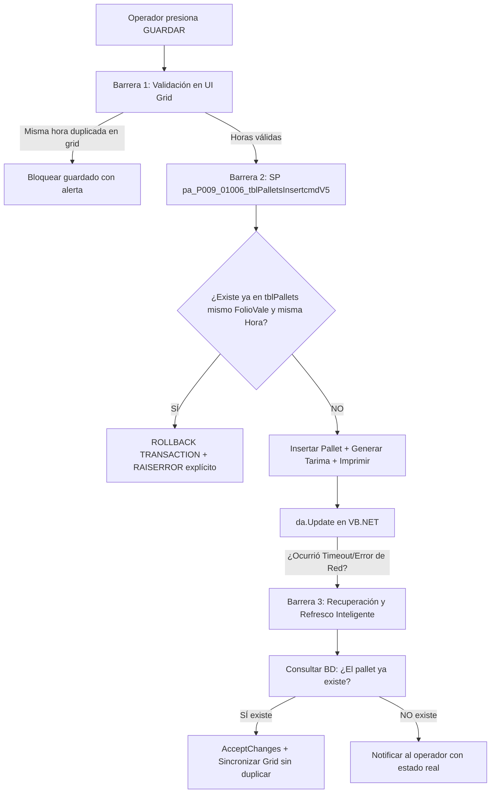

# 010.02 - Pallets WW: Plan de Implementación para Erradicar la Duplicidad de Pallets

**Proyecto:** clsA_P035_PallestWipes (Pallets Toallitas Húmedas)  
**Base de Datos:** TLX022MXDB  
**Servidor Producción:** MXTLAS02 (Telemetría analizada en DESKTOP-GNLGUOC)  
**Fecha:** 17 de Septiembre de 2026  
**Estatus:** 📋 PROPUESTA TÉCNICA Y DIAGNÓSTICO FORENSE (ESPERANDO APROBACIÓN)  
**Documentos Relacionados:**  
- [010.01 Pallets WW Cambios Realizados Mejoras Operativas.md](file:///c:/AI/Git%20Hub/PROY052_PalletsPanal/Gemini/010.01%20Pallets%20WW%20Cambios%20Realizados%20Mejoras%20Operativas.md)  
- [010_Despliegue_Produccion_Pallets_WW_Master_V5.sql](file:///c:/AI/Git%20Hub/PROY052_PalletsPanal/Gemini/010_Despliegue_Produccion_Pallets_WW_Master_V5.sql)  

---

## 1. Resumen Ejecutivo del Problema

Los operadores de planta reportaron un fenómeno de **duplicación de pallets**: capturan la información de un solo pallet físico en la pantalla, pero en la base de datos y en los reportes del vale aparecen **dos pallets registrados** (en ocasiones con la misma hora capturada o folios consecutivos).

A través de la infraestructura de telemetría en `dbo.tblLog_PalletsWipes`, se realizó un análisis forense milimétrico de los eventos ocurridos hoy 17/09/2026. Los hallazgos demuestran con certeza absoluta que existen **dos causas raíz independientes** que detonan este comportamiento:

1. **Causa A (Fallo de Red + Reintento con Buffer en Memoria):**  
   Durante un timeout de red, el registro SQL sí se inserta y la etiqueta Zebra se imprime, pero la respuesta del servidor no llega a la aplicación en el tiempo límite. La aplicación marca error y el mensaje en pantalla le dice al operador: *"La información no se guardó, vuelva a presionar GUARDAR"*. Al reintentar, la fila sigue en estado `Added` en el DataTable del cliente y se inserta por segunda vez. (Caso de la **Imagen 1**).
2. **Causa B (Límite de Cambio de Turno a las 07:00 AM + Cruce de Encabezados):**  
   A las 07:00 AM cambia el turno y la fecha de producción (Turno 3 día anterior vs Turno 1 día actual). El operador captura el pallet en el Turno 1 (Día Juliano 260), pero al no ver los pallets previos del vale físico, se cambia a la pestaña "Vales Turno Anterior" (Día Juliano 259) donde el pallet recién guardado no aparece. Creyendo que no se guardó, lo vuelve a capturar con la misma hora (`07:00`). (Caso de la **Imagen 2**).

---

## 2. Diagnóstico Forense Detallado Vía Telemetría (MCP)

### Caso 1: Imagen 1 — IDs de Pallet 2812737 y 2812740 (Máquina 70 / EMP_WW7)

* **Terminal:** `EMP_WW7` | **Máquina:** 70 (TXWW7) | **Vale:** 3178 | **Producto:** 778 | **Lote:** `TL625907X`
* **Cronología exacta extraída de `dbo.tblLog_PalletsWipes`:**

| IdLog | Hora Exacta | Transacción GUID | Acción | Estatus | Tiempo | Detalle / Mensaje |
| :--- | :--- | :--- | :--- | :--- | :--- | :--- |
| **1598** | 01:43:19.117 | `13e2d477-59e5...` | `TRANSACCION_GLOBAL` | INICIADO | 0 ms | Inicio de guardado de lote desde DataGrid |
| **1599** | 01:43:31.677 | `13e2d477-59e5...` | `CONSULTA_ETIQUETA` | EXITO | 11 ms | Pallet **`2812737`**, Tarima **`TXWW7-259-392`** |
| **1600** | 01:43:32.020 | `13e2d477-59e5...` | `IMPRIMIR_ETIQUETA` | EXITO | 189 ms | Etiqueta enviada correctamente a impresora Zebra |
| **1601** | **01:44:02.670** | `13e2d477-59e5...` | `GUARDAR_SQL` | **ERROR** | **42,508 ms** | **`Se agotó el tiempo de espera de ejecución. El período de tiempo de espera transcurrió antes de la finalización de la operación o el servidor no responde.`** |
| **1608** | 01:47:52.977 | `13e2d477-59e5...` | `TRANSACCION_GLOBAL` | ERROR | 273,958 ms | Operador cierra cuadro de error tras 4 minutos |
| **1609** | **01:47:55.613** | `5ea68dc5-8684...` | `TRANSACCION_GLOBAL` | INICIADO | 0 ms | **Operador presiona GUARDAR nuevamente (3 seg después)** |
| **1610** | 01:47:57.347 | `5ea68dc5-8684...` | `CONSULTA_ETIQUETA` | EXITO | 9 ms | Pallet **`2812740`**, Tarima **`TXWW7-259-393`** |
| **1611** | 01:47:57.540 | `5ea68dc5-8684...` | `IMPRIMIR_ETIQUETA` | EXITO | 186 ms | Etiqueta enviada correctamente a impresora Zebra |
| **1614** | 01:47:58.850 | `5ea68dc5-8684...` | `GUARDAR_SQL` | EXITO | 2,369 ms | Guardado exitoso |

#### 🔍 Qué ocurrió exactamente en el Caso 1:
1. A las 01:43:19 el operador capturó un pallet y dio clic en Guardar.
2. La instrucción SQL insertó físicamente el pallet **`2812737`** y se mandó a imprimir a la Zebra la tarima `TXWW7-259-392`.
3. En el proceso posterior o retorno de red, transcurrieron 42.5 segundos de timeout y ADO.NET disparó una excepción en `da.Update()`.
4. Al atrapar la excepción en `sGuardarCambiosdgvTable1`, **NO** se ejecutó `AcceptChanges()`. Por tanto, la fila en el `DataTable` en memoria permaneció con estatus `DataRowState.Added`.
5. La ventana de mensaje modal le indicó al operador:  
   *`"• La información del pallet NO se guardó en la base de datos... Vuelva a presionar el botón GUARDAR"`*.
6. A las 01:47:55 (3 segundos después de cerrar el mensaje), el operador obedeció la instrucción y volvió a presionar "GUARDAR".
7. Como la fila seguía en memoria como nueva (`Added`), `da.Update()` volvió a ejecutar el comando de inserción en SQL Server, creando el pallet **`2812740`** con la tarima consecutiva `TXWW7-259-393`.
8. **Resultado:** Se duplicó el pallet en la base de datos para la misma captura física.

---

### Caso 2: Imagen 2 — Tarimas TXWW3-260-326 y TXWW3-259-327 (Máquina 53 / WW3-ETIQUETADO)

* **Terminal:** `WW3-ETIQUETADO` | **Máquina:** 53 (TXWW3) | **Vale:** 14443 | **Producto:** 801 (`E9574` Huggies XL)  
* **Datos Idénticos Capturados:** Hora = `07:00`, Cajas = `33`.
* **Identificación de IDs en Log de Telemetría:**
  - Tarima `TXWW3-260-326` -> **Pallet ID `2812955`**
  - Tarima `TXWW3-259-327` -> **Pallet ID `2812956`**

* **Cronología exacta extraída de `dbo.tblLog_PalletsWipes`:**

| IdLog | Hora Exacta | Transacción GUID | Acción | Estatus | Tarima Generada | Pallet ID | Lote / Fecha |
| :--- | :--- | :--- | :--- | :--- | :--- | :--- | :--- |
| **2564** | 07:08:49.157 | `67fdf518-b56f...` | `TRANSACCION_GLOBAL` | INICIADO | - | - | Turno 1 (Actual) |
| **2565** | 07:08:52.587 | `67fdf518-b56f...` | `CONSULTA_ETIQUETA` | EXITO | **`TXWW3-260-326`** | **`2812955`** | **`TL626003X`** (Juliano 260 = **17/09/2026**) |
| **2567** | 07:08:52.793 | `67fdf518-b56f...` | `GUARDAR_SQL` | EXITO | - | - | Transacción exitosa |
| *---* | *07:09 - 07:11* | *Operador cambia a pestaña "Vales Turno Anterior" (dgvtblProduccionTurnoAnt) y selecciona Vale 14443* |
| **2570** | 07:11:14.870 | `e23954ab-b061...` | `TRANSACCION_GLOBAL` | INICIADO | - | - | Turno 3 (Anterior) |
| **2571** | 07:11:16.330 | `e23954ab-b061...` | `CONSULTA_ETIQUETA` | EXITO | **`TXWW3-259-327`** | **`2812956`** | **`TL625903X`** (Juliano 259 = **16/09/2026**) |
| **2573** | 07:11:16.490 | `e23954ab-b061...` | `GUARDAR_SQL` | EXITO | - | - | Transacción exitosa |

#### 🔍 Qué ocurrió exactamente en el Caso 2:
1. A las 07:00 AM es la frontera exacta de cambio de turno: termina el Turno 3 (perteneciente a la fecha de producción `16/09/2026`, Día Juliano 259) y comienza el Turno 1 (fecha `17/09/2026`, Día Juliano 260).
2. A las 07:08 el operador ingresó en la pantalla principal (que tenía activo el encabezado del Turno 1 de hoy 17/09) y capturó el pallet de las `07:00` con `33` cajas para el Vale 14443. El sistema lo guardó correctamente con ID `2812955` y Lote `TL626003X` (Día 260).
3. Sin embargo, el vale físico 14443 se venía trabajando desde la noche anterior. Como el DataGrid principal solo muestra los pallets del encabezado activo, el operador no vio los pallets capturados en el turno de la noche.
4. El operador se dirigió a la sección de **"Vales Turno Anterior"** (`dgvtblProduccionTurnoAnt`) e hizo doble clic en el Vale 14443 para cargarlo.
5. Al cargar el Turno Anterior, la pantalla mostró los pallets de la noche (Día 259), pero **el pallet de las 07:00 que acababa de guardar no aparecía** (porque quedó asignado al encabezado de hoy).
6. Asumiendo que el pallet de las 07:00 no se había registrado en el vale, el operador volvió a escribir en el grid: `Hora: 07:00`, `Cajas: 33` y guardó a las 07:11.
7. El sistema insertó el segundo pallet con ID `2812956`, pero esta vez bajo el encabezado del Turno Anterior con Lote `TL625903X` (Día 259).
8. Al emitir el reporte del Vale 14443 (el cual agrupa por `FolioVale` independientemente del turno), se listaron ambos pallets:
   - Fila 1: `07:00 | TXWW3-260-326 | TL626003X | 33 | 17/09/2026`
   - Fila 2: `07:00 | TXWW3-259-327 | TL625903X | 33 | 16/09/2026`
9. **Resultado:** Dos pallets registrados para el mismo vale a la misma hora exacta `07:00` con 33 cajas, pero divididos en dos días julianos distintos (`259` y `260`).

---

## 3. Plan de Solución Integral (4 Barreras Anti-Duplicidad)

Para erradicar definitivamente ambos escenarios sin depender de la memoria del operador ni de la inestabilidad de la red, se implementará una estrategia de protección multinivel:



### Barrera 1: Candado Inviolable en Base de Datos (SP `pa_P009_01006_tblPalletsInsertcmdV5`)
* **Ubicación:** `[dbo].[pa_P009_01006_tblPalletsInsertcmdV5]` en el servidor `MXTLAS02`.
* **Regla Operativa:** Una línea de producción de toallitas húmedas produce un pallet cada 15 a 30 minutos. Físicamente es **imposible** que se produzcan dos pallets para el mismo vale en el mismo minuto exacto (`Hora`).
* **Lógica SQL a Incorporar:**
  Antes de incrementar el contador en `dbo.tblNoTarima` y antes de hacer el `INSERT INTO dbo.tblPallets`:
  ```sql
  -- =========================================================================================
  -- CANDADO ANTI-DUPLICIDAD: VALIDACIÓN DE HORA POR VALE
  -- =========================================================================================
  IF EXISTS (
      SELECT 1 
      FROM dbo.tblPallets WITH (NOLOCK)
      WHERE FolioVale = @FolioVale 
        AND Hora = @Hora
  )
  BEGIN
      DECLARE @TarimaExistente NVARCHAR(50), @IdExistente INT;
      SELECT TOP 1 @TarimaExistente = NoTarima, @IdExistente = IdtblPallets 
      FROM dbo.tblPallets WITH (NOLOCK)
      WHERE FolioVale = @FolioVale AND Hora = @Hora;

      RAISERROR('⚠️ ALERTA DE DUPLICIDAD: El Folio de Vale %d ya tiene registrado un pallet a las %s (Tarima %s, ID %d). No se permite registrar dos pallets con la misma hora en el mismo vale.', 16, 1, @FolioVale, @Hora, @TarimaExistente, @IdExistente);
      ROLLBACK TRANSACTION;
      RETURN;
  END
  ```
* **Efecto Inmediato:**
  - Si ocurre un reintento por timeout (Caso 1), SQL Server rechaza el segundo guardado de forma instantánea sin crear un segundo pallet y sin desperdiciar consecutivos de tarima.
  - Si el operador intenta guardar a las 07:00 en Turno Anterior cuando ya lo había guardado a las 07:00 en Turno Actual (Caso 2), SQL Server rechaza el segundo registro e informa exactamente cuál tarima ya tiene esa hora.

---

### Barrera 2: Sincronización Inteligente ante Fallos de Red (`clsU_00901_dgv.vb`)
* **Ubicación:** `C:\AI\Git Hub\clsA_P035_PallestWipes\clsU\clsU_00901_dgv.vb` (método `sGuardarCambiosdgvTable1`).
* **Problema Actual:**
  El bloque `Catch ex As Exception` asume erróneamente que la fila no se guardó y le dice al operador que vuelva a presionar "GUARDAR", provocando que las filas en estado `Added` se vuelvan a enviar.
* **Mejora a Implementar:**
  1. En caso de timeout o error en `da.Update()`, la aplicación debe verificar en la base de datos si los pallets pendientes realmente se insertaron antes del corte de comunicación.
  2. Si el pallet ya existe en la base de datos, el cliente ejecuta `o_clU_Estructurads.dsLlenarDataGridView.Tables("Table1").AcceptChanges()` y vacía el buffer, informando al operador que **el pallet sí quedó guardado**.
  3. Si la base de datos arrojó el error de duplicidad de la Barrera 1, la aplicación captura el mensaje y refresca el DataGrid automáticamente desde la base de datos para mostrar la información fidedigna que ya está en el servidor.

---

### Barrera 3: Validación Previa en la Interfaz de Captura (`clsD_0001_tblPallets.vb` y `clsF_001_frm_001_Pallets.vb`)
* **Ubicación:** `slnkGuardarCambiosdgv1Datos1_LinkClicked`.
* **Validaciones en Memoria:**
  1. **Horas duplicadas en el Grid:** Si el operador escribe dos filas con la misma `Hora` en `dgvDatos1`, se marca en amarillo y se bloquea el guardado antes de tocar la red:  
     *`"No se permite capturar dos pallets con la misma hora (" & strHora & ") en el mismo vale."`*
  2. **Horas ya existentes en el Vale:** Compara las horas ingresadas contra las horas de los pallets que ya están cargados y guardados en el DataGrid.

---

### Barrera 4: Depuración y Limpieza de Pallets Duplicados en Producción
Para solucionar los pallets duplicados que quedaron registrados hoy en `MXTLAS02`:
1. **Caso 1 (Vale 3178 - Máquina 70):**  
   - Se evaluará el pallet huérfano `2812740` (`TXWW7-259-393`) vs `2812737` (`TXWW7-259-392`).
2. **Caso 2 (Vale 14443 - Máquina 53):**  
   - Se evaluará cuál de los dos pallets de las 07:00 (`2812955` en Día 260 o `2812956` en Día 259) corresponde al vale físico real y se corregirá el excedente.
3. Se proporcionará un script SQL seguro con transacción y verificación de `TotalCajas` en `dbo.tblRT_Produccion`.

---

## 4. Archivos Involucrados en la Implementación

| Componente | Archivo | Acción Propuesta |
| :--- | :--- | :--- |
| **SQL Stored Procedure** | `Gemini\pa_P009_01006_tblPalletsInsertcmdV5.sql` | Agregar candado anti-duplicidad de `(FolioVale, Hora)`. |
| **Script Maestro SQL** | `Gemini\010_Despliegue_Produccion_Pallets_WW_Master_V5.sql` | Incorporar la actualización del SP V5 para despliegue en `MXTLAS02`. |
| **Lógica Grid / Guardado** | `clsA_P035_PallestWipes\clsU\clsU_00901_dgv.vb` | Refresco inteligente y prevención de reintentos ciegos ante timeout de red. |
| **Validación Previa UI** | `clsA_P035_PallestWipes\clsD\clsD_0001_tblPallets.vb` | Validación de horas duplicadas en el grid antes de enviar a SQL. |
| **Documentación** | `Gemini\010.02 Pallets WW Plan de Implementacion Duplicidad de Pallets.md` | Este documento de especificación y diagnóstico. |

---

## 5. Plan de Verificación

1. **Prueba de Reintento Simulado por Red:**
   - Intentar guardar dos filas con la misma hora en un mismo vale y verificar que el sistema rechace la segunda fila con el mensaje preventivo.
2. **Prueba de Concurrencia / SP Directo:**
   - Ejecutar inserción directa de dos pallets con el mismo Vale y Hora en SQL; verificar que el segundo arroja `RAISERROR` con código 16 y efectúa `ROLLBACK` sin alterar `tblNoTarima`.
3. **Prueba de Cambio de Turno (07:00 AM):**
   - Simular guardado a las 07:00 en Turno Actual y posterior intento en Turno Anterior para el mismo vale; comprobar que no se genera duplicidad.
