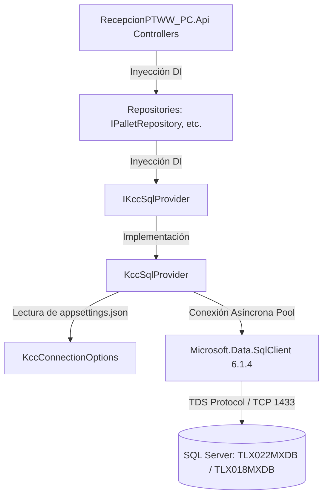
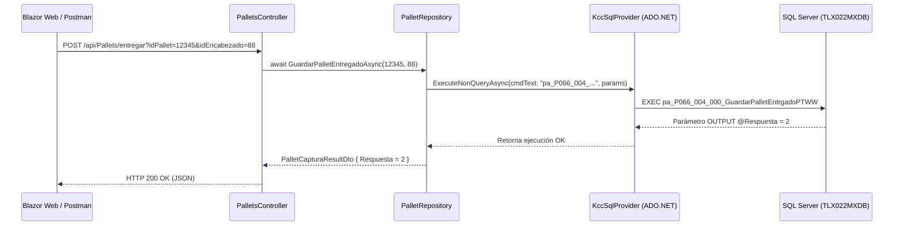
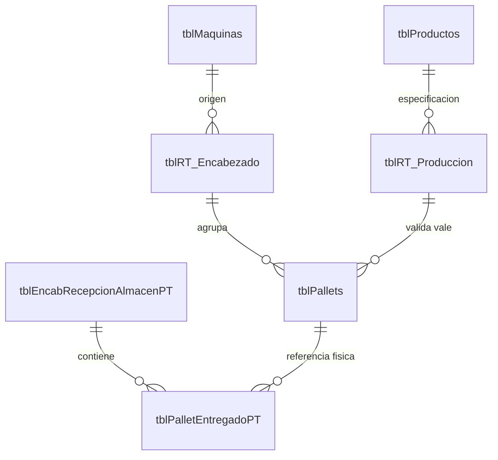

# 100 Análisis Exhaustivo de la Aplicación de Referencia Corporativa: RecepcionPTWW_PC
**Fecha de Análisis:** Septiembre 2026
**Ubicación del Proyecto Analizado:** `C:\AI\Git Hub\clsA_P035_PallestWipes\App Web con Api de ejemplo\RecepcionPTWW_PC_sln`
**Propósito:** Establecer el estándar corporativo supremo (tecnología, diseño, patrones de arquitectura, asincronía, configuración desacoplada y acceso a datos) para la modernización y desarrollo de sistemas de planta en Kimberly-Clark de México.

---

## 1. Resumen Ejecutivo y Filosofía de Diseño

La solución **RecepcionPTWW_PC_sln** constituye la **Plantilla Arquitectónica de Referencia Oficial** diseñada para sustituir progresivamente los desarrollos tradicionales monolíticos basados en Windows Forms (.NET Framework 4.8 / VB.NET) por un ecosistema desacoplado, escalable, moderno y resiliente basado en **.NET 8 (C# 12)**.

La arquitectura implementa una separación estricta entre la lógica de negocio y acceso a datos (**Web API**) y la interfaz de usuario en piso de planta (**Blazor Web App InteractiveServer**). Este diseño elimina por completo los problemas históricos de las aplicaciones cliente-servidor clásicas:
- **Cero dependencias locales en terminales de operador:** No requiere instalaciones pesadas vía Setup MSI, ClickOnce ni configuraciones locales de controladores OLEDB/ODBC en las computadoras de producción.
- **Protección contra caídas y lentitud de red:** Las terminales no abren conexiones síncronas persistentes directas contra SQL Server. Toda la comunicación viaja por HTTP/REST tipado y circuitos SignalR optimizados.
- **Agnosticismo de Base de Datos y Múltiples Plantas:** Desaparece cualquier mención a nombres físicos de base de datos (`TLX018MXDB`, `TLX022MXDB`, etc.) en el código fuente C#. Toda la orquestación reside en archivos JSON de configuración.
- **Acceso Asíncrono de Ultra Alto Rendimiento:** Uso obligatorio del paquete propietario corporativo `Kcc.Infrastructure.Sql`, garantizando llamadas no bloqueantes (`async/await`) en todas las capas del servidor Kestrel.

---

## 2. Estructura Física y Organización de la Solución

La solución está construida bajo la especificación moderna de Visual Studio `.slnx` (XML Solution Format) y se subdivide en módulos altamente cohesivos:

```text
RecepcionPTWW_PC_sln/
│
├── Antigravity/                               # Directivas arquitectónicas y guías de empaquetado
│   ├── Como_Configurar_Ambientes_Multiples.md # Guía para ambientes QA, Dev y Producción
│   ├── Evolucion_ArquitecturaApi.md           # Registro de refactorización hacia async y DI
│   └── Instrucciones_NuGet_KccSql.md          # Manual de empaquetado y consumo de Kcc.Infrastructure.Sql
│
├── Gemini/                                    # Registro de ingeniería, bitácoras y diseño UI (000-048)
│   ├── 031 Reporte Crystal Reports.md         # Integración y soporte del motor legacy COM
│   ├── 033 Organizacion de Puertos.md         # Convención de puertos por departamento (bloques de 100)
│   └── 035 Error de Proxy en Produccion.md    # Diagnóstico y resolución de red en perfil Operador
│
├── src/
│   ├── RecepcionPTWW_PC.Api/                  # [CAPA BACKEND] ASP.NET Core Web API (.NET 8)
│   │   ├── Controllers/                       # Endpoints RESTful con atributos OpenAPI
│   │   │   ├── EmpleadosController.cs         # Catálogo de supervisores de planta (TLX032MXDB)
│   │   │   ├── PalletsController.cs           # Entrega, consulta y eliminación de pallets
│   │   │   ├── ReportesController.cs          # Consolidación y resumen de turnos
│   │   │   └── TurnosController.cs            # Verificación y alta de turnos
│   │   ├── Data/Repositories/                 # Repositorios con Inversión de Dependencias (IoC)
│   │   │   ├── IEmpleadoRepository.cs / EmpleadoRepository.cs
│   │   │   ├── IPalletRepository.cs / PalletRepository.cs
│   │   │   └── ITurnoRepository.cs / TurnoRepository.cs
│   │   ├── Models/Dtos/                       # DTOs de transferencia fuertemente tipados
│   │   │   ├── EmpleadoDto.cs
│   │   │   ├── PalletCapturaResultDto.cs
│   │   │   ├── PalletEntregadoDto.cs
│   │   │   ├── ReporteResumenDto.cs
│   │   │   ├── TurnoCapturaResultDto.cs
│   │   │   └── TurnoDto.cs
│   │   ├── appsettings.json                   # Configuración de conexiones y bases lógicas
│   │   ├── appsettings.Development.json       # Configuración local de depuración
│   │   ├── Program.cs                         # Pipeline HTTP, Swagger y DI de Kcc.Infrastructure.Sql
│   │   └── RecepcionPTWW_PC.Api.csproj        # Dependencias NuGet (net8.0)
│   │
│   └── RecepcionPTWW_PC.Web/                  # [CAPA FRONTEND] Blazor InteractiveServer (.NET 8)
│       ├── Components/
│       │   ├── Layout/                        # Layout moderno con estética Glassmorphism
│       │   │   ├── MainLayout.razor           # Contenedor Dark-Theme
│       │   │   └── NavMenu.razor              # Navegación lateral reactiva
│       │   ├── Pages/                         # Vistas de interacción de piso
│       │   │   ├── Recepcion.razor            # Pantalla principal de captura con código de barras
│       │   │   ├── Reportes.razor             # Visualizador de reportes con filtros por turno
│       │   │   └── ReporteTurno.razor         # Reporte bilingüe con KPIs e impresión PDF
│       │   └── Shared/                        # Componentes reutilizables
│       │       └── ConfirmModal.razor         # Modal reactivo con backdrop-filter y spinners
│       ├── Services/                          # Servicios clientes HTTP tipados
│       │   ├── ApiSettings.cs                 # Modelo de configuración de URL base
│       │   ├── EmpleadosApiService.cs
│       │   ├── PalletsApiService.cs
│       │   ├── ReportesApiService.cs
│       │   └── TurnosApiService.cs
│       ├── Models/                            # DTOs espejeados para la capa cliente
│       ├── wwwroot/                           # Recursos estáticos
│       │   ├── app.css                        # Variables CSS corporativas y micro-animaciones
│       │   ├── bootstrap/                     # Bootstrap 5
│       │   └── bootstrap-icons/               # Iconografía vectorial moderna
│       ├── appsettings.json                   # Endpoint de la API (BaseUrl)
│       ├── Program.cs                         # Configuración de HttpClient y Circuitos Blazor
│       └── RecepcionPTWW_PC.Web.csproj        # Dependencia a CrystalDecisions Engine
```

---

## 3. Estándar Estricto de Conexión a Base de Datos: `Kcc.Infrastructure.Sql`

### 3.1. Por qué NO se utiliza Entity Framework Core en Planta
En el entorno industrial de Kimberly-Clark, donde convergen cientos de transacciones por minuto desde 14 líneas de producción y lectores automáticos RFID, Entity Framework Core (EF Core) resulta contraproducente debido a:
1. **Sobrecarga de Memoria y Seguimiento de Estados (Change Tracking):** EF Core mantiene grafos de objetos pesados en memoria, incrementando la recolección de basura (GC pauses) y el consumo de CPU.
2. **Generación de Consultas Ineficientes:** Las consultas generadas por ORM a menudo carecen de los `LOCK HINTS` necesarios (`UPDLOCK`, `ROWLOCK`, `READCOMMITTEDLOCK`) o introducen conversiones de tipos implícitas que causan table scans y bloqueos.
3. **Incompatibilidad con Stored Procedures Empresariales Complejos:** El núcleo de la lógica de manufactura reside en Stored Procedures consolidados (`pa_P009_...`, `pa_P066_...`) que ejecutan lógica transaccional atómica, inserción de logs de auditoría y manejo de parámetros `OUTPUT` que ADO.NET ejecuta con tiempo de respuesta inferior a 2 milisegundos.

### 3.2. Arquitectura de `Kcc.Infrastructure.Sql`
Para estandarizar el acceso a SQL Server sin comprometer el rendimiento, se creó la librería corporativa **`Kcc.Infrastructure.Sql`** (Versión 1.1.1), construida sobre el driver oficial de última generación `Microsoft.Data.SqlClient` (v6.1.4):



### 3.3. Inyección en `Program.cs`
El registro del proveedor en el contenedor de dependencias se realiza en una sola línea mediante el método de extensión corporativo:

```csharp
// Program.cs (RecepcionPTWW_PC.Api)
var kccOptions = builder.Configuration
    .GetSection("KccConnection")
    .Get<KccConnectionOptions>();

if (kccOptions is null)
    throw new Exception("No se encontró la sección KccConnection en appsettings.json");

// Registrar la infraestructura SQL en Inyección de Dependencias
builder.Services.AddKccSqlInfrastructure(builder.Configuration);
```

### 3.4. Métodos Nucleares de `IKccSqlProvider`
El contrato `IKccSqlProvider` provee operaciones estrictamente asíncronas optimizadas:

| Método | Propósito | Caso de Uso en Planta |
|---|---|---|
| `ExecuteNonQueryAsync(...)` | Ejecución de Stored Procedures o DML sin retornar filas (`INSERT`, `UPDATE`, `DELETE`), soportando parámetros `OUTPUT`. | Registro de pallet entregado (`pa_P066_004`), eliminación de pallet (`pa_P066_005`), captura de turno (`pa_P066_003`). |
| `ExecuteReaderAsync(...)` | Ejecuta una consulta o procedimiento y procesa una sola fila o registro escalar mediante un delegado `handleRow: rdr => { ... }`. | Verificación de encabezado de turno actual (`pa_P066_001_000_VerificaEncabTurno`), consulta de supervisores. |
| `ExecuteReaderManyAsync(...)` | Ejecuta y procesa conjuntos masivos de registros iterando de forma asíncrona sobre el `SqlDataReader`. | Obtención del historial de pallets entregados en el turno (`pa_P066_002_000_VerificaEncabTurno`). |

### 3.5. Patrón de Consumo en Repositorio (Código Real de `PalletRepository.cs`)

```csharp
public class PalletRepository : IPalletRepository
{
    private readonly IKccSqlProvider _sqlProvider;
    private readonly string _database;

    public PalletRepository(IKccSqlProvider sqlProvider, IConfiguration configuration)
    {
        _sqlProvider = sqlProvider;
        _database = configuration["AppDatabases:RecepcionPTWWDb"] 
            ?? throw new ArgumentNullException("AppDatabases:RecepcionPTWWDb no configurado");
    }

    public async Task<PalletCapturaResultDto> GuardarPalletEntregadoAsync(int idPallet, int idEncabezado)
    {
        SqlParameter pRespuesta = null!;

        await _sqlProvider.ExecuteNonQueryAsync(
            database: _database,
            cmdType: CommandType.StoredProcedure,
            cmdText: "pa_P066_004_000_GuardarPalletEntrgadoPTWW",
            configure: cmd =>
            {
                cmd.Parameters.Add("@IdtblPallets", SqlDbType.Int).Value = idPallet;
                cmd.Parameters.Add("@IdtblEncabRecepcionAlmacenPT", SqlDbType.Int).Value = idEncabezado;

                pRespuesta = new SqlParameter("@Respuesta", SqlDbType.Int)
                {
                    Direction = ParameterDirection.Output
                };
                cmd.Parameters.Add(pRespuesta);
            });

        return new PalletCapturaResultDto
        {
            Respuesta = pRespuesta.Value == DBNull.Value ? 0 : Convert.ToInt32(pRespuesta.Value)
        };
    }
}
```

---

## 4. Configuración Desacoplada, Multi-Base y Multi-Ambiente

### 4.1. La Regla de Oro: Cero Hardcoding de Bases de Datos
En el código heredado era habitual encontrar sentencias como `USE TLX018MXDB;` o nombres quemados dentro de clases estáticas. En el estándar moderno:
- Los repositorios nunca mencionan nombres fijos de base de datos.
- El archivo `appsettings.json` define alias lógicos bajo la sección `AppDatabases`.

```json
{
  "KccConnection": {
    "ModoPrueba": false,
    "ServerSettings": "10.26.25.133\\SQLEXPRESS",
    "ServerPrueba": "DESKTOP-GNLGUOC"
  },
  "AppDatabases": {
    "RecepcionPTWWDb": "TLX022MXDB",
    "EmpleadosDb": "TLX032MXDB"
  }
}
```

### 4.2. Separación de Ambientes vía `ASPNETCORE_ENVIRONMENT`
ASP.NET Core carga automáticamente la jerarquía de configuración:
1. `appsettings.json` (Base general, por defecto apunta a la infraestructura de Producción).
2. `appsettings.Development.json` (Sobreescribe valores únicamente cuando se depura localmente en Visual Studio).
3. `appsettings.Production.json` (Sobreescribe valores específicos del servidor IIS).

> [!TIP]
> **Ventaja de Escalamiento entre Máquinas:**
> Si este mismo código compilado se traslada a la Máquina 30 o Máquina 18, **no se recompila nada**. Simplemente se modifica el archivo `appsettings.json` en esa carpeta del servidor para que `RecepcionPTWWDb` apunte a `TLX030MXDB` o `TLX018MXDB`.

---

## 5. Arquitectura y Patrones en la Web API (`RecepcionPTWW_PC.Api`)

### 5.1. Flujo de Control y Separación de Responsabilidades
La Web API aplica una arquitectura limpia en 3 capas verticales:



### 5.2. Asincronía Total contra Thread Starvation
Uno de los peores problemas de las aplicaciones anteriores era el congelamiento de interfaz cuando la red corporativa presentaba latencia. En la Web API, cada controlador expone métodos `async Task<IActionResult>`.
Cuando el servidor Kestrel recibe una petición y llama a la base de datos, el hilo de trabajo del ThreadPool **se libera de inmediato** para atender otras peticiones mientras SQL Server responde. Al completarse la consulta, el hilo se reanuda.

### 5.3. Catálogo de Endpoints RESTful Implementados

#### A) `PalletsController` (`/api/Pallets`)
- `POST /api/Pallets/entregar?idPallet={id}&idEncabezado={id}`: Registra la recepción del pallet. Retorna `PalletCapturaResultDto` con el código de resultado del SP.
- `DELETE /api/Pallets/{idPallet}`: Elimina un pallet previamente entregado. Retorna `204 NoContent`.
- `GET /api/Pallets/entregados?idEncabezado={id}`: Retorna la lista detallada de pallets entregados en el turno (`IEnumerable<PalletEntregadoDto>`).

#### B) `TurnosController` (`/api/Turnos`)
- `GET /api/Turnos/verificar?fecha={yyyy-MM-dd}&turno={1|2|3}`: Verifica si el turno ya fue dado de alta. Si no existe, retorna `404 NotFound`; si existe, retorna `200 OK` con `TurnoDto`.
- `POST /api/Turnos/capturar?noEmpSup={no}&turno={turno}&fecha={fecha}`: Da de alta el turno en base de datos. Retorna `TurnoCapturaResultDto` con el nuevo `FolioTurno`.

#### C) `EmpleadosController` (`/api/Empleados`)
- `GET /api/Empleados/supervisores`: Consulta la base `TLX032MXDB` filtrando por empleados activos del departamento 6 (`tblEmpleados`). Retorna `IEnumerable<EmpleadoDto>`.

#### D) `ReportesController` (`/api/Reportes`)
- `GET /api/Reportes/resumenTurno/{idEncabezado}`: Calcula agregados en tiempo real (Total de pallets, suma de cajas, lista completa) retornando `ReporteResumenDto`.

---

## 6. Arquitectura del Frontend Web Blazor (`RecepcionPTWW_PC.Web`)

### 6.1. Blazor Web App con Render Mode `InteractiveServer`
- **Mecanismo:** Mantiene un circuito WebSocket (SignalR) ligero entre el navegador y el servidor Kestrel.
- **Cero Latencia en Render:** Las actualizaciones de la interfaz (agregar filas al grid, cambiar estados de error, alternar visibilidad de modales) ocurren en milisegundos mediante Diffing de DOM binario enviado por el websocket.

### 6.2. Clientes HTTP Fuertemente Tipados (Typed HttpClients)
El frontend no utiliza `fetch()` arbitrario ni librerías de terceros; inyecta servicios fuertemente tipados configurados en `Program.cs`:

```csharp
// Program.cs (RecepcionPTWW_PC.Web)
var apiBaseUrl = builder.Configuration.GetSection("ApiSettings:BaseUrl").Value;

builder.Services.AddHttpClient<TurnosApiService>(client => client.BaseAddress = new Uri(apiBaseUrl!));
builder.Services.AddHttpClient<PalletsApiService>(client => client.BaseAddress = new Uri(apiBaseUrl!));
builder.Services.AddHttpClient<ReportesApiService>(client => client.BaseAddress = new Uri(apiBaseUrl!));
builder.Services.AddHttpClient<EmpleadosApiService>(client => client.BaseAddress = new Uri(apiBaseUrl!));
```

### 6.3. Ergonomía y Experiencia de Usuario (UX) de Piso en `Recepcion.razor`
La página principal implementa los siguientes patrones industriales de alta productividad:
1. **Cálculo Automático de Fecha y Turno Fabril:**
   - Turno 1: 07:00 a 14:59
   - Turno 2: 15:00 a 22:59
   - Turno 3: 23:00 a 06:59 (asigna automáticamente la fecha del día anterior si la hora es anterior a las 07:00).
2. **Temporizador de Turno en Segundo Plano:** Un `System.Threading.Timer` evalúa cada 5 minutos el reloj del sistema. Si ocurre un cambio de turno físico, la pantalla se refresca automáticamente.
3. **Navegación Rápida a Turnos Históricos:** Botón con icono `bi-rewind-fill` para consultar hasta 3 turnos atrás y botón para regresar al turno actual.
4. **Captura Rápida con Pistola Láser de Código de Barras:**
   - Campo de texto con `autofocus`.
   - Disparo por evento `@onkeydown="PalletInputKeyDown"` al detectar `Enter`.
   - Limpieza inmediata del input y foco listo para el siguiente disparo.
5. **Validación Preventiva con Parpadeo Dinámico:** Si el operador olvida elegir supervisor al dar de alta el turno, la lista desplegable parpadea con un halo rojo brillante (`shadow-danger-glow`) durante 2.5 segundos mediante una tarea asíncrona no bloqueante (`FlashSupervisorDropdown`).
6. **Modal de Confirmación Moderno (`ConfirmModal.razor`):**
   - Efecto Glassmorphism con `backdrop-filter: blur(4px)`.
   - Botones con estado de carga interactivo (`spinner-border` y deshabilitación durante el guardado) para evitar dobles clics.

### 6.4. Manejo de Códigos de Respuesta del Negocio
Al ingresar un pallet, la Web API y la UI interpretan de forma unificada los códigos de negocio emitidos por el Stored Procedure:

| Código Respuesta | Significado en Planta | Comportamiento en Interfaz |
|:---:|---|---|
| **1** | Pallet ya registrado anteriormente en almacén | Muestra mensaje de advertencia y limpia el campo. |
| **2** | Registro Exitoso | Inserta el pallet en el DataGrid en la primera posición y emite feedback visual. |
| **4** | El folio del pallet no existe en `tblPallets` | Mensaje de error solicitando verificación de tarima física. |
| **5** | Pallet capturado automáticamente por antena RFID | Mensaje: *¡Este pallet fue capturado automáticamente, NO SE PUEDE ELIMINAR!* |

---

## 7. Estándar de Infraestructura, Red y Organización de Puertos

### 7.1. Convención Departamental de Puertos por Bloques de 100
Para evitar colisiones en los servidores IIS locales de planta y permitir un monitoreo claro en firewalls, se estableció la convención oficial de reservar **una centena fija por cada departamento**:

| Rango de Puertos | Departamento / Proceso | Asignaciones Actuales |
|---|---|---|
| **5000 - 5099** | **Departamento Wet Wipes (WW)** | `5061`: `RecepcionPTWW_PC.Api`<br>`5062`: `RecepcionPTWW_PC.Web`<br>`5042`: API antigua WW<br>`5051`/`5052`: EstacionRI |
| **5100 - 5199** | **Departamento Pañal (Panal)** | `5101`: `RecepcionPanal.Api`<br>`5102`: `RecepcionPanal.Web` |
| **5200 - 5299** | **Departamento Coform** | Reservado para APIs y Web Apps de Cortadoras Coform |
| **5300 - 6499** | **Departamentos 4 al 15** | Reservados para futuras migraciones de planta |

### 7.2. Resolución del Incidente de Proxy en Perfil de Operador
Documentado formalmente en `Gemini/035 Error de Proxy en Produccion.md`:
- **Síntoma:** En la PC de producción, la app web abría perfecto en la sesión de Windows de *Administrador*, pero en la sesión de *Operador* arrojaba el error `ERR_PROXY_CONNECTION_FAILED`.
- **Causa Raíz:** En Windows, la configuración de red y proxy se almacena **por usuario (per-user registry)**. El perfil del operador tenía activa la directiva corporativa de proxy para navegación externa, provocando que las peticiones a `localhost` o IP local fueran desviadas al proxy inexistente.
- **Solución Estándar:** Desactivar la detección automática de proxy en `inetcpl.cpl` o agregar la excepción `localhost; 127.0.0.1; 10.26.*` en las Opciones de Internet del usuario Operador.

---

## 8. Arquitectura de Base de Datos y Stored Procedures (P066)

La aplicación se integra directamente con el ecosistema de producción mediante 7 procedimientos almacenados en la base de datos `TLX022MXDB` (con consultas federadas a `TLX009MXDB`, `TLX040MXDB` y `TLX032MXDB`):



### 8.1. Detalle Técnico de los Stored Procedures

#### 1. `pa_P066_001_000_VerificaEncabTurno`
- **Propósito:** Comprueba si ya existe un encabezado de recepción abierto para la fecha y el turno dados.
- **Parámetros:** `@Fecha (nvarchar(25))`, `@Turno (tinyint)`.
- **Retorno:** `IdtblEncabRecepcionAlmacenPT`, `Fecha`, `Turno`, `NoEmpSup`.

#### 2. `pa_P066_002_000_VerificaEncabTurno`
- **Propósito:** Obtiene el listado completo y detallado de pallets entregados en un turno específico para llenar el DataGrid.
- **Cruces Federados:** Une `tblPalletEntregadoPT` con `tblPallets`, `tblRT_Encabezado`, `TLX009MXDB.dbo.tblMaquinas`, `tblRT_Produccion` y `TLX040MXDB.dbo.tblProductos`.
- **Columnas Retornadas:** `FECHA`, `NUMERO DE PALLET`, `TARIMA`, `MAQUINA`, `CAJAS PALLET`, `CLAVE`, `DESCRIPCION DE PRODUCTO`, `TURNO`, `PALLET CAPTURADO AUTOMATICAMENTE?`.

#### 3. `pa_P066_003_000_CapturaTurno`
- **Propósito:** Da de alta el registro maestro del turno en `tblEncabRecepcionAlmacenPT`.
- **Parámetros:** `@Fecha (datetime)`, `@Turno (smallint)`, `@NoEmpsup (int)`, `@Folioturno (int output)`, `@intRespuesta (int output)`.
- **Lógica Anti-Duplicados:** Si el turno ya existe devuelve `@intRespuesta = 1`; si no, inserta y retorna `@Folioturno = @@IDENTITY` y `@intRespuesta = 2`.

#### 4. `pa_P066_004_000_GuardarPalletEntrgadoPTWW`
- **Propósito:** Inserción y validación atómica de recepción de pallet.
- **Parámetros:** `@IdtblPallets (int)`, `@IdtblEncabRecepcionAlmacenPT (int)`, `@Respuesta (int output)`.
- **Candados de Integridad:**
  * Si existe con `LeidoRFID = 'FALSE'`, retorna `@Respuesta = 1` (ya registrado).
  * Si existe con `LeidoRFID = 'TRUE'`, retorna `@Respuesta = 5` (pallet de antena automática).
  * Si existe en `tblPallets`, inserta en `tblPalletEntregadoPT` con `FechaSys = GETDATE()` y retorna `@Respuesta = 2`.
  * Si no existe en `tblPallets`, retorna `@Respuesta = 4`.

#### 5. `pa_P066_005_000_EliminarPalletEntrgadoPTWW`
- **Propósito:** Permite al operador eliminar una tarima escaneada por error manual (`DELETE FROM tblPalletEntregadoPT WHERE IdtblPallets = @IdtblPallets`).

#### 6 y 7. `pa_P066_006_000_rtpReporteXTurno` y `pa_P066_007_00_rtpReportexTurnoDetalle`
- **Propósito:** Procedimientos optimizados para alimentar la generación de reportes consolidados y el puente de Crystal Reports.

---

## 9. Matriz Comparativa: Aplicación Legacy vs Estándar Moderno Web API

| Atributo de Calidad | Sistema Legacy Windows Forms (`clsA_P035_PallestWipes` / `PROY052_PalletsPanal`) | Estándar Moderno de Referencia (`RecepcionPTWW_PC_sln`) |
|---|---|---|
| **Plataforma y Lenguaje** | .NET Framework 4.8 / Visual Basic .NET (VB.NET). Monolítico. | .NET 8 (LTS) / C# 12. Arquitectura desacoplada Web API + Blazor. |
| **Conexión a Base de Datos** | Conexiones ADO.NET clásicas directas y síncronas (`SqlConnection` / `SqlDataAdapter`). | Paquete NuGet corporativo `Kcc.Infrastructure.Sql` v1.1.1 con inyección `IKccSqlProvider`. |
| **Patrón de Ejecución** | Síncrono bloqueante en el hilo de interfaz de usuario (UI Thread). | **100% Asíncrono (`async/await`)** en repositorios, controladores y clientes HTTP. |
| **Gestión de Configuración** | Cadenas de conexión quemadas en código o en `App.config` local en cada PC. | Diccionario JSON dinámico (`AppDatabases`) en `appsettings.json`, agnóstico al ambiente. |
| **Despliegue y Distribución** | Setup MSI / ClickOnce. Obliga a compilar e instalar en cada una de las 14 PC de planta. | **Cero instalación en cliente.** Se despliega en servidor IIS y se consume vía navegador web. |
| **Resiliencia ante Red Lenta** | La ventana de Windows Forms se congela ("No responde"), causando múltiples clics y etiquetas repetidas. | El servidor Web absorbe la latencia, la UI muestra loaders y modales reactivos con `Task.Yield()`. |
| **Mantenibilidad y Testing** | Código espagueti dentro de eventos de botones (`btnGuardar_Click`), difícil de testear. | Separación limpia en capas: DTOs inmutables, Interfaces de Repositorio, Controllers y Servicios. |
| **Reporteo e Impresión** | Dependencia rígida de DLLs nativas COM de SAP Crystal Reports en el sistema operativo. | Reportes web interactivos modernos (HTML5/CSS print) con puente seguro a Crystal Reports. |

---

## 10. Los 10 Mandamientos Corporativos para Desarrollos Futuros

Al desarrollar una nueva aplicación o modernizar módulos de `PROY052_PalletsPanal` o `clsA_P035_PallestWipes`, el equipo y el agente deben cumplir estrictamente las siguientes directivas:

1. **Framework Obligatorio:** Todo nuevo proyecto debe nacer en **.NET 8** o superior, con C# como lenguaje principal, `<Nullable>enable</Nullable>` y `<ImplicitUsings>enable</ImplicitUsings>`.
2. **Uso Exclusivo de `Kcc.Infrastructure.Sql`:** Queda prohibido instanciar `new SqlConnection()` manualmente o usar Entity Framework Core en módulos de alta concurrencia de planta.
3. **Asincronía Universal:** Todo método que toque red, disco o base de datos debe ser `async Task` o `async Task<T>` y terminar con el sufijo `Async`.
4. **Cero Nombres Físicos en C#:** Los nombres de bases de datos (`TLX018MXDB`, etc.) deben inyectarse mediante `IConfiguration` desde `AppDatabases` en `appsettings.json`.
5. **Inversión de Dependencias (IoC):** Todos los repositorios deben tener su interfaz (`IRepository`) y registrarse como `Scoped` en el contenedor de servicios.
6. **DTOs Limpios y Desacoplados:** La Web API debe recibir y responder únicamente DTOs (Data Transfer Objects), nunca exponer estructuras internas de base de datos directamente.
7. **Asignación Departamental de Puertos:** Respetar rigurosamente los bloques de 100 puertos (WW: 5000-5099, Pañal: 5100-5199, etc.) para evitar conflictos en IIS.
8. **UI con Estética Premium:** Las aplicaciones web deben usar temas modernos (Glassmorphism, Dark/Light equilibrado, micro-animaciones, badges de estado claros) diseñados para pantallas táctiles y lectores de código de barras.
9. **Manejo Preventivo de Red:** Los botones de acción deben mostrar estado de carga (`spinner`) y deshabilitarse de inmediato para evitar envíos dobles ante latencias de red.
10. **Documentación de Ingeniería:** Cada cambio o nueva funcionalidad debe respaldarse con su plan técnico y bitácora en la carpeta `Gemini/` con codificación **UTF-8 con BOM**.
