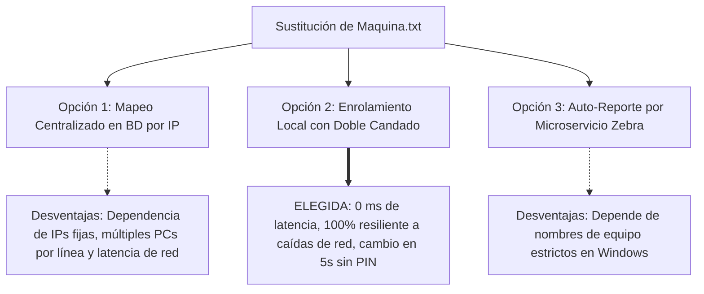
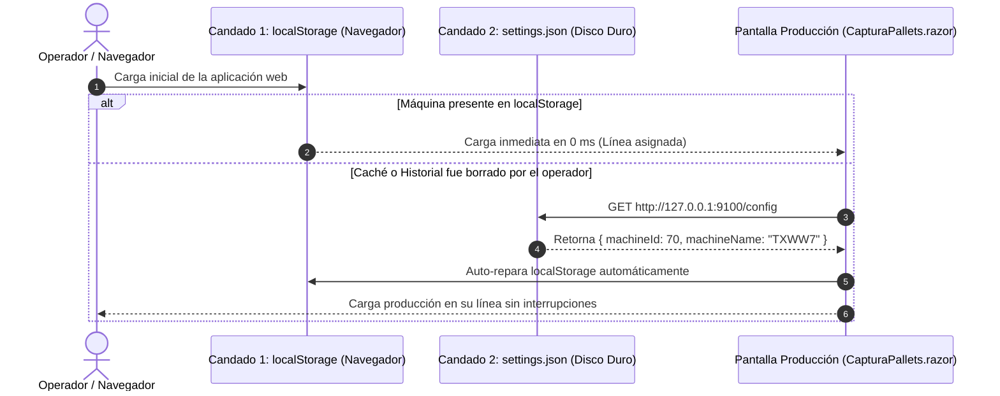

# 105 Enrolamiento de Terminales, Doble Candado y Migración Dinámica de Servidor

**Sistema:** Pallets Wet Wipes (.NET 8 Web App / Blazor Server)  
**Servidor Central IIS:** `http://10.26.24.31:5106/` (Anterior: `http://10.26.24.37:5106/`)  
**Microservicio Local USB:** `http://127.0.0.1:9100/` (`PalletsPrintBridge.exe`)  
**Paquete Instalador Cliente:** `C:\AI\Git Hub\clsA_P035_PallestWipes\Instalador_Cliente_Zebra`  
**Fecha de Implementación:** 19 de Septiembre de 2026  
**Estatus:** ✅ DESPLIEGUE Y OPERATIVIDAD CONFIRMADA  

---

## 1. Justificación Técnica: Eliminación del Archivo Legacy `Maquina.txt`

Durante más de 15 años, el sistema cliente en Visual Basic .NET (`clsA_P035_PallestWipes`) dependió rígidamente de la existencia física del archivo:
`C:\ArchivosBitacoraAut\Maquina.txt`
en el disco duro de cada computadora de producción para saber a qué línea pertenecía (ej. `70` para Máquina 7).

### Problemas Operativos y Técnicos Resueltos:
1. **Incompatibilidad con Arquitectura Web (.NET 8):** Las aplicaciones web ejecutadas en navegadores modernos (Edge/Chrome) están aisladas por motivos de seguridad (*Sandboxing*) y no pueden leer libremente archivos locales en `C:\`.
2. **Fricción de Soporte en Planta:** Cada vez que una computadora fallaba o se instalaba una nueva terminal, el personal de sistemas debía trasladarse físicamente a piso de producción a crear la carpeta `C:\ArchivosBitacoraAut` y escribir el archivo `Maquina.txt` a mano.
3. **Riesgo de Pérdida por Mantenimiento o Formateo:** Al limpiar temporales, actualizar Windows o cambiar de equipo, la terminal perdía su identidad y la aplicación dejaba de operar.
4. **Errores Humanos:** Si un operador o técnico editaba el archivo y colocaba un número equivocado, se registraban pallets en turnos o máquinas incorrectas en la base de datos de producción.

---

## 2. Alternativas Evaluadas y Decisión Industrial

Ante la necesidad de eliminar el archivo de texto, se analizaron tres opciones de vanguardia:



### ¿Por qué se seleccionó la Opción 2 (Doble Candado Local)?
* **Velocidad Extrema (0 ms):** No realiza consultas repetitivas a la base de datos en cada clic; la identidad reside en memoria de la terminal.
* **Tolerancia Total a Cortes de Red:** Si el switch de planta parpadea o la red se interrumpe, la PC no pierde su asignación de máquina.
* **Soporte Multi-PC:** Permite tener 2 o más computadoras trabajando en la misma máquina física (ej. una en mesa de empaque y otra de respaldo) sin tener que dar de alta direcciones IP adicionales en SQL Server.
* **Agilidad Operativa:** El supervisor puede cambiar de línea cualquier computadora en menos de 5 segundos desde la pantalla de Configuración.

---

## 3. Arquitectura del Doble Candado de Respaldo

Para asegurar que una terminal nunca olvide su línea de producción, se implementó un sistema de **Persistencia Redundante**:



### Componentes del Doble Candado:
1. **Candado 1 (`localStorage` del Navegador):** Almacena las claves `PalletsWW_MaquinaId` y `PalletsWW_MaquinaNombre`. Permite que al abrir la app o presionar F5, la pantalla cargue en **0 milisegundos**.
2. **Candado 2 (`settings.json` en Disco Duro):** Gestionado por el microservicio local `PalletsPrintBridge.exe` en:
   `%LOCALAPPDATA%\PalletsWW_ZebraBridge\settings.json`
   Si el operador borra el historial, cookies o datos de navegación, la aplicación web consulta al microservicio local en `127.0.0.1:9100/config`, recupera la máquina de disco y **repara el `localStorage` de forma totalmente transparente**.

---

## 4. Procedimiento Operativo: Cambio de Máquina en Menos de 5 Segundos

Cuando una computadora física se traslada a otra línea de producción o se requiere registrar pallets de otra máquina:

1. **Ingreso a Configuración:**
   * En la barra superior de la app, hacer clic en el botón de engrane o ingresar a `/configuracion`.
   * Introducir la contraseña maestra de supervisor: **`w0rdP@$$`**.
   * **SIN PIN ADICIONAL:** La contraseña maestra valida los privilegios de administrador, eliminando pasos y demoras innecesarias.
2. **Selección de Línea:**
   * La interfaz muestra las líneas activas en botones interactivos (ej. *Línea 3 - TXWW3*, *Línea 7 - TXWW7*).
   * Hacer clic en la línea requerida.
3. **Guardado y Notificación Automática:**
   * Al pulsar **"Guardar y Asignar Máquina"**:
     1. JavaScript guarda la nueva máquina en `localStorage`.
     2. Envía un `POST http://127.0.0.1:9100/config` al servicio local, actualizando `settings.json`.
     3. La pantalla muestra la confirmación en verde: *¡Terminal asignada con éxito a Línea X!*
     4. Tras 1.5 segundos, el sistema redirige automáticamente a la pantalla de producción (`/`).
4. **Tiempo Total:** Menos de 5 segundos para que la PC esté lista operando con los turnos, vales y catálogo de la nueva línea.

---

## 5. Catálogo Dinámico de Máquinas desde SQL Server (`tblMaquinas`)

Una mejora fundamental es que la lista de máquinas **no está fija ni quemada en el código**:

* **Origen de Datos:** Conectado directamente a la base de datos `TLX040MXDB` mediante el Stored Procedure:
  ```sql
  EXEC TLX040MXDB..pa_P009_000_008_LlenarcbxNoMaquinaConParams @NoDepto = 3
  ```
* **Comportamiento ante Nuevas Máquinas:** Si en el futuro la planta incorpora nuevas líneas de toallitas húmedas (ej. Máquina 8 o una nueva línea de empaque) y se registra en `tblMaquinas`, **aparecerá automáticamente en la aplicación web sin necesidad de modificar código, compilar ni reinstalar ningún software**.

---

## 6. Migración Dinámica de Servidor Central (Cambio a `10.26.24.31`)

Ante traslados de publicaciones entre servidores de cómputo (ej. migrar de la IP `10.26.24.37` a la nueva IP definitiva `10.26.24.31`), se diseñaron dos soluciones:

### 6.1 Solución Definitiva de Infraestructura (Recomendada para TI)
Se instruye al personal de TI/Redes de Planta Tlaxcala a registrar un alias DNS interno en el controlador de dominio:
* **Alias DNS:** `http://pallets-ww:5106/` apuntando a la IP en turno (`10.26.24.31`).
* **Beneficio:** En futuros reemplazos de servidores, TI solo cambia la IP en el servidor DNS central y **ninguna PC cliente de la planta tiene que ser modificada**.

### 6.2 Solución Integrada en la Aplicación Web (Tarjeta "Servidor Central")
Para migración inmediata sin depender de cambios de DNS:
1. En `/configuracion`, el supervisor localiza la tarjeta **"Servidor Central de la Aplicación"**.
2. Escribe la nueva IP: **`10.26.24.31`** y pulsa **"Guardar y Reconectar"**.
3. **Automatización:**
   * La app web envía la nueva IP al microservicio local `PalletsPrintBridge`.
   * El microservicio busca en el Escritorio de Windows el acceso directo **`Pallets WW.lnk`** y **reescribe automáticamente su URL de destino** a `http://10.26.24.31:5106/`.
   * La pantalla redirige en vivo a la nueva IP en 1.8 segundos.
   * La terminal se auto-reconoce en el nuevo servidor gracias al Doble Candado.

---

## 7. Paquete Instalador Zero-Touch de 1 Solo Clic

Ubicado en: `C:\AI\Git Hub\clsA_P035_PallestWipes\Instalador_Cliente_Zebra`

* **Instalador:** `INSTALAR_AQUI_1_CLIC.bat`.
* **Cero Preguntas:** No pide número de máquina ni rutas.
* **Modo Silencioso WinExe:** Compilado como `<OutputType>WinExe</OutputType>`. No abre consolas negras en el escritorio del operador.
* **Auto-Inicio:** Se registra en `shell:startup` para iniciar automáticamente con Windows.
* **Acceso Directo Kiosco:** Crea en el Escritorio un acceso directo limpio: **`Pallets WW.lnk`**.

---

## 8. Matriz de Tolerancia a Fallos en Planta

| Escenario de Falla | Comportamiento del Sistema | Acción Requerida |
|---|---|---|
| **Operador borra historial o caché del navegador** | `localStorage` queda vacío. La app web consulta automáticamente `127.0.0.1:9100/config` al servicio local Zebra, recupera la máquina de `settings.json` y **auto-restaura el navegador en 0 ms**. | **Ninguna.** El operador no nota nada. |
| **Se apaga o reinicia la PC** | `PalletsPrintBridge.exe` inicia solo con Windows en segundo plano. La app web lee la máquina de disco y carga en su línea habitual. | **Ninguna.** |
| **Se desconecta el cable de red o se apaga el switch** | La máquina configurada y el servicio Zebra viven localmente en la PC (`127.0.0.1`). Al volver el enlace de red, todo continúa intacto. | **Ninguna.** |
| **Se desconecta el cable USB de la Zebra** | El Spooler de Windows retiene el trabajo en cola. Al reconectar el cable USB, la etiqueta sale de inmediato. | Conectar cable USB. |
| **La PC se mueve físicamente a otra línea** | El supervisor entra a Configuración (`w0rdP@$$`), hace clic en la nueva línea (ej. Línea 3) y pulsa "Guardar y Asignar Máquina". En 1.5s ya está en la Línea 3. | **5 segundos** en pantalla. |
| **Se da de alta una nueva máquina en SQL Server (`tblMaquinas`)** | La app web consulta el catálogo por stored procedure. La nueva máquina aparece automáticamente en el menú de Configuración. | **Ninguna.** Cero cambios de código. |

---

## 9. Estado de Compilación, Publicación y Cumplimiento Normativo

1. **Microservicio Local Zebra (`PalletsPrintBridge`):**
   * Compilado en modo Release WinExe (.NET 8 self-contained x64).
   * Endpoints verificados: `/default?type=printer`, `/write`, `/config` (GET y POST).
2. **Publicación en IIS (`C:\PublishIIS`):**
   * `PalletsWW_PC.Blazor.Publish` (Puerto 5106) actualizado.
   * `PalletsWW_PC.Api.Publish` (Puerto 5105) actualizado.
3. **Regla 1 de `AGENTS.md` (Obligatoria):**
   * Compilación MSBuild Release de `clsA_P035_PallestWipes.vbproj` ejecutada con éxito (0 Errores).
   * Empaquetado MSI actualizado en `C:\AI\Git Hub\SetupPalletsWW_V6\Debug\`:
     - `SetupPalletsWW_V6.msi` (697,344 bytes)
     - `setup.exe` (549,376 bytes)
4. **Codificación:** Todos los archivos de código y documentación guardados estrictamente en **UTF-8 con BOM**.
