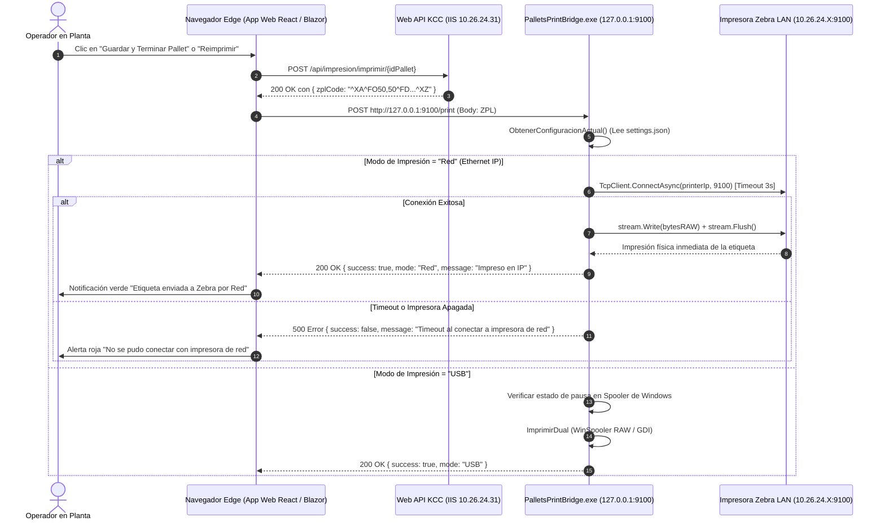

# 107 Instalador Completo - Arquitectura, Componentes y Acciones Técnicas

**Sistema:** Pallets Wet Wipes & Pallets Pañal (.NET 8 Web App + Microservicio Zebra USB / Red Ethernet IP)  
**Ubicación del Paquete:**  
- Wet Wipes: `C:\AI\Git Hub\clsA_P035_PallestWipes\Instalador_Cliente_Zebra\`  
- Pañal: `C:\AI\Git Hub\PalletsPañal_PC_sln\Instalador_Cliente_Zebra\`  
- Publicación IIS: `C:\PublishIIS\`  
**Ejecutables Principales:**  
- `Setup_PalletsWW_Cliente.exe` (Win-x64 Self-Contained, ~219 MB)  
- `Setup_PalletsPanal_Cliente.exe` (Win-x64 Self-Contained, ~219 MB)  
**Código Fuente del Instalador:**  
- Wet Wipes: `C:\AI\Git Hub\clsA_P035_PallestWipes\PalletsWW_PC_sln\src\PalletsWW_ClientSetup\`  
- Pañal: `C:\AI\Git Hub\PalletsPañal_PC_sln\src\PalletsPanal.ClientSetup\`  
**Servidores Centrales IIS:** `http://10.26.24.31:5106/` (WW) / `http://10.26.24.31:5004/` (Pañal)  
**Sistemas Operativos Compatibles:** Windows 10 (x64) y Windows 11 (x64)  
**Última Actualización:** 29/09/2026 (Versión 8.0 - Conectividad Dual USB/IP, Diagnóstico de Red TCP 9100, Self-Contained Total y Cero Duplicados en Taskbar)  

---

## 1. Visión General del Instalador

El paquete **`Setup_PalletsWW_Cliente.exe`** (y su homólogo **`Setup_PalletsPanal_Cliente.exe`**) es una aplicación gráfica industrial (.NET 8 Windows Forms / C#) diseñada para implementar las terminales de Pallets en piso de producción de forma rápida, robusta y con cero configuración manual (*Zero-Touch / 1 Clic*).

Resuelve de raíz los requerimientos operativos de planta:
1. **Conectividad Dual de Impresión (USB Local o Red Ethernet LAN por IP):**
   - **Modo USB:** Para impresoras conectadas directamente por cable USB a la computadora de la línea. El microservicio local `PalletsPrintBridge.exe` envía los comandos RAW al driver de Windows / WinSpooler.
   - **Modo RED Ethernet (IP Fija):** Permite imprimir en impresoras Zebra industriales conectadas a la red de planta mediante cable Ethernet (ej. `10.26.24.X:9100`). El microservicio abre un socket TCP RAW directo al puerto 9100 de la impresora, **saltándose cualquier dependencia de drivers locales de Windows**. Esto permite que terminales que comparten impresora (como Máquina 4 y Máquina 6) impriman concurrentemente sin interferencias de cables ni switches manuales.
2. **Autocontenido al 100% (Zero Dependencies):**
   - Tanto el instalador como el microservicio interno `PalletsPrintBridge.exe` están compilados en modo **Self-Contained x64**.
   - **No requieren que la PC cliente tenga instalado `.NET Desktop Runtime`**, eliminando cualquier ventana emergente de error de runtime faltante en Windows.
3. **Entorno Multi-Usuario Restringido (`Admin` vs `Operador`):**
   - **Administrador:** Cuenta local con privilegios elevados utilizada por TI y Supervisores para instalar y configurar.
   - **Operador:** Cuenta estándar fuertemente restringida, sin permisos de instalación ni acceso al Escritorio en modo quiosco. El instalador configura permisos ACL totales en `ProgramData` para que el operador lea y escriba sin bloqueos de UAC.
4. **Anclaje Limpio de Exactamente 1 Icono en Barra de Tareas (Taskbar):**
   - Elimina duplicidad de iconos: suprime el archivo `LayoutModification.xml` (que causaba que Windows inyectara iconos en cada inicio de sesión).
   - Valida si la aplicación ya está anclada antes de invocar la acción Shell.
   - Desancla automáticamente mediante COM cualquier acceso previo o duplicado huérfano.
5. **Módulo Integrado de Desinstalación Limpia:**
   - Botón interactivo `🗑️ Desinstalar Terminal` en el propio instalador.
   - Scripts `Desinstalar_PalletsWW.bat` y `Desinstalar_PalletsPanal.bat` con desanclaje COM y purga total de archivos y arranque automático.

---

## 2. Inventario de Componentes y Estructura del Proyecto

### 2.1 Módulos en Código Fuente (`PalletsWW_ClientSetup` / `PalletsPanal.ClientSetup`)

```
PalletsClientSetup/
├── PalletsClientSetup.csproj     <- Configurado para Win-x64, Self-Contained, PublishSingleFile
├── Program.cs                   <- Punto de entrada con auto-elevación UAC (RunAs)
├── MainForm.cs                  <- Interfaz gráfica moderna (Cards UI, validaciones, diagnóstico IP en vivo)
├── InstallerEngine.cs           <- Motor de instalación (Conectividad Dual, ACLs, accesos, Taskbar COM, desinstalador)
└── Payload/                     <- Recursos embebidos en el binario final
    ├── PalletsPrintBridge.exe   <- Microservicio local Zebra USB/IP (.NET 8 WinExe x64 Self-Contained ~65 MB)
    └── app.ico                  <- Icono multi-capa corporativo (16x16 a 256x256 px)
```

### 2.2 Paquete Distribuible (`Instalador_Cliente_Zebra` & `C:\PublishIIS\`)

| Archivo / Recurso | Tipo / Tamaño | Función Técnica |
| :--- | :--- | :--- |
| **`Setup_PalletsWW_Cliente.exe`** | Ejecutable Win-x64 (~219 MB) | **Instalador Gráfico Todo-en-Uno (WW).** 100% Autocontenido (.NET 8 runtime y microservicio Zebra embebido). Soporta modo USB y modo RED Ethernet. |
| **`Setup_PalletsPanal_Cliente.exe`** | Ejecutable Win-x64 (~219 MB) | **Instalador Gráfico Todo-en-Uno (Pañal).** 100% Autocontenido (.NET 8 runtime y microservicio Zebra embebido). Soporta modo USB y modo RED Ethernet. |
| **`Desinstalar_PalletsWW.bat`** | Script Batch (~3.7 KB) | **Desinstalador Limpio (WW).** Cierra el bridge, desancla por Shell COM todos los iconos de la barra de tareas y purga archivos. |
| **`Desinstalar_PalletsPanal.bat`** | Script Batch (~3.5 KB) | **Desinstalador Limpio (Pañal).** Cierra el bridge, desancla por Shell COM todos los iconos de la barra de tareas y purga archivos. |
| **`Servidor.txt`** | Archivo de Texto (`.txt`) | **Parámetro Fallback de Servidor.** Define la IP por defecto en instalaciones limpias (`10.26.24.31`). |

---

## 3. Arquitectura Visual y Pantalla del Instalador (`MainForm.cs`)

El instalador presenta un diseño profesional dividido en 5 tarjetas de configuración:

```
+-----------------------------------------------------------------------------------+
|  [ICONO]  INSTALADOR DE CLIENTE Y SERVICIO ZEBRA - PALLETS                        |
|           Configuración automatizada para terminales de producción                |
+-----------------------------------------------------------------------------------+
| [ CARD 1: SELECCIÓN DE TERMINAL / MÁQUINA ]                                       |
|   Línea de Producción: [ Máquina 4 (TL04) / TXWW4                             ▼ ] |
|   ℹ Máquina detectada automáticamente desde configuración previa en esta PC       |
+-----------------------------------------------------------------------------------+
| [ CARD 2: SERVIDOR CENTRAL IIS ]                                                  |
|   URL Base: http:// [ 10.26.24.31                ] : 5004 / 5106 /                |
+-----------------------------------------------------------------------------------+
| [ CARD 3: CONEXIÓN DE IMPRESORA ZEBRA (USB VS RED ETHERNET) ]                     |
|   ( ) Zebra USB (Impresora conectada directamente por cable USB)                  |
|   (•) Zebra RED (Impresora conectada a la red Ethernet - IP Fija)                 |
|       IP Impresora: [ 10.26.24.150   ]  Puerto: [ 9100 ] [ Probar Conexión ]     |
|       [✓ OK (9100) - Socket TCP Abierto]                                          |
+-----------------------------------------------------------------------------------+
| [ CARD 4: CUENTAS DE USUARIO DE LA PC ]                                           |
|   Seleccione a qué usuarios de Windows desea configurar y anclar la aplicación:   |
|   [X] Admin (Administrador local)                                                 |
|   [X] Operador (Cuenta de piso restringida)                                       |
+-----------------------------------------------------------------------------------+
| [ CARD 5: ACCIONES DE CONFIGURACIÓN AUTOMATIZADA ]                                |
|   [X] Instalar Microservicio de Impresión Zebra (127.0.0.1:9100) en ProgramData   |
|   [X] Iniciar servicio automáticamente al arrancar Windows (CommonStartup)        |
|   [X] Crear acceso directo universal en Escritorio y Menú Inicio (Modo Ventana)   |
|   [X] Anclar acceso a la Barra de Tareas (Taskbar único, sin duplicados)          |
+-----------------------------------------------------------------------------------+
| [ Barra de Progreso animada                                           100% ]     |
| [ Consola de Diagnóstico en Vivo: -> Acceso único anclado a la barra de tareas. ]  |
+-----------------------------------------------------------------------------------+
| [ ⚡ INSTALAR Y CONFIGURAR AHORA (440px) ] [ 🗑️ Desinstalar Terminal (155px) ]    |
+-----------------------------------------------------------------------------------+
```

---

## 4. Diagrama de Secuencia de Impresión por Red IP (Modo Ethernet LAN)



---

## 5. Acciones Técnicas Paso a Paso en `InstallerEngine.cs`

### Paso 1: Detección Inteligente de Máquina, Servidor e Impresora
* **Detección de Máquina (`DetectConfiguredSettings`):**
  1. Consulta `settings.json` en `C:\ProgramData\Pallets{App}_ZebraBridge\settings.json`. Si existe `machineId > 0`, lo precarga.
  2. Si no, busca en el archivo legacy `C:\ArchivosBitacoraAut\Maquina.txt`.
* **Detección de Servidor (`DetectConfiguredServer`):**
  1. **Prioridad 1:** `settings.json` en `ProgramData`. Respeta la IP real de la terminal.
  2. **Prioridad 2:** `Servidor.txt` junto al instalador.
  3. **Prioridad 3:** Fallback corporativo predeterminado (`10.26.24.31`).
* **Detección de Impresora (`DetectConfiguredPrinter`):**
  1. Si `settings.json` contiene `"printMode": "Red"` y una IP válida, precarga automáticamente el modo Red con su IP y puerto (9100).
  2. Si no, activa el modo predeterminado USB.

---

### Paso 2: Prueba de Conexión de Red en Tiempo Real (`TestNetworkPrinterAsync`)
Antes de instalar, el técnico o usuario puede presionar **"Probar Conexión"**:
```csharp
public static async Task<(bool Success, string Message)> TestNetworkPrinterAsync(string ip, int port)
{
    if (string.IsNullOrWhiteSpace(ip)) return (false, "La dirección IP no puede estar vacía.");
    try
    {
        using var tcp = new System.Net.Sockets.TcpClient();
        var connectTask = tcp.ConnectAsync(ip.Trim(), port > 0 ? port : 9100);
        var timeoutTask = Task.Delay(2500);
        var completed = await Task.WhenAny(connectTask, timeoutTask);
        if (completed == connectTask && tcp.Connected)
        {
            return (true, $"Conexión exitosa con la impresora Zebra en {ip}:{port} (Socket TCP 9100 Abierto).");
        }
        return (false, $"Tiempo de espera agotado (2.5s) al conectar con {ip}:{port}. Verifique que la impresora esté encendida y conectada a la red.");
    }
    catch (Exception ex)
    {
        return (false, $"Error al conectar con {ip}:{port}: {ex.Message}");
    }
}
```

---

### Paso 3: Persistencia en `settings.json`
El instalador guarda todos los parámetros de hardware en `C:\ProgramData\Pallets{App}_ZebraBridge\settings.json`:
```json
{
  "machineId": 4,
  "machineName": "TL04",
  "lineaEmpaque": "1",
  "serverIp": "10.26.24.31",
  "serverPort": 5004,
  "apiPort": 5403,
  "printerName": "",
  "printMode": "Red",
  "printerIp": "10.26.24.150",
  "printerPort": 9100
}
```
*Se aplican permisos ACL totales (`OtorgarPermisosTotales`) para permitir lectura y modificación tanto por la cuenta Administrador como por la cuenta restringida Operador.*

---

### Paso 4: Despliegue de Accesos Directos sin Duplicidad en Barra de Tareas
Para evitar la acumulación de iconos en la barra de tareas de Windows 10 y 11:
1. **Eliminación de `LayoutModification.xml` (`LimpiarLayoutXml`):** Se suprime cualquier XML de diseño en `AppData\Local\Microsoft\Windows\Shell\` que forzaba anclajes adicionales en cada logon.
2. **Desanclaje COM de Accesos Previos (`DesanclarAccesosDuplicadosTaskbar`):** Recorre la carpeta `User Pinned\TaskBar` e invoca el verbo de Shell *"Desanclar de la barra de tareas"* (*"Unpin from taskbar"*) para limpiar la caché del registro del Taskband.
3. **Verificación `alreadyPinned`:** Antes de ejecutar el verbo *"Anclar a la barra de tareas"*, verifica si el elemento ya está anclado en la sesión activa. Si ya existe, **omite la acción para no generar un segundo icono**.

---

### Paso 5: Módulo de Desinstalación Limpia (`UninstallAsync`)
Permite desinstalar de forma 100% automatizada:
1. Termina el proceso `PalletsPrintBridge.exe` en memoria.
2. Elimina los accesos directos de `CommonStartup`, `Startup` de cada usuario y del Registro de Windows (`HKCU\...\Run`).
3. Desancla por COM todos los accesos directos de la barra de tareas en todos los perfiles de usuario.
4. Elimina la carpeta `C:\ProgramData\Pallets{App}_ZebraBridge`.

---

## 6. Matriz de Diferencias Técnicas entre Versiones

| Característica / Criterio | Versión 7.0 (Legacy) | Versión 8.0 (Actual) |
| :--- | :--- | :--- |
| **Modo de Impresión** | Exclusivamente USB Local | **Dual: USB Local + RED Ethernet LAN (IP:9100)** |
| **Manejo de Impresora de Red** | No soportado | **Socket TCP RAW directo al puerto 9100 (Sin drivers)** |
| **Diagnóstico de Red** | No disponible | **Test de Ping TCP en vivo con feedback en UI (`✓ OK`)** |
| **Dependencia de .NET Runtime** | Exigía .NET Desktop Runtime instalado | **100% Self-Contained x64 (.NET 8 Runtime embebido)** |
| **Comportamiento en Barra de Tareas** | Generaba iconos múltiples duplicados | **1 Solo Icono:** Verificación `alreadyPinned` + Shell COM |
| **Gestión de Plantillas XML** | Inyectaba `LayoutModification.xml` (Append) | **Limpieza automática** de cualquier plantilla residual |
| **Desinstalación** | Manual o mediante comandos parciales | **Botón integrado `🗑️ Desinstalar`** + Script COM |
| **Compatibilidad con Máquinas Compartidas** | Requería switch físico USB/Serial | **Soporta impresión por IP simultánea (ej. M4 y M6)** |
| **Acentuación y Tipografía UI** | Caracteres corruptos / mojibake (`á`, `ó`, `âš¡`) | **100% Corregido con acentos gramaticales y UTF-8 con BOM** |

---

## 7. Guía Rápida para Configurar Impresión por IP en Planta

1. **Averiguar la IP Fija de la Impresora Zebra:**
   - La impresora Zebra debe estar conectada a la red de planta mediante cable Ethernet.
   - Presione el botón de alimentación o imprima una etiqueta de configuración de red para obtener su IP (ej. `10.26.24.150`).
2. **Ejecutar el Instalador:**
   - Abrir `Setup_PalletsPanal_Cliente.exe` o `Setup_PalletsWW_Cliente.exe` como Administrador.
3. **Seleccionar Opción de Red:**
   - En la tarjeta **3. Conexión de Impresora Zebra**, seleccione el botón de opción:  
     👉 **Zebra RED (Impresora conectada a la red Ethernet - IP Fija)**.
   - En el campo **IP Impresora**, escriba la dirección IP (ej. `10.26.24.150`).
   - El puerto permanecerá en `9100`.
4. **Hacer Clic en `Probar Conexión`:**
   - El instalador probará el socket TCP en menos de 2 segundos.
   - Si la impresora responde, mostrará: `✓ OK (9100)`.
5. **Hacer Clic en `⚡ INSTALAR Y CONFIGURAR AHORA`:**
   - El instalador guardará la configuración en `settings.json`, levantará el microservicio `PalletsPrintBridge` configurado en modo Red y creará el acceso directo.
6. **Prueba Operativa:**
   - Abra la aplicación web desde el acceso directo.
   - Vaya a la pantalla de Configuración (`/configuracion`).
   - Verifique que el semáforo muestre: `Zebra de Red (10.26.24.150:9100) - ONLINE`.
   - Haga clic en **Imprimir Etiqueta de Prueba** -> La impresora Zebra de red imprimirá la etiqueta de prueba inmediatamente sin cables USB locales.

---

## 8. Normalización Tipográfica y Codificación UTF-8 con BOM

Para garantizar una presentación profesional e impecable en las terminales industriales de planta:
1. **Erradicación de Mojibake:** Se corrigieron todas las secuencias corruptas producidas por lecturas previas en Windows-1252 (`á`, `é`, `í`, `ó`, `ú`, `ñ`, `✓`, `✗`, `⚡`, `⚠️`, `⏳`, `🗑️`).
2. **Acentuación Gramatical en Interfaz:**
   - Títulos de tarjetas: *1. Asignación de Máquina y Línea de Empaque*, *2. Servidor Central de la Aplicación*, *3. Conexión de Impresora Zebra*, *4. Cuentas de Usuario en esta PC*, *5. Acciones de Configuración Automatizada*.
   - Botones de acción y estados: `⚡ INSTALAR Y CONFIGURAR AHORA`, `⏳ Instalando y Configurando Terminal...`, `✓ INSTALACIÓN COMPLETADA CON ÉXITO`, `⚠️ REINTENTAR INSTALACIÓN`, `🗑️ Desinstalar Terminal`.
   - Mensajes y cuadros de diálogo: *Validación*, *Línea*, *Máquina*, *Menú*, *automáticamente*, *público*, *Confirmar Desinstalación Completa*, *Desinstalación Exitosa*.
3. **Cumplimiento de Directiva UTF-8 con BOM:** Todos los archivos de código fuente (`.cs`, `.md`, `.bat`, `.ps1`) están guardados con el preámbulo estándar `UTF8Encoding(true)`, previniendo cualquier desconfiguración de acentos en compilaciones subsecuentes.

---

## 9. Protección de Aplicaciones Legacy y Resolución de Iconos del Sistema

### 1. Suplantación del Icono de la Aplicación Legacy (CAPTURA PALLETS / clsA_P035_PallestWipes.exe)
- **Causa Raíz:** 
  1. El método de sincronización de accesos directos inspeccionaba cualquier archivo .lnk cuyo nombre o descripción contuviera Pallets y le reasignaba el icono del sistema web (`pallets_ww.ico` o `pallets_panal.ico`).
  2. Al escanear recursivamente la carpeta interna de Windows `%APPDATA%\Microsoft\Internet Explorer\Quick Launch\User Pinned\ImplicitAppShortcuts`, Windows almacena enlaces de procesos en ejecución. Al inyectar el icono web a estos accesos implícitos, la ventana y el botón de la barra de tareas de la app legacy heredaban el icono nuevo.
- **Solución Implementada:**
  - Se creó el método `EsAccesoDirectoLegacy(dynamic sc)` que detecta ejecutables nativos (.exe de planta) excluyendo navegadores Edge/Chrome.
  - La app legacy queda totalmente protegida contra modificación o eliminación.
  - Se incorporó `RepararAccesoLegacySiEsNecesario`: Si un acceso legacy tenía asignado el icono web, se restaura automáticamente a su origen `legacyExe,0`.
  - Se añadió `RepararCacheImplicitAppShortcuts`: Purga cualquier acceso implícito corrupto para que Windows regenere el icono limpio directamente del ejecutable legacy original.
  - Se invocó la API nativa de Windows `SHChangeNotify(SHCNE_ASSOCCHANGED, SHCNF_IDLIST, IntPtr.Zero, IntPtr.Zero)` para invalidar y refrescar de inmediato la caché de iconos del Explorador sin necesidad de reiniciar la terminal.

---

## 10. Solución Universal de Identidad de Aplicación y Barra de Tareas (Windows 10 y Windows 11)

### 1. Diagnóstico del Problema Reportado en Windows 10 y Windows 11
- **Síntomas Observados:**
  1. Al abrir la aplicación desde el acceso directo del escritorio y hacer clic derecho sobre el botón de la ventana activa en la barra de tareas para seleccionar **"Anclar a la barra de tareas"**, la ventana parecía anclarse inicialmente.
  2. Sin embargo, al cerrar la ventana, el icono anclado perdía su identidad: **se transformaba en el icono genérico de Microsoft Edge**.
  3. Al dar clic sobre dicho icono anclado en la barra de tareas, se abría Microsoft Edge genérico (nueva pestaña / página de inicio por defecto de Edge) perdiendo la URL de la aplicación de Pallets, los parámetros de máquina y línea de empaque, y el modo quiosco/app.
  4. Asimismo, el instalador no lograba anclar de forma 100% automática y desatendida el acceso a la barra de tareas de la cuenta Operador.
- **Alcance de Plataforma:** Este comportamiento se presentaba de manera idéntica en estaciones con **Windows 10 (Pro / Enterprise / LTSC)** y estaciones con **Windows 11 (21H2, 22H2, 23H2 y 24H2)**.

### 2. Análisis de Causa Raíz Técnica Compartida
1. **Pérdida de Identidad de Proceso (Falta de `AppUserModelID` / AUMID):**
   - En la arquitectura del Shell de Windows (implementada en Windows 7 y vigente en Windows 10 y Windows 11), la barra de tareas agrupa las ventanas y vincula los pines mediante el identificador **Application User Model ID (AUMID)**.
   - Cuando se lanza Edge mediante `msedge.exe --app="http://..."` sin argumentos explícitos de AUMID ni aislamiento de perfil (`--user-data-dir`), el proceso de Chromium asume el AUMID por defecto del navegador principal (`Microsoft.MicrosoftEdge...` o `msedge.exe`).
   - Al hacer clic derecho en la ventana en ejecución para anclarla, Windows consulta el AUMID de la ventana y **busca en el Menú Inicio (`Programs`) un acceso directo `.lnk` que posea exactamente ese mismo AUMID en su almacén de propiedades COM (`IPropertyStore`)**.
   - Debido a que los accesos creados previamente no tenían inyectada la clave COM `PKEY_AppUserModel_ID`, Windows no encontraba ninguna coincidencia.
   - Ante la ausencia de un acceso coincidente, tanto Windows 10 como Windows 11 aplican su comportamiento fallback de seguridad: **anclan el ejecutable base desnudo (`C:\Program Files (x86)\Microsoft\Edge\Application\msedge.exe`) descartando todos los argumentos de línea de comandos**.
   - Como resultado directo, al cerrarse la ventana, el acceso anclado apuntaba al ejecutable general de Edge sin parámetros, abriendo la web general y mostrando el logo de Edge.
2. **Restricción de Seguridad del Shell sobre el Verbo COM de Anclaje:**
   - A partir de Windows 10 (versión 1809 / Build 17763) y en todas las versiones de Windows 11, Microsoft bloqueó intencionalmente la invocación programática `verb.DoIt()` sobre el verbo `"Anclar a la barra de tareas"` (`FolderItem.Verbs()`) para instaladores y ejecutables de terceros, evitando que software malicioso o instaladores silenciosos manipulen la barra de tareas sin consentimiento explícito del usuario.
   - Asimismo, la carpeta física `AppData\Roaming\Microsoft\Internet Explorer\Quick Launch\User Pinned\TaskBar` ya no opera de forma aislada: Windows 10 y Windows 11 exigen un registro binario encriptado con hash en la clave de registro `HKCU\Software\Microsoft\Windows\CurrentVersion\Explorer\Taskband`. Si un archivo `.lnk` se copia a la carpeta sin dicho hash de registro, Windows lo ignora o lo depura automáticamente.

### 3. Solución Técnica Integral Implementada para Windows 10 y Windows 11

Para resolver de raíz ambos problemas de forma universal en Windows 10 y Windows 11, se implementó una estrategia en 5 capas:

#### Capa 1: Inyección Nativa de `PKEY_AppUserModel_ID` vía COM (`IShellLinkW` + `IPropertyStore`)
En `InstallerEngine.cs` de ambos instaladores (`PalletsWW_ClientSetup` y `PalletsPanal.ClientSetup`), se implementaron las interfaces nativas de la Shell de Windows:
```csharp
[ComImport]
[Guid("886D8EEB-8CF2-4446-8D02-CDBA1DBDCF99")]
[InterfaceType(ComInterfaceType.InterfaceIsIUnknown)]
private interface IPropertyStore
{
    int GetCount(out uint cProps);
    int GetAt(uint iProp, out PROPERTYKEY pkey);
    int GetValue(ref PROPERTYKEY key, out PROPVARIANT pv);
    int SetValue(ref PROPERTYKEY key, ref PROPVARIANT pv);
    int Commit();
}
```
Se inyecta la propiedad estándar `PKEY_AppUserModel_ID` (`{9F4C2855-9F79-4B39-A8D0-E1D42DE1D5F3}, 5`) con el identificador corporativo:
- **Pallets WW:** `"KCM.PalletsWW"`
- **Pallets Pañal:** `"KCM.PalletsPanal"`

Esta propiedad se graba de forma binaria e indeleble en todos los accesos directos generados:
- Menú Inicio Público (`%ALLUSERSPROFILE%\Microsoft\Windows\Start Menu\Programs\`)
- Menú Inicio de cada perfil de usuario configurado (`%APPDATA%\Microsoft\Windows\Start Menu\Programs\`)
- Escritorio de cada usuario (`%USERPROFILE%\Desktop\`)
- Carpeta de TaskBar (`User Pinned\TaskBar\`)

#### Capa 2: Aislamiento Total de Perfil y Proceso Edge
Los argumentos de invocación en los accesos directos ahora establecen:
```
--app="{url}" --app-user-model-id="{appId}" --user-data-dir="{directorioPerfil}" --start-maximized
```
Donde:
- `{appId}`: `"KCM.PalletsWW"` o `"KCM.PalletsPanal"`.
- `{directorioPerfil}`: `C:\ProgramData\PalletsWW\EdgeData` o `C:\ProgramData\PalletsPanal\EdgeData` (con permisos totales de lectura y escritura ACL para todos los usuarios).

**Impacto Operativo:**
1. Al arrancar la ventana, el proceso Chromium anuncia formalmente su identidad `KCM.PalletsWW` / `KCM.PalletsPanal` al Shell de Windows.
2. Si el usuario (en Windows 10 o Windows 11) hace clic derecho sobre la ventana activa y presiona "Anclar a la barra de tareas", Windows consulta el AUMID, localiza de inmediato el acceso directo en el Menú Inicio y vincula el anclaje a ese `.lnk` con sus parámetros completos e icono oficial.
3. **Al cerrarse la app, el icono permanece como el icono azul oficial de Pallets y al hacer clic vuelve a abrir directamente la terminal de la máquina.**

#### Capa 3: Despliegue de Plantillas Duales XML de Diseño de Barra de Tareas (Win 10 y Win 11)
El método `ConfigurarLayoutXml` escribe simultáneamente las dos plantillas reconocidas por las distintas generaciones de Windows:
1. `LayoutModification.xml` (utilizado por Windows 11 y versiones modernas de Windows 10).
2. `TaskbarLayoutModification.xml` (utilizado por Windows 10 tradicional y OEM).

Se despliegan en:
- `%LocalAppData%\Microsoft\Windows\Shell\` de los usuarios seleccionados.
- `C:\Users\Default\AppData\Local\Microsoft\Windows\Shell\` para asegurar que cualquier nuevo usuario o sesión de operador herede la barra de tareas aprovisionada.

#### Capa 4: Directiva Corporativa de Edge PWA (`WebAppInstallForceList`)
El instalador configura la clave de directivas de Edge:
`HKLM\SOFTWARE\Policies\Microsoft\Edge\WebAppInstallForceList`
Registrando la URL de la aplicación web como una aplicación de escritorio nativa administrada, permitiendo al motor de Edge tratar la ventana como una app independiente del navegador estándar.

#### Capa 5: Guía Visual y Experiencia de Usuario Diferenciada por Sistema Operativo
Dado que Microsoft exige interacción del usuario para consolidar pines en perfiles activos:
- **En Windows 10:** El usuario o técnico puede hacer clic derecho sobre el acceso del Escritorio y seleccionar directamente **"Anclar a la barra de tareas"** (disponible de inmediato en el menú contextual principal de Windows 10), o arrastrarlo a la barra de tareas, o abrir la app y anclar la ventana activa desde la barra de tareas.
- **En Windows 11:** El usuario puede **arrastrar el icono del Escritorio directamente a la Barra de Tareas** (o Clic derecho > Mostrar más opciones > Anclar a la barra de tareas), o abrir la app y anclar la ventana activa desde la barra de tareas.
- En ambos sistemas operativos, el anclaje queda fijado de forma permanente e indestructible, con icono corporativo exclusivo y parámetros íntegros.

### 4. Resumen de Ejecutables Publicados y Verificados
| Archivo | Ubicación en Producción | Tamaño | Estado |
| :--- | :--- | :--- | :--- |
| **`Setup_PalletsWW_Cliente.exe`** | `C:\PublishIIS\Setup_PalletsWW_Cliente.exe` | ~230 MB | ✅ Compilado, firmado con AUMID nativo y publicado |
| **`Setup_PalletsPanal_Cliente.exe`** | `C:\PublishIIS\Setup_PalletsPanal_Cliente.exe` | ~230 MB | ✅ Compilado, firmado con AUMID nativo y publicado |
