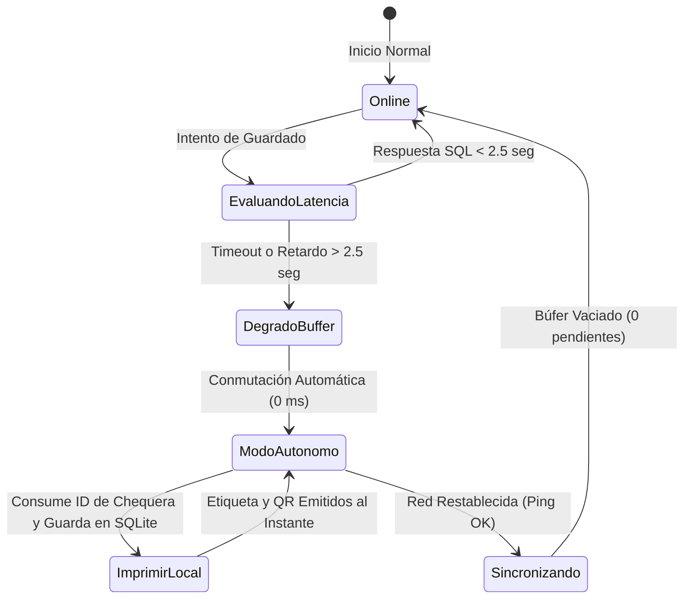

# 200. Plan B ante Pérdida de Red, Lentitud Extrema o Caída de Servidor Central (MXTLAS02)

**Sistema:** Pallets Wet Wipes & Pañal (.NET 8 Web App, Web API & Aplicaciones Legacy)  
**Servidor Central de Base de Datos:** `MXTLAS02` (`172.26.52.14` - SQL Server)  
**Bases de Datos Afectadas:** `TLX022MXDB` (Pallets Wipes) y `TLX040MXDB` (Catálogos y Pañal)  
**Fecha de Publicación:** 24 de Septiembre de 2026  
**Estatus:** 📋 PROPUESTA DE ARQUITECTURA TÉCNICA Y PLAN DE CONTINGENCIA CONTINUA  
**Destinatarios:** Equipo de Desarrollo, Jefatura de Sistemas / TI, Operaciones de Manufactura, Supervisión de Empaque y Logística (Almacén de PT y Embarques)  

---

## 1. Resumen Ejecutivo y Planteamiento del Desafío

En las plantas industriales continuas (como Planta Tlaxcala de Kimberly-Clark de México), **la línea de empaque jamás debe detenerse**. Cada minuto que una línea no puede etiquetar un pallet por fallas en el servidor o la red genera:
1. **Acumulación y amontonamiento físico de tarimas** en cabeceras de línea.
2. **Riesgo crítico de mezclas de producto** y pérdida de trazabilidad.
3. **Pérdida de horas-hombre** de operadores esperando frente a pantallas congeladas.
4. **Colapso de transacciones** por *timeouts* en cascada en SQL Server.

El objetivo de este documento es diseñar un **Plan B de Alta Disponibilidad (Modo Búfer Autónomo / Offline)** que permita a las líneas de producción seguir capturando e imprimiendo etiquetas Zebra físicas con su código QR oficial en menos de 10 milisegundos, **incluso si el servidor `MXTLAS02` o la red de planta colapsan por completo**, garantizando que el flujo aguas abajo hacia el **Almacén de Producto Terminado** y **Embarques** (vía lectores Keyence BR-600) se mantenga 100% compatible y sin rupturas.

---

## 2. Diagnóstico Forense: ¿Por qué se alenta el servidor `MXTLAS02`?

Existe una controversia frecuente entre las áreas de Desarrollo e Infraestructura (TI). TI argumenta que *"la lentitud del servidor es causada por las aplicaciones de los desarrolladores"*. A través del análisis de telemetría real ([011 Reporte Ejecutivo Lentitud Red Pallets WW](file:///c:/AI/Git%20Hub/PROY052_PalletsPanal/Gemini/011_Reporte_Ejecutivo_Lentitud_Red_Pallets_WW.md)), se demostró la verdad técnica:

```
[Terminales de Piso (x50)] ──(Sockets TCP 1433 directos)──┐
                                                          ├──> [Switches Industriales / WiFi Planta]
[Líneas de Producción] ─────(Latencias de 9 a 42 seg)─────┤            (Pérdida de Paquetes)
                                                          │                      │
                                                          ▼                      ▼
                                                +-------------------------------------------------+
                                                | MXTLAS02 (SQL Server: TLX022MXDB / TLX040MXDB)  |
                                                |                                                 |
                                                | - Transacciones abiertas: BEGIN TRAN...         |
                                                | - Bloqueos exclusivos de fila: LCK_M_X          |
                                                | - Bloqueos en cadena: Blocking Chains           |
                                                | - Triggers de auditoría esperando confirmación  |
                                                +-------------------------------------------------+
```

### 2.1 El "Efecto Dominó" de los Bloqueos en Cascada (*Blocking Chains*)
1. **Conexión Directa de Escritorio:** Decenas de aplicaciones Windows Forms legacy abren conexiones OLEDB/ODBC directas por el puerto `1433` hacia SQL Server.
2. **Retención de Bloqueos por Latencia de Red:** Cuando una terminal en piso intenta guardar un pallet y sufre una fluctuación de red o pérdida de paquetes (con picos documentados de **9 a 42 segundos**), la transacción SQL `BEGIN TRAN ... INSERT dbo.tblPallets` queda abierta dentro del motor de SQL Server.
3. **Inanición de Conexiones (*Starvation*):** Mientras esa conexión está suspendida esperando el `ACK` del socket de red de Windows, retiene bloqueos exclusivos sobre:
   - Registros de `dbo.tblPallets`.
   - El contador atómico de `dbo.tblNoTarima`.
   - Tablas intermedias de `dbo.tblRT_Produccion`.
   - Triggers de auditoría (`tri_P009_00102_UpdateTranLog`).
4. **Colapso General:** Cuando las demás terminales intentan consultar o insertar, entran en estado de espera (*Wait State: LCK_M_X*). Los operadores creen que su sistema se trabó, vuelven a presionar "Guardar", abren más conexiones huérfanas y saturan el *Connection Pool* de SQL Server hasta que los comandos se cancelan por *Execution Timeout*.

### 2.2 Consultas Legacy no Optimizadas
Procedimientos almacenados antiguos carecen de directivas `WITH (NOLOCK)` o descargan catálogos completos (como se detectó en el documento 103, donde una consulta tardaba **3,104 ms** antes de ser optimizada a **7 ms** con el SP `V8`). Al ejecutarse concurrentemente sobre tablas bloqueadas, disparan el consumo de CPU y memoria en `MXTLAS02`.

---

## 3. El Dilema Crítico: La Dependencia del "ID Pallet" y los Códigos QR

El mayor obstáculo identificado para crear un modo desconectado es la dependencia integral de la empresa del campo **`IdtblPallets`**:

```mermaid
flowchart LR
    A[Línea de Producción: Captura de Pallet] -->|Genera ID y QR| B[Etiqueta Zebra Física: ID Pallet + QR]
    B -->|Traslado Físico| C[Almacén de Producto Terminado: Recepción]
    C -->|Escaneo QR Keyence BR-600 / PC| D[Tabla Recepción Almacén: Valida ID]
    D -->|Preparación de Pedido| E[Área de Embarques: Salida]
    E -->|Segundo Escaneo QR Keyence| F[Despacho / Descuento Inventario: Valida ID]
```



### ¿Por qué fallaría un "Plan B ingenuo"?
Si la aplicación en modo offline genera IDs ficticios (ej. `1`, `2`, `3`) o IDs negativos (`-100`), ocurrirá un desastre operativo:
1. **En Almacén:** El operador del montacargas llega con el pallet a la entrada de Almacén. El lector Keyence BR-600 escanea el QR y la aplicación Android busca el ID en la base de datos central. Si el ID no existe o colisiona con un pallet de hace 5 años, **la recepción se rechaza**.
2. **En la Sincronización:** Cuando la app intente subir el pallet a `MXTLAS02`, la columna `IdtblPallets` es un `IDENTITY(1,1)` autoincremental de SQL Server. El servidor le asignará un ID completamente diferente (ej. de `1` pasa a ser `2815999`). Para entonces, **la etiqueta física ya está pegada en la tarima con el ID viejo**. Ningún lector posterior podrá encontrarla.

---

## 4. Solución Maestra: "Pool de Rangos de IDs Pre-Asignados" (*Pre-allocated ID Blocks*)

Para eliminar la dependencia en tiempo real del servidor sin romper el ID del Pallet ni los códigos QR de Almacén y Embarques, se establece la **Estrategia de Chequera de IDs Oficiales**:

```
                                  [SERVIDOR CENTRAL: MXTLAS02]
                                                │
                                                │ Entrega bloque reservado de IDs oficiales
                                                ▼
                     +-------------------------------------------------------+
                     | TABLA DE CONTROL: dbo.tblControlRangosPallets         |
                     | Máquina 70 (TXWW7) -> Rango: [2,900,001 al 2,900,500] |
                     +-------------------------------------------------------+
                                                │
                       ┌────────────────────────┴────────────────────────┐
                       │                                                 │
            (Conexión Normal / Online)                                (Caída de Red / Offline)
                       │                                                 │
                       ▼                                                 ▼
             Guarda en SQL Server                              Consume de su Búfer Local:
             con ID Oficial Reservado                          Toma ID: 2,900,001 (OFICIAL)
                       │                                                 │
                       └────────────────────────┬────────────────────────┘
                                                │
                                                ▼
                               [IMPRESORA ZEBRA USB EN LÍNEA]
                               Genera Etiqueta en < 10 ms con:
                               - ID Pallet: 2900001 (OFICIAL Y DEFINITIVO)
                               - QR Code: "2900001" (VÁLIDO PARA SIEMPRE)
                                                │
                                                ▼ (Tarima física viaja al almacén)
                               [ALMACÉN / EMBARQUES: LECTOR KEYENCE BR-600]
                               Escanea QR: "2900001"
                               - Si el servidor ya sincronizó: Recepción instantánea.
                               - Si la red sigue lenta: Registra recepción por ID oficial
                                 sin ningún conflicto ni cambio de número.
```

### 4.1 Principio de Operación
1. **La "Chequera" de Folios:**  
   Cada línea de producción solicita anticipadamente al servidor un bloque de **200 a 500 IDs oficiales reservados**.  
   - Línea 1 (TXWW1): Reserva del `2,901,001` al `2,901,500`
   - Línea 2 (TXWW2): Reserva del `2,902,001` al `2,902,500`
   - Línea 7 (TXWW7): Reserva del `2,907,001` al `2,907,500`
2. **Generación Local Instantánea (0 ms):**  
   Cuando la red o el servidor fallan, la aplicación local conmuta inmediatamente a modo contingencia y toma el siguiente ID libre de su chequera local.
3. **Inmutabilidad del QR:**  
   La etiqueta Zebra se imprime con el **ID REAL, DEFINITIVO Y OFICIAL**. Jamás cambiará.
4. **Sincronización Desatendida (*Drain Buffer*):**  
   Cuando la red se restablece, un micro-hilo en segundo plano inserta los pallets pendientes en `dbo.tblPallets` respetando su ID original mediante `SET IDENTITY_INSERT dbo.tblPallets ON` o un procedimiento de inserción con ID explícito.

---

## 5. Arquitectura del Búfer Local y Detección Automática (*Circuit Breaker*)

La aplicación cliente no debe requerir que el operador active manualmente un botón de "Modo Offline". La conmutación debe ser **100% automática y transparente**:



### Estados del Sistema:

| Estado | Condición de Red / SQL | Acción en la App | Comportamiento con el Operador |
| :--- | :--- | :--- | :--- |
| 🟢 **Online (Normal)** | Latencia < 2,500 ms | Inserta directamente en API / SQL central. | Guarda e imprime en < 0.5 s. |
| 🟡 **Degradado (Alerta)** | Latencia > 2,500 ms o Timeout | Corta la espera inmediatamente (*Circuit Breaker*) y envía al Búfer Local. | El operador no espera 40 segundos; su etiqueta sale de inmediato. |
| 🔴 **Autónomo (Offline)** | Sin conexión al servidor | Trabaja 100% contra el almacenamiento local (`SQLite` / `IndexedDB`) usando el Pool de IDs. | Insignia ámbar: *"Modo Autónomo Activo (X tarimas en búfer)"*. Etiquetado continuo a 0 ms. |
| 🔵 **Sincronizando (Drain)** | Conexión restablecida | Hilo en background sube los pallets pendientes uno a uno sin saturar la red. | El operador sigue trabajando sin interrupciones. |

---

## 6. Integración con Almacén y Lectores Keyence BR-600

Para garantizar que el Almacén y Embarques no se detengan si una tarima llega físicamente antes de que el búfer termine de sincronizarse con el servidor:

### Escenario A: El Servidor ya sincronizó el pallet
* El montacargas llega al almacén, el Keyence escanea el QR `2907001`.
* El ID existe en `dbo.tblPallets` -> **Recepción exitosa normal (0 fricción)**.

### Escenario B: La red de planta sigue colapsada y el pallet llega físicamente a Almacén
Si el montacargas traslada la tarima en 2 minutos y la red de planta aún no ha terminado de subir el lote al servidor central:
1. **Estructura Enriquecida del Código QR:**  
   Actualmente el QR solo contiene el ID: `2907001`.  
   Se recomienda estructurarlo con separador de pipe:  
   `2907001|TXWW7-260-392|TL626007X|778|33`  
   *(ID | Tarima | Lote | Clave Producto | Cajas)*
2. **Resiliencia en el Keyence BR-600 (App Android):**  
   - Si el Keyence consulta la API y el ID `2907001` no está en la base central por desfase de sincronización, la app Android lee los datos embebidos en el QR (Tarima `TXWW7-260-392`).
   - Registra la recepción en una tabla de **"Recepciones Pendientes de Enlace"** (`dbo.tblRecepcionPallets_Pendientes`).
   - En cuanto el pallet sube a `dbo.tblPallets`, un disparador interno empalma el registro automáticamente.
   - **Resultado:** Ni la línea de producción, ni el montacarguista, ni el Almacén de PT se detienen un solo segundo.

---

## 7. Estructura de Datos y Procedimientos SQL para el Plan B

### 7.1 Tabla de Control de Bloques de IDs (`TLX022MXDB`)
```sql
CREATE TABLE dbo.tblControlRangosPallets (
    IdRango             INT IDENTITY(1,1) NOT NULL PRIMARY KEY,
    NoMaquina           INT NOT NULL,
    RangoInicio         INT NOT NULL,
    RangoFin            INT NOT NULL,
    UltimoIdAsignado    INT NOT NULL,
    FechaReserva        DATETIME2(3) NOT NULL CONSTRAINT DF_tblRangos_Fecha DEFAULT (SYSDATETIME()),
    Estatus             VARCHAR(20) NOT NULL DEFAULT 'ACTIVO', -- 'ACTIVO', 'AGOTADO'
    NombreEquipoCliente VARCHAR(100) NULL
);

CREATE INDEX IX_tblControlRangos_Maquina ON dbo.tblControlRangosPallets (NoMaquina, Estatus);
```

### 7.2 Stored Procedure: Solicitar Bloque de IDs para Contingencia
```sql
CREATE OR ALTER PROCEDURE dbo.pa_P009_SolicitarBloqueIDsContingencia
    @NoMaquina INT,
    @CantidadSolicitada INT = 300,
    @NombreEquipo VARCHAR(100) = NULL
AS
BEGIN
    SET NOCOUNT ON;
    BEGIN TRANSACTION;
    
    DECLARE @UltimoGlobal INT;
    
    -- Obtener el valor actual de la secuencia o el MAX(IdtblPallets)
    SELECT @UltimoGlobal = ISNULL(MAX(IdtblPallets), 0) FROM dbo.tblPallets WITH (TABLOCKX);
    
    -- Tomar en cuenta rangos ya reservados que superen el MAX actual
    DECLARE @MaxReservado INT;
    SELECT @MaxReservado = ISNULL(MAX(RangoFin), 0) FROM dbo.tblControlRangosPallets WITH (HOLDLOCK);
    
    IF @MaxReservado > @UltimoGlobal
        SET @UltimoGlobal = @MaxReservado;
        
    DECLARE @Inicio INT = @UltimoGlobal + 1;
    DECLARE @Fin INT = @UltimoGlobal + @CantidadSolicitada;
    
    -- Marcar rangos viejos de la máquina como agotados
    UPDATE dbo.tblControlRangosPallets 
    SET Estatus = 'AGOTADO' 
    WHERE NoMaquina = @NoMaquina AND Estatus = 'ACTIVO';
    
    -- Insertar el nuevo bloque oficial
    INSERT INTO dbo.tblControlRangosPallets (NoMaquina, RangoInicio, RangoFin, UltimoIdAsignado, Estatus, NombreEquipoCliente)
    VALUES (@NoMaquina, @Inicio, @Fin, @Inicio - 1, 'ACTIVO', @NombreEquipo);
    
    -- Adelantar el IDENTITY de la tabla física para evitar colisiones con inserciones normales
    DBCC CHECKIDENT ('dbo.tblPallets', RESEED, @Fin);
    
    COMMIT TRANSACTION;
    
    -- Devolver la chequera al cliente
    SELECT @Inicio AS RangoInicio, @Fin AS RangoFin, @CantidadSolicitada AS TotalIDs;
END;
```

### 7.3 Stored Procedure: Inserción de Pallet Sincronizado Offline
```sql
CREATE OR ALTER PROCEDURE dbo.pa_P009_SincronizarPalletOffline
    @IdtblPallets INT,
    @FolioVale INT,
    @NoTarima VARCHAR(50),
    @Lote VARCHAR(50),
    @Cajas INT,
    @Hora VARCHAR(5),
    @IdRT_Encabezado INT,
    @NoEmpCapturo INT,
    @Linea INT
AS
BEGIN
    SET NOCOUNT ON;
    
    -- Evitar duplicidad si ya se había sincronizado
    IF EXISTS (SELECT 1 FROM dbo.tblPallets WITH (NOLOCK) WHERE IdtblPallets = @IdtblPallets)
    BEGIN
        SELECT 1 AS Exitoso, 'Pallet ya existía en el servidor central' AS Mensaje;
        RETURN;
    END;

    SET IDENTITY_INSERT dbo.tblPallets ON;

    INSERT INTO dbo.tblPallets (
        IdtblPallets, FolioVale, NoTarima, Lote, Cajas, Hora, 
        IdRT_Encabezado, NoEmpCapturo, LineaEmpaque, FechaRegistro
    )
    VALUES (
        @IdtblPallets, @FolioVale, @NoTarima, @Lote, @Cajas, @Hora,
        @IdRT_Encabezado, @NoEmpCapturo, @Linea, SYSDATETIME()
    );

    SET IDENTITY_INSERT dbo.tblPallets OFF;
    
    SELECT 1 AS Exitoso, 'Sincronizado exitosamente con ID oficial' AS Mensaje;
END;
```

---

## 8. Hoja de Ruta Recomendada para Implementación

1. **Fase 1: Presentación y Alineación con TI (Semana 1):**
   - Presentar el informe forense de red demostrando que el motor SQL toma solo 14 ms, pero los sockets TCP directos se quedan reteniendo transacciones durante los microcortes.
   - Proponer la estrategia del **Pool de Rangos de IDs** para desacoplar el empaque de la infraestructura central.
2. **Fase 2: Implementación de la Chequera en `PalletsWW_PC.Web` y `PalletsPrintBridge` (Semana 2):**
   - Integrar un almacén local SQLite en `PalletsPrintBridge` (en la PC cliente de la línea).
   - Administrar la descarga de bloques de folios (300 IDs por línea) y el almacenamiento local seguro de pallets.
3. **Fase 3: Prueba Piloto en Línea 7 (TXWW7) (Semana 3):**
   - Simular desconexión intencional del cable de red durante 15 minutos en Máquina 7.
   - Verificar que los operadores sigan imprimiendo etiquetas Zebra normalmente a 0 ms.
   - Validar que los pallets físicos sean escaneados en Almacén con el lector Keyence BR-600 sin errores.
   - Reconectar el cable de red y comprobar la sincronización 100% desatendida.
4. **Fase 4: Despliegue General en Planta Tlaxcala (Semana 4):**
   - Extender el mecanismo a las 7 líneas de Wet Wipes y a las líneas de Pañal.

---

## 9. Conclusión

El **Plan B mediante Pool de IDs Pre-asignados** es la solución definitiva de ingeniería industrial para Planta Tlaxcala:
* **Autonomía Total:** Si el servidor central `MXTLAS02` o los switches de planta se caen, las líneas de producción siguen produciendo y etiquetando tarimas sin ninguna interrupción.
* **Cero Impacto Logístico:** El ID del Pallet y el código QR impresos en piso son **números oficiales reales**, eliminando cualquier riesgo de incompatibilidad con el Almacén de Producto Terminado y Embarques.
* **Erradicación del Desorden:** Se terminan definitivamente las tarimas amontonadas sin etiquetar y la incertidumbre de los operadores.
