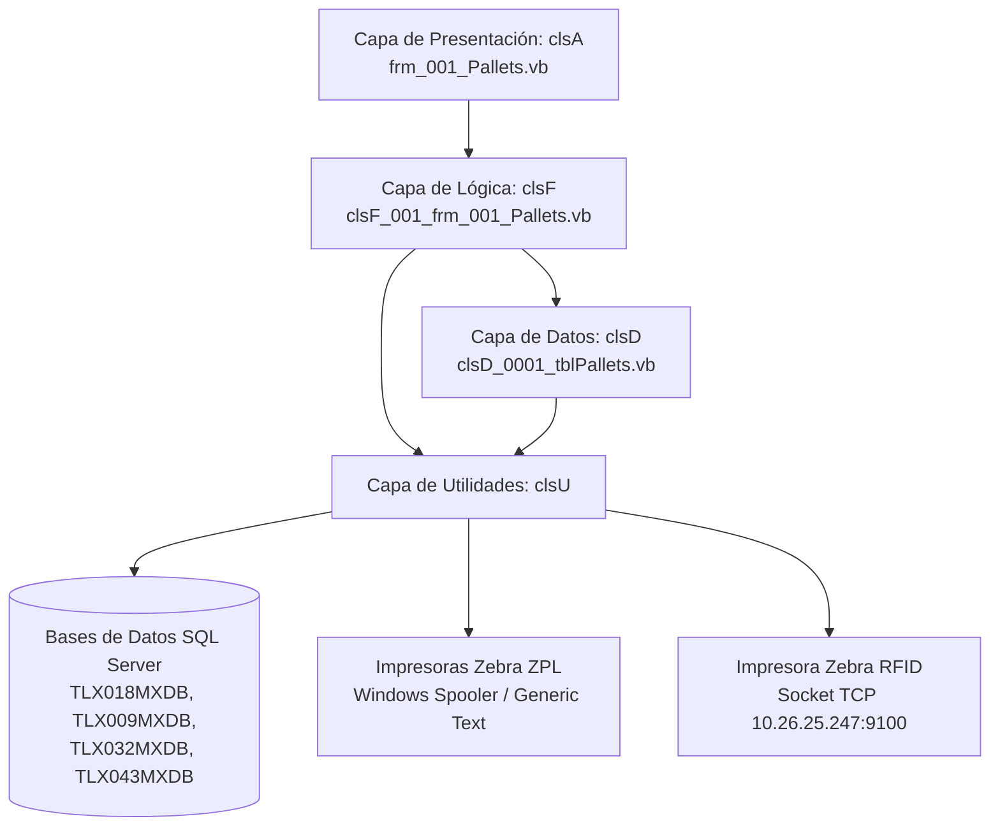
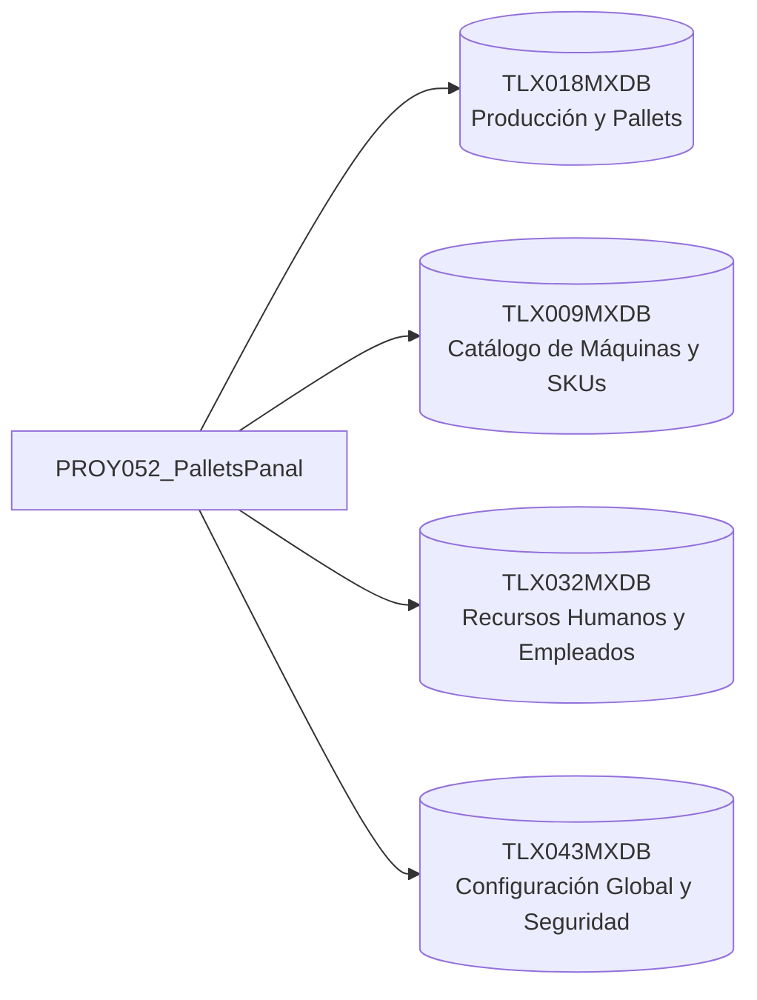
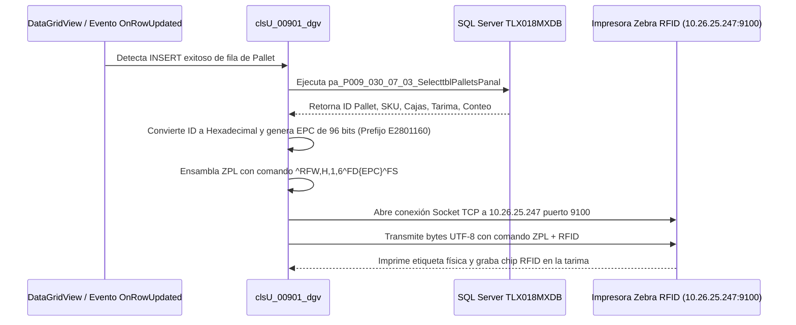
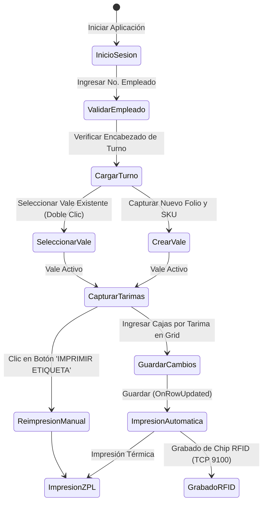

# Documentación Técnica y Funcional: Sistema de Control de Pallets Pañal (PROY052_PalletsPanal)

> **Empresa:** Kimberly-Clark de México (KCM)  
> **Sistema:** Manufactura de Clase Mundial (MCM) - Planta Tlaxcala / Planta Ramos Arizpe  
> **Módulo:** Captura, Registro y Etiquetado RFID de Pallets de Pañal (`PROY052_PalletsPanalGlobal`)  
> **Plataforma:** .NET Framework 4.8 / Windows Forms (Visual Basic .NET)  
> **Fecha de Documentación:** Septiembre 2026  

---

## 1. Resumen Ejecutivo

**PROY052_PalletsPanal** es una aplicación cliente de escritorio industrial (WinForms en VB.NET) diseñada para estaciones de trabajo en las líneas de empaque y manufactura de pañales y toallitas húmedas de **Kimberly-Clark de México**.

El objetivo central del sistema es:
1. **Controlar el registro de producción en tiempo real** vinculado a turnos operativos y tripulaciones.
2. **Generar y gestionar Vales de Producción** asociados a claves específicas de producto (SKUs).
3. **Registrar tarimas/pallets individuales** con su número consecutivo, cajas por tarima y estampas de tiempo.
4. **Imprimir etiquetas físicas industriales en código ZPL (Zebra Programming Language)** en impresoras térmicas Zebra.
5. **Codificar chips RFID (EPC Gen2 de 96 bits)** de forma inalámbrica en etiquetas inteligentes mediante sockets TCP/IP directos (puerto 9100).
6. **Validar candados operativos**, tales como cambio automático de turno, cierres contables mensuales y mantenimiento de servidores.

---

## 2. Estructura del Repositorio y Versiones

El repositorio contiene dos versiones del proyecto, reflejando su evolución tecnológica:

```
PROY052_PalletsPanal/
│
├── PROY052_PalletsPanal.sln            # Solución principal de Visual Studio
│
├── PROY052_PalletsPanal/               # [VERSIÓN ACTIVA / GLOBAL]
│   ├── PROY052_PalletsPanalGlobal.vbproj  # Target: .NET Framework 4.8
│   ├── App.config                      # Configuración de runtime .NET
│   ├── clsA/                           # Capa de Presentación (Formularios)
│   ├── clsD/                           # Capa de Acceso a Datos
│   ├── clsF/                           # Capa de Lógica de Formulario / Negocio
│   ├── clsU/                           # Capa de Utilidades transversales y Hardware
│   ├── arc001_Iconos/                  # Recursos gráficos e iconografía de la UI
│   └── Resources/                      # Recursos binarios
│
├── Solo captura/                       # [VERSIÓN PREVIA / LEGACY WORKSTATION]
│   ├── clsA_P052_PallestPanal/         # Target: .NET Framework 4.0
│   │   ├── clsA_P052_PallestPanal.vbproj
│   │   ├── clsA/, clsD/, clsF/, clsU/
│   │   └── clsR/                       # Reportes Crystal Reports (.rpt / .vb)
│   └── SetupPalletsPanal/              # Proyecto InstallShield (.isl, .isproj)
│
└── Gemini/                             # Documentación del sistema
    └── DOCUMENTACION_APP.md
```

### Comparativa entre Versiones

| Característica | `PROY052_PalletsPanalGlobal` (Raíz) | `clsA_P052_PallestPanal` (`Solo captura`) |
| :--- | :--- | :--- |
| **Framework Target** | .NET Framework 4.8 | .NET Framework 4.0 |
| **Integración RFID** | Nativa (Socket TCP/IP directo puerto 9100 con ZPL EPC) | No habilitada o en fase experimental |
| **Dependencia Crystal Reports** | Eliminada (optimizado para impresión ZPL pura) | Presente (`clsR` con visor CrystalReportViewer) |
| **Dependencias COM / ActiveX** | Ninguna (limpio y nativo) | `AxWMPLib` (Windows Media Player para videos) |
| **Compatibilidad Multiplanta** | Sí (Tlaxcala + Ramos Arizpe, máquinas 56 a 59) | Específico Tlaxcala |
| **Despliegue** | Ensamblado optimizado listo para ClickOnce / SCCM | Instalador InstallShield (`SetupPalletsPanal.isproj`) |

---

## 3. Arquitectura del Software

El sistema sigue una arquitectura por capas desacoplada con nomenclatura corporativa estandarizada KCM:



### Detalle de Capas

### 3.1. Capa `clsA` (Application / UI)
- **`frm_001_Pallets.vb`**: Formulario principal tipo dashboard industrial.
  - Sección de Encabezado: Turno, fecha operativa, máquina, tripulación, supervisor, línea de empaque.
  - Sección de Vale: Captura de folio, búsqueda por clave de producto (SKU), descripción, alta de vale.
  - Sección de Grid de Producción: Visualización de vales del turno actual y del turno anterior.
  - Sección de Grid de Pallets (`dgvDatos1`): Edición en lote de tarimas (cajas por tarima, fecha/hora, botón para reimpresión manual de etiqueta).
  - Utilidad Oculta de Reimpresión: Activada mediante doble clic en `Label13` para ingresar un ID de pallet directamente.
- **`frm_a002_007_frmAutoClose.vb`**: Formulario de bloqueo automático. Se despliega con un temporizador cuando el servidor entra en mantenimiento o la aplicación es deshabilitada por configuración global en base de datos.

### 3.2. Capa `clsF` (Facade / Business Logic)
- **`clsF_001_frm_001_Pallets.vb`**:
  - Control de carga inicial (`sfrm_001_Pallets_Load`).
  - Lógica de captura y modificación de vales (`slnkCapturaVale_LinkClicked`, `slnkModificaVale_LinkClicked`).
  - Cálculo de turnos industriales y fechas contables.
  - Generación de comandos ZPL y envío de reimpresión de etiquetas (`sReimprimirEtiqueta`).
  - Monitoreo periódico mediante timers: `tmrVerificaTurno` (detecta el corte de turno automático) y `tmrCierreMesHabilitado` (bloqueo por cierre fiscal).

### 3.3. Capa `clsD` (Data Access Layer)
- **`clsD_0001_tblPallets.vb`**:
  - Configura el llenado del DataGridView con el histórico de pallets asociados al vale activo (`pa_P009_00132_05_04_tblPalletsPanal`).
  - Configura comandos de inserción (`pa_P009_00132_07_03_tblPalletsInsertcmd`) y actualización (`pa_P009_00132_08_03_tblPalletsUpdatecmd`).
  - Aplica validaciones de celdas requeridas (e.g. número de cajas).
- **`clsD_0000_Styles.vb`**:
  - Configura estilos visuales (`DataGridViewCellStyle`) con esquemas de color verde (solo lectura) y rojo (editable/obligatorio) para guiar visualmente al operador.

### 3.4. Capa `clsU` (Utilities & Hardware Interop)
- **`clsU_00101ConstYEnums.vb`**: Constantes globales, credenciales por defecto, enumeradores de comandos SQL y lectura dinámica de servidor desde `C:\MCM\Modo.txt`.
- **`clsU_00201ConexionSQL.vb`**: Fábrica de conexiones `SqlConnection` con gestión de CommandTimeout a 120,000 ms y obtención de credenciales descifradas mediante `SettingsConnectKCC`.
- **`clsU_00301Utils.vb` y `clsU_00401Utils.vb`**:
  - Helpers de enlace a combos (`ComboBox`) y listas (`ListBox`).
  - Algoritmo de cálculo de turno (`fTurnoActual`):
    - **Turno 1:** 07:00 a 14:59 hrs.
    - **Turno 2:** 15:00 a 22:59 hrs.
    - **Turno 3:** 23:00 a 06:59 hrs.
  - Algoritmo de fecha operativa (`fFechaCalc`): Si la hora es anterior a las 07:00 am, la producción contable pertenece al día natural anterior (`Date.Today.Subtract(1 día)`).
- **`clsU_00601ZebraPrint.vb`**: Interfaz de bajo nivel mediante P/Invoke a `kernel32.dll` (`CreateFileA`) para escribir secuencias ZPL hacia puertos locales o rutas UNC compartidas.
- **`clsU_00602SetControls.vb`**: Estandarización de interfaz corporativa (colores Navy, fuentes Arial, estilos uniformes de botones, labels y textboxes).
- **`clsU_00901_dgv.vb`**:
  - Gestión transaccional de datos en el DataGridView (`SqlDataAdapter`, `DataSet`, `BindingSource`).
  - **Hook `OnRowUpdated`**: Dispara la impresión automática de la etiqueta en cuanto se confirma un INSERT en la tabla `tblPalletsPanal`.
  - Generador de código ZPL (`GenerarZPL`) y codificador hexadecimal EPC para RFID.
  - Transmisión TCP/IP por socket hacia la impresora RFID de red.
- **`clsU_01201_Encrypt.vb`**: Cifrado y descifrado simétrico AES con derivación de llave `Rfc2898DeriveBytes` (PBKDF2) para proteger contraseñas de bases de datos.

---

## 4. Bases de Datos y Procedimientos Almacenados

El sistema interactúa con un entorno distribuido de Microsoft SQL Server en la red corporativa de Kimberly-Clark (`KCUS`):



### 4.1. Catálogo de Bases de Datos

1. **`TLX018MXDB` (Base de Datos Operativa Principal)**:
   - Almacena las tablas `tblRT_Encabezado` (turnos), `tblRT_Produccion` (vales) y `tblPalletsPanal` (tarimas registradas).
2. **`TLX009MXDB` (Catálogos de Planta)**:
   - Catálogo de máquinas por departamento, productos por máquina y supervisores de turno.
3. **`TLX032MXDB` (Personal)**:
   - Padrón de números de empleado y nombres de operadores para el registro de autoría en la captura.
4. **`TLX043MXDB` (Configuraciones de Planta y Seguridad)**:
   - Tabla `tblHabilitaMCM` para el estado de habilitación de módulos y procedimiento de conexión dinámico `pa_002_SettingsKCC`.

### 4.2. Principales Procedimientos Almacenados (Stored Procedures)

| Procedimiento | Base de Datos | Descripción / Función |
| :--- | :--- | :--- |
| `pa_P009_000_002_LlenarcbxNoMaquinaConParam` | `TLX009MXDB` | Obtiene la lista de máquinas habilitadas para el departamento de pañal (`@NoDepto = 1`). |
| `pa_P009_000_036_SupXDepto` | `TLX009MXDB` | Consulta los supervisores asignados al departamento de pañal. |
| `pa_P009_000_001_LlenarcbxNoEmpSinParams` | `TLX032MXDB` | Carga el catálogo de empleados para validar quién realiza la captura. |
| `pa_P009_000_056_ProductosXMaquinaPanal` | `TLX009MXDB` | Filtra los productos y presentaciones configurados para la máquina activa. |
| `pa_P009_000_058_ClaveProducto` | `TLX009MXDB` | Resuelve la clave de producto escrita manualmente en el cuadro de texto. |
| `pa_P009_00102_01_ConsultaEncabezadoReporteTurno` | `TLX018MXDB` | Valida si el turno actual ya fue dado de alta en la línea; recupera `IdRT_Encabezado`. |
| `pa_P009_00132_01_CapturaVale_01` | `TLX018MXDB` | Da de alta un nuevo vale de producción vinculado al turno y producto. |
| `pa_P009_00132_09_lnkModificaFolioVale` | `TLX018MXDB` | Modifica el folio o producto asignado a un vale existente. |
| `pa_P009_00132_05_04_tblPalletsPanal` | `TLX018MXDB` | Consulta todas las tarimas capturadas para un vale de producción específico. |
| `pa_P009_00132_07_03_tblPalletsInsertcmd` | `TLX018MXDB` | Inserta una nueva tarima (número de cajas, máquina, empleado, fecha/hora). |
| `pa_P009_00132_08_03_tblPalletsUpdatecmd` | `TLX018MXDB` | Actualiza la cantidad de cajas o datos de un pallet ya registrado. |
| `pa_P009_030_07_03_SelecttblPalletsPanal` | `TLX018MXDB` | Obtiene los datos consolidados del pallet para armar la etiqueta ZPL y el tag RFID. |
| `pa_P009_01010_btnImprimirEtiqueta_click` | `TLX018MXDB` | Obtiene la información para reimpresión manual de etiquetas de tarima. |
| `pa_P009_02303_VerificaCierreMes` | `TLX018MXDB` | Verifica si la máquina se encuentra en periodo de bloqueo por cierre contable. |
| `pa_002_SettingsKCC` | `TLX043MXDB` | Retorna servidor, usuario y contraseña encriptada para conexiones seguras. |

---

## 5. Configuración en Estaciones de Trabajo (Archivos Locales)

La aplicación depende de archivos planos ubicados en el sistema de archivos de la estación de trabajo para autoconfigurarse según la máquina física y el entorno de red:

```
C:\
├── ArchivosBitacoraAut\
│   └── Maquina.txt             # Línea 1: Número de Máquina
│                               # Línea 2: Línea de Empaque
│
└── MCM\
    ├── Modo.txt                # Línea 1: 1 = Servidor dinámico / Otro = Predeterminado
    │                           # Línea 2: Es Inductive/Ignition (1/0)
    │                           # Línea 3: Nombre del Servidor SQL Server
    │
    └── ModoLogTags.txt         # Línea 1: Vacío / Reservado
                                # Línea 2: Nombre de Servidor para SETTINGS
                                # Línea 3: Habilitación de Impresión RFID (1 = Sí, 0 = No)
```

### Ejemplo de Contenido de Archivos

#### `C:\ArchivosBitacoraAut\Maquina.txt`
```text
56
1
```
*(Indica que la estación corresponde a la Máquina 56, Línea de Empaque 1).*

#### `C:\MCM\Modo.txt`
```text
0
0
KCMTLXMCM
```
*(Modo estándar apuntando a `KCMTLXMCM\SQLEXPRESS`). Si la segunda línea fuera `1`, apuntaría a la red VLAN de Inductive Ignition `10.26.25.31\SQLEXPRESS`.*

#### `C:\MCM\ModoLogTags.txt`
```text

TLX043MXDB
1
```
*(Indica servidor de configuración y activa la funcionalidad de quemado RFID).*

---

## 6. Integración con Hardware Industrial

### 6.1. Impresión Térmica ZPL (Zebra Programming Language)
La aplicación envía instrucciones ZPL puras a la impresora predeterminada o mediante la cola del spooler de Windows configurada como `"Generic / Text Only"`.

- **Formato Estándar (Planta Tlaxcala):**
  - Dos secciones idénticas separadas (etiqueta duplicada para dos caras del pallet).
  - Encabezado: "Kimberly Clark de México - PLANTA TLAXCALA".
  - Descripción de producto y clave SKU.
  - Leyenda de calidad "ACEPTADO".
  - Número de tarima consecutivo y número de cajas.
  - Fecha y hora exacta de producción.
  - Código QR bidimensional con formato `^BQN,2,9,M,^FDQA,{IdPallet}^FS`.
  - ID numérico del pallet.

- **Formato Específico (Planta Ramos Arizpe - Máquinas 56 a 59):**
  - Encabezado: "KIMBERLY CLARK DE MEXICO S.A. B. DE C.V. - PLANTA RAMOS ARIZPE".
  - Tipografía de mayor tamaño (`480x140`) para el número de tarima.
  - Fecha y hora formateadas.

### 6.2. Codificación y Grabado de Tags RFID EPC Gen2
Cuando la opción de RFID se encuentra activa (`LeerImpresionRFID = True`):



#### Estructura del Código EPC Generado
1. **Prefijo Corporativo / TID Impinj:** `E2801160` (8 caracteres hex = 32 bits).
2. **ID del Pallet en Hexadecimal:** El folio secuencial numérico de la tabla `tblPalletsPanal` convertido a hexadecimal (`idPallet.ToString("X")`).
3. **Relleno con Ceros:** Se aplica `PadLeft` para alcanzar exactamente 24 caracteres hexadecimales (96 bits totales estándar EPC Gen2).

---

## 7. Flujo Operativo del Usuario (Paso a Paso)



1. **Arranque y Autenticación del Operador:**
   - La aplicación inicia y lee el número de máquina desde `C:\ArchivosBitacoraAut\Maquina.txt`.
   - Se solicita ingresar el número de empleado (`txtNoemp`).
   - El sistema valida al operador contra la base de datos de personal (`TLX032MXDB`).
2. **Verificación del Turno Operativo:**
   - El sistema calcula el turno actual (1, 2 o 3) y la fecha operativa.
   - Consulta si el turno ya fue dado de alta en `TLX018MXDB`. Si existe, carga supervisor y tripulación.
3. **Apertura / Selección de Vale de Producción:**
   - Para un vale nuevo: Se ingresa el Folio del Vale, se selecciona la Clave de Producto (SKU) y se hace clic en *Guardar Vale*.
   - Para continuar un vale abierto: Se hace doble clic en el registro deseado de la cuadrícula de vales activos.
4. **Registro de Pallets:**
   - En la tabla de datos (`dgvDatos1`), el operador introduce el total de cajas para la tarima.
   - La columna de fecha/hora se llena automáticamente con la estampa del sistema.
   - El operador hace clic en *Guardar Cambios*.
5. **Emisión de Etiquetas y RFID:**
   - El procedimiento almacena el registro en `tblPalletsPanal` y genera el consecutivo de tarima.
   - Automáticamente se envía la impresión física ZPL a la impresora de línea y se graba el tag RFID por red.
6. **Reimpresión:**
   - Si una etiqueta se daña, el operador presiona el botón *IMPRIMIR ETIQUETA* directamente en la fila del grid o utiliza el panel de reimpresión manual.

---

## 8. Seguridad y Mecanismos de Tolerancia a Fallos

1. **Cifrado de Credenciales:**
   - Las contraseñas de las bases de datos no están expuestas en texto claro en archivos `.config`. Se recuperan cifradas desde `TLX043MXDB` y se procesan en memoria con AES-256 (`clsU_01201_Encrypt`).
2. **Candado de Cierre de Mes (`tmrCierreMesHabilitado`):**
   - Un timer ejecuta periódicamente `pa_P009_02303_VerificaCierreMes`. Si el departamento administrativo habilita el cierre contable, la pantalla despliega una alerta visual para impedir capturas fuera del periodo fiscal.
3. **Corte Automático de Turno (`tmrVerificaTurno`):**
   - Al llegar a las 07:00, 15:00 o 23:00 hrs, el timer detecta la discrepancia entre el turno en pantalla y la hora actual, obligando a revalidar el número de empleado y refrescando los datos para evitar que la producción se cargue al turno anterior por descuido humano.
4. **Validación de Integridad de Datos:**
   - El sistema valida que ninguna celda de cajas quede nula o vacía antes de enviar los datos a SQL Server, marcando visualmente las filas erróneas en color amarillo.
5. **Gestión Explícita de Memoria:**
   - Debido a la ejecución continua 24/7 en terminales de planta con recursos limitados, el código implementa destrucción explícita de referencias (`Dispose()`, `= Nothing`) e invocaciones controladas a `GC.Collect()` para evitar fugas de memoria (*memory leaks*).

---

## 9. Requisitos de Ejecución y Despliegue

### Requisitos de Hardware y Sistema Operativo
- **Sistema Operativo:** Windows 10 / Windows 11 / Windows Server (32 o 64 bits).
- **Runtime:** Microsoft .NET Framework 4.8.
- **Red:** Conexión a la red LAN de planta (acceso a servidores SQL corporativos y a la IP `10.26.25.247` en el puerto 9100).
- **Impresoras:**
  - Impresora industrial Zebra (Serie ZT410, ZT411, ZT610 o equivalente) con soporte ZPL.
  - Driver de Windows instalado como *"Generic / Text Only"* para la cola de impresión local.
  - Módulo RFID UHF EPC Gen2 integrado en la impresora para el quemado inalámbrico.

### Configuración Previa a la Ejecución
1. Crear el directorio `C:\ArchivosBitacoraAut\` y generar el archivo `Maquina.txt` con el número de máquina y línea de empaque.
2. Crear el directorio `C:\MCM\` y generar `Modo.txt` y `ModoLogTags.txt` según el servidor asignado a la celda de manufactura.
3. Asegurar los permisos de red del usuario de dominio de Windows para comunicarse con las instancias SQL Server de Kimberly-Clark.

---

## 10. Conclusiones y Recomendaciones de Mantenimiento

- **Modernización Exitosa:** El proyecto principal (`PROY052_PalletsPanalGlobal`) ha superado las dependencias frágiles de versiones anteriores (tales como Crystal Reports y controles ActiveX OCX de Windows Media Player), haciéndolo robusto frente a actualizaciones de Windows 11 de 64 bits.
- **IPs en Duro (Hardcoded):** Se detectó que la dirección IP de la impresora RFID (`10.26.25.247`) y su puerto (`9100`) se encuentran definidos directamente en el código fuente (`clsU_00901_dgv.vb:708`). Se recomienda migrar esta configuración a la base de datos `TLX043MXDB` o al archivo `ModoLogTags.txt` para evitar necesidad de recompilación ante cambios de topología de red o reemplazo de impresoras.
- **Gestión de Excepciones:** Se sugiere reemplazar las llamadas `MsgBox(Err.Description)` por un mecanismo de logging centralizado (como NLog o Windows Event Viewer) para facilitar el diagnóstico remoto por parte del equipo de soporte de TI de Planta.
